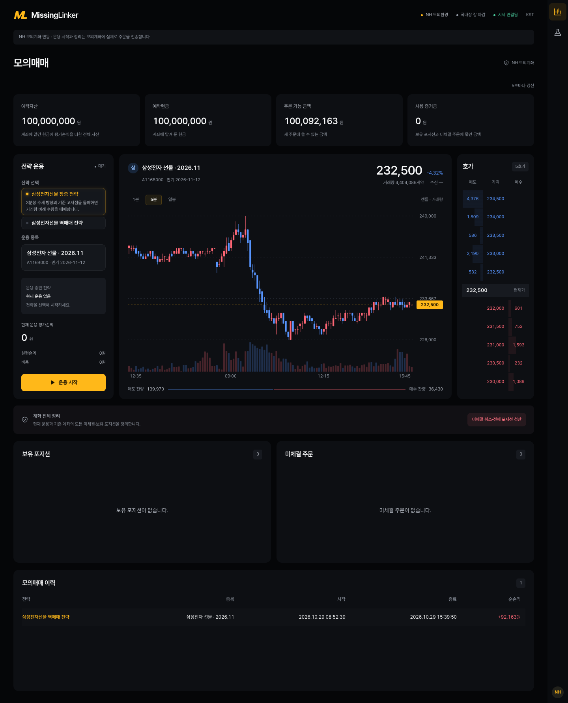
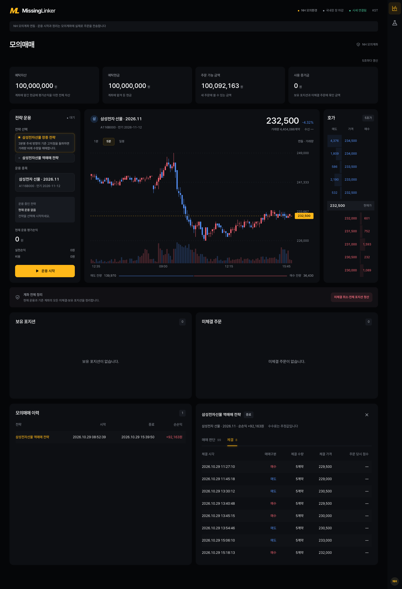
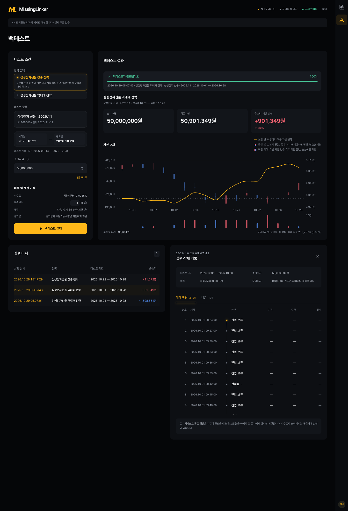
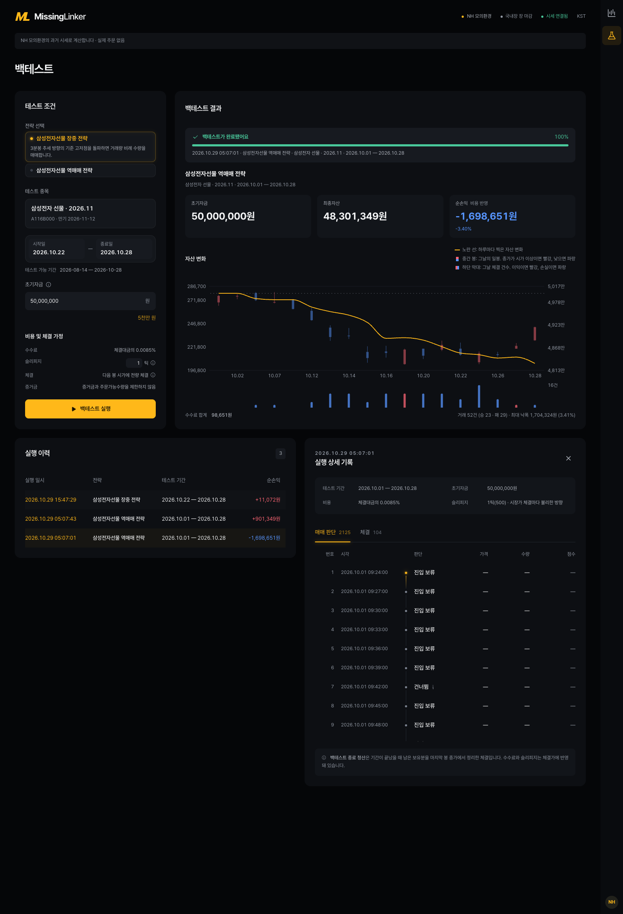

# 2주차 · 국내상품 전략 구현 — 미싱링커

**제출일: 2026/10/30(금) 23:59까지**

> **작성 범위: 1~9절 작성 완료.** 수치는 모두 `results/`의 원본 파일에서 읽은 값입니다.
> 환경 구분: 모의매매는 **NH 모의계좌 주문**, 백테스트는 **프로그램 내부 시뮬레이션**입니다. 시뮬레이션 체결을 모의계좌 체결로 표기하지 않았습니다.

| 항목 | 내용 |
| --- | --- |
| 팀 | 미싱링커 (Missing Linker), 07팀 — 양민수·이한용 |
| 과제 | 국내상품 전략 구현 |
| 전략 이름 | 삼성전자선물 역매매 전략 (`week02_samsung_futures_reversal`) |
| 대상 종목 | 삼성전자선물 2026년 11월물 `A116B000`, 거래승수 10, 최종거래일 2026-11-12 |
| 판단 주기 | 완성된 3분봉 |
| 실행 환경 | NH선물 국내 모의투자(`TRADING_ENV=mock`) · 과거 분봉 백테스트 |
| 코드 저장소 | [pioneer-1st-code-team07](https://github.com/NH-Futures-Pioneer-1-Team07/pioneer-1st-code-team07) |
| 작성일 | 2026-10-29 (KST) |

## 이번 주 느낀 점

1. **전략 뼈대는 사람이 먼저 정해야 함.** 전략을 명확하게 구성하기 전에 AI에 의존하면 진행할수록 구상이 흐려짐을 느낌. 다음에는 전략 뼈대를 먼저 확정하고 AI에는 구현 작업만 맡기는 방식을 검토함.
2. **수수료와 슬리피지의 영향이 큼.** 매매 체결이 많아야 한다고 생각했지만, 체결 빈도보다 비용을 감당하고도 남는 확실한 수익 창출 전략이 더 중요하다고 느낌.
3. **선물이기에 할 수 있는 전략도 구현해 보고 싶음.** 이번 역매매 전략은 현물장에서도 가능한 전략이므로, 다음에는 현물-선물 관계를 이용하는 등 선물의 특성을 살린 전략을 구현해 보고자 함.

## 폴더 구성

| 경로 | 내용 |
| --- | --- |
| [README.md](README.md) | 2주차 보고서 |
| [.env.example](.env.example) | 비밀값을 제외한 모의환경 설정 템플릿 (코드 저장소의 `backend/.env`로 복사해 사용) |
| [results/](results/) | 실행 원본 기록 (`meta.json`·`result.json`·`journal/`). 백테스트 2건, 모의매매 1건 |
| [screenshots/](screenshots/) | 실제 화면 캡처 5장 (모의매매 3, 백테스트 2) |

## 1. 과제 요약

**과제:** NH선물 Open API로 국내 선물·옵션 상품 하나에 대한 규칙 기반 전략을 구현하고, 실제 실행 기록으로 결과를 분석합니다.
평가 관점은 전략 실행·API 작동·결과 분석(손실 포함)·오류와 개선·재현성입니다.

**현재 상태:**

- 제출 전략: 삼성전자선물 역매매 전략입니다.
- 백테스트: 슬리피지 0틱·1틱 각 1회 실행을 완료했고, 기록은 `results/`에 반영했습니다.
- 모의매매: 2026-10-29 하루 운용을 완료했고, 4거래 기록을 `results/`에 반영했습니다.

### 1-1. 필수 기능

| 필수 기능 | 수행 내용 | 근거 (이 폴더 기준) |
| --- | --- | --- |
| 시세 수신 | 국내 분봉·현재가·호가 조회, WebSocket 체결·호가 수신 | 백테스트: 분봉 조회로 3분봉 판단 2,463회 ([result.json](results/week02_samsung_futures_reversal/backtest/20261029_050743/result.json)). 모의매매: 실시간 연결 후 3분봉 판단 기록 99건 ([journal/](results/week02_samsung_futures_reversal/paper/20261029_085239/journal/)) |
| 신호 판정 | 완성된 3분봉으로 판단 | [journal/](results/week02_samsung_futures_reversal/backtest/20261029_050743/journal/)의 `decision` 기록 2,125건 |
| 주문 처리 | NH 모의계좌에 주문·취소 전송. 접수와 체결을 구분해 기록 | 모의계좌 주문 접수 8건, 체결 통보 8건 ([journal/](results/week02_samsung_futures_reversal/paper/20261029_085239/journal/)의 `order`·`fill` 기록). 백테스트 `order`·`fill`은 시뮬레이션 기록 |
| 위험 관리 | 진입분별 손절(기준 고저점 ± 1,500원), 15:24 신규 진입 중단, 15:30 전량 청산, 최종거래일 신규 진입 금지 | 손절 17건·당일 청산 3건 ([journal/](results/week02_samsung_futures_reversal/backtest/20261029_050743/journal/)의 `order` 기록) |
| 실행 기록 | 판단·주문·체결·거래·이벤트를 실행별로 저장 | [results/](results/) 백테스트 2건, 모의매매 1건 |

선택 기능은 백테스트와 화면 조회입니다. 기능 구현 여부와 실제 NH 모의계좌 검증 결과는 구분하며, 모의계좌 근거는 `results/`·`screenshots/`의 파일로 두었습니다.

테스트 원칙: 실전 계좌 주문은 하지 않습니다. 시뮬레이션 체결을 모의계좌 체결로 표기하지 않습니다. 주문 접수만 있으면 체결 성공으로 적지 않습니다. 실제로 발생한 오류만 기록합니다.

### 1-2. 제출물

| 제출물 | 위치 |
| --- | --- |
| 소스코드 | 코드 저장소 (상단 정보 표) |
| 실행 방법·설정 템플릿 | 이 README 2절, `.env.example` |
| 보고서 | 이 README |
| 실행 근거 | `results/` (백테스트 2건, 모의매매 1건) |
| 화면 캡처 | `screenshots/` (5장, 인증정보·계좌 식별정보 없음) |

## 2. 실행 방법

터미널 2개(백엔드·프론트엔드)와 데스크톱 브라우저가 필요합니다. 아래 명령은 모두 코드 저장소 기준입니다.

### 2-1. 사전 준비

| 항목 | 준비 내용 |
| --- | --- |
| uv | 설치(`brew install uv` 등). Python 3.12 이상은 uv가 자동 설치 |
| Node.js | 22.12 이상, npm 포함 |
| NH선물 키 | 국내 모의투자 계좌 개설 후 Real HTS **[6128] REST API 신청**에서 **국내 모의투자용** APP Key·APP Secret Key 발급 |

### 2-2. 코드 내려받기

```bash
git clone --branch dev https://github.com/NH-Futures-Pioneer-1-Team07/pioneer-1st-code-team07.git
cd pioneer-1st-code-team07
```

개발 중인 작업 폴더가 있으면 보존하고, 별도 위치에 내려받아 실행합니다.

### 2-3. 설정

```bash
cp backend/.env.example backend/.env
```

`backend/.env`에 발급받은 키를 입력합니다. `NH_APP_KEY`·`NH_APP_SECRET` 앞의 `#`를 제거합니다. 이 제출 폴더의 [.env.example](.env.example)은 같은 항목을 `#` 없이 정리한 템플릿이며, 복사해 써도 동일합니다.

```dotenv
TRADING_ENV=mock
NH_APP_KEY=발급받은_국내_모의투자_APP_Key
NH_APP_SECRET=발급받은_국내_모의투자_APP_Secret_Key
```

| 변수 | 값·역할 |
| --- | --- |
| `TRADING_ENV` | 필수. 과제 실행은 `mock` |
| `NH_APP_KEY`, `NH_APP_SECRET` | NH 시세·계좌 조회·모의 주문에 필요. 백테스트의 과거 분봉 조회에도 필요 |

인증정보는 로컬 `backend/.env`에만 저장합니다. 실제 값이 있는 `.env`·키·토큰·계좌 식별정보는 제출 대상에서 제외합니다.

### 2-4. 실행

**터미널 1 — 백엔드**

```bash
cd backend
uv sync --locked
uv run uvicorn app.main:create_app --factory --reload
```

**터미널 2 — 프론트엔드**

```bash
cd frontend
npm ci
npm run dev
```

`uv sync --locked`·`npm ci`는 최초 설치 또는 잠금 파일 변경 시에만 실행합니다.

브라우저에서 [http://127.0.0.1:5173](http://127.0.0.1:5173)에 접속하면 모의매매·백테스트 화면이 표시됩니다(포트가 사용 중이면 Vite 터미널에 표시된 주소를 사용합니다).

### 2-5. 화면에서 실행

**백테스트 (프로그램 내부 시뮬레이션)**

- 메뉴 **백테스트**에서 전략·기간·초기자금·슬리피지를 정해 실행합니다.
- 기간: 종료일은 오늘 이전, 최대 366일입니다.
- 슬리피지: 0~20틱입니다.
- NH 과거 분봉을 조회해 프로그램 안에서 체결을 계산하며, 모의계좌에는 주문하지 않습니다.
- 봉 마감 신호는 다음 봉 시가에 전량 체결합니다.
- 체결마다 슬리피지와 수수료를 반영합니다.
- 증거금·주문가능수량 제한은 적용하지 않습니다.

**모의매매 (NH 모의계좌 주문)**

- 메뉴 **모의매매**에서 전략을 고르고 **운용 시작**을 누릅니다.
- 해당 종목에 기존 포지션·미체결이 있으면 시작이 거부됩니다.
- 시작 이후 새로 완성된 당일 3분봉부터 판단합니다.
- **운용 종료** 시 해당 운용의 미체결을 취소하고 보유분을 청산합니다.
- 운용 시작과 취소·청산은 모의계좌에 실제로 주문을 전송합니다.
- 주문 접수와 체결을 구분해 확인합니다.

### 2-6. 실행 기록

- 저장 위치: `backend/runs/<전략 id>/<backtest|paper>/<실행 일시>/`
- `meta.json`: 실행 조건·파라미터·상태
- `result.json`: 최종 요약
- `journal/YYYY-MM-DD.jsonl`: 판단·주문·체결·거래·이벤트
- `backtest`는 내부 시뮬레이션, `paper`는 NH 모의계좌 운용 기록입니다.
- 제출할 실행이 확정되면 해당 폴더를 `results/<전략 id>/<모드>/<실행 일시>/`로 복사합니다.
- 복사 전 키·계좌 식별정보가 없는지 확인합니다.

실행이 안 되면 `backend/.env`(`TRADING_ENV=mock`, 키 앞 `#` 제거)와 국내 **모의투자용** 키 여부부터 확인합니다. NH API 오류는 [API 오류 확인·질문·제보 안내](../docs/support-guide.md)에 따라 기록합니다.

## 3. 전략과 매매 계획

“무릎에서 사고, 어깨에서 판다.”

<삼성전자선물 역매매 전략>은 저점에서 반등하면 매수 포지션에, 고점에서 하락하면 매도 포지션에 진입합니다. 고점(저점) 이탈 후 복귀를 가격 반전의 신호로 보고, 반대쪽 저점(고점)까지의 가격 차이를 수익 기회로 삼습니다.

### 3-1. 대상 상품

대상은 삼성전자선물 2026년 11월물입니다. 만기가 가까워지면서 청산과 월물 교체로 나타날 수급 변화에 주목했습니다. 이 과정에서 거래량과 변동성이 커지고, 수익 기회도 늘어날 것이라고 판단했습니다.

| 항목 | 내용 |
| --- | --- |
| 전략 이름 | 삼성전자선물 역매매 전략 |
| 대상 종목 | 삼성전자선물 2026년 11월물 (`A116B000`) |
| 적용 호가 단위 | 500원 |
| 거래승수 | 10 |
| 1계약의 1틱 가치 | 5,000원 = 500원 × 10 |
| 진입당 수량 | 5계약 |
| 5계약의 1틱 손익 | 25,000원 |
| 계획 예산 | 100,000,000원 |
| 신호 판단 | 완성된 3분봉 |
| 신호 자료 범위 | 09:00부터 시작하는 당일 완성 봉, 한국 시간 |


### 3-2. 전략 선정 이유

추세가 전환되는 시점을 잘 포착하면 수익을 얻을 수 있다고 보고 전략을 구상했습니다. 이에 고저점 부근에서 가격 방향이 바뀌는 움직임에 주목했습니다.

고저점을 벗어나려던 가격이 다시 기준가격 안쪽으로 돌아오면, 기존 방향에서 반전되어 반대로 움직일 가능성이 높다고 보았습니다. 반전의 초기 움직임을 확인한다는 점에서 ‘무릎에서 사고, 어깨에서 판다’는 생각을 매매 규칙으로 구체화했습니다.


### 3-3. 지표 설정

**3분봉과 앞뒤 각 2봉의 고저점**을 사용합니다. 작은 흔들림에 반응하는 빈도를 줄이면서 장중 방향 전환을 포착하려는 선택입니다. 가운데 봉을 포함한 5개 봉을 비교하며, 가운데 봉 마감 후 뒤쪽 2개 봉이 완성되는 6분 뒤에 고저점을 확정합니다.

**고점**은 가운데 봉의 고가가 앞쪽 2개 봉의 고가 이상이고 뒤쪽 2개 봉의 고가보다 높을 때 인정합니다. **저점**은 가운데 봉의 저가가 앞쪽 2개 봉의 저가 이하이고 뒤쪽 2개 봉의 저가보다 낮을 때 인정합니다.
이후 다음 봉을 확인하여 복귀가 유지되는지 판단합니다. 매수는 다음 봉도 기준 저점 위에서 마감해야, 매도는 기준 고점 아래에서 마감해야 진행합니다.

**거래량**은 확인 봉과 직전 10개 봉의 평균을 비교합니다. 최근 30분을 비교 기준으로 삼고, 확인 봉은 평균에서 제외합니다. 거래량이 평균의 0.5배 이상일 때만 진입을 허용해, 거래활동이 과소할 경우 거짓신호의 가능성이 높다고 보고 걸러냈습니다.


### 3-4. 매매 규칙과 설정 근거

**진입 조건**

완성된 3분봉으로 신호를 판단합니다. 후보 봉 시작 전에 확정된 고점과 저점이 모두 있어야 하며, 아래 조건을 모두 충족하면 진입합니다.

| 항목 | 매수 | 매도 |
| --- | --- | --- |
| 후보 발생 | 봉 저가가 기준 저점 이하이고 종가가 기준 저점보다 높음 | 봉 고가가 기준 고점 이상이고 종가가 기준 고점보다 낮음 |
| 다음 봉 확인 | 바로 다음 연속 봉의 종가가 기준 저점보다 높음 | 바로 다음 연속 봉의 종가가 기준 고점보다 낮음 |
| 거래량 조건 | 확인 봉 거래량이 직전 10봉 평균의 0.5배 이상 | 확인 봉 거래량이 직전 10봉 평균의 0.5배 이상 |
| 첫 목표 | 후보 봉 시작 전에 확정된 최근 고점 | 후보 봉 시작 전에 확정된 최근 저점 |
| 손절 기준 | 진입 기준 저점 − 1,500원 | 진입 기준 고점 + 1,500원 |
| 진입 직전 가격 | 손절보다 높고 목표보다 낮음 | 목표보다 높고 손절보다 낮음 |
| 최소 목표거리 | 목표 − 관측 가격이 1,500원 이상 | 관측 가격 − 목표가 1,500원 이상 |

확인 봉 마감 후 첫 1분 구간의 첫 관측 가격으로 조건을 한 번 검사하고, 충족하면 5계약을 시장가로 주문합니다. 조건 미충족이나 시한 경과 시 신호를 폐기하며, 확인 봉에서는 새 후보를 만들지 않습니다.

거래량 기준은 거래가 적은 구간의 신호를 걸러내기 위해 적용했습니다. 사전 비교에서 평균의 1배 조건은 거래 기회를 크게 줄여 0.5배를 선택했습니다.

최소 목표거리는 3틱으로 정했습니다. 사전 비교에서 1~2틱은 비용 반영 후 성과가 약했고, 4틱은 거래 기회를 줄여 3틱을 채택했습니다.

**주문 수량과 추가 진입**

진입 수량은 신호당 5계약입니다. 1억원 예산에서 진입 규모를 일정하게 유지하고 신호를 평가하기 위해 수량을 고정했습니다.

새로운 매매 기회를 활용하기 위해 같은 방향의 추가 진입과 청산 후 재진입을 허용합니다. 보유 중 반대 방향 신호는 무시하며, 같은 봉에서 양방향 후보가 발생하거나 이전 주문이 처리 중이면 진입하지 않습니다.

**목표와 손절**

목표와 손절은 진입분별로 관리합니다. 장중 가격대 변화를 반영해, 새로운 반대쪽 고저점이 확정되면 목표를 갱신하고 손절가는 유지합니다.

손절 폭은 사전 비교에서 1,000원보다 손절 횟수가 적고 합계 손익이 높았던 **1,500원**을 선택했습니다. 손절가는 진입가가 아닌 기준 고저점에서 계산합니다.

목표 갱신은 3분봉 마감 때 판단하며, 종가가 새 목표에 도달했거나 지났으면 시장가로 청산합니다. 장중에는 실시간 가격이 목표나 손절가에 닿는 즉시 청산하며, 두 조건을 동시에 충족하면 손절을 우선합니다.

백테스트는 관측 1분봉의 가격 경로로 청산을 재현합니다. 청산 주문 처리 중에는 중복 주문을 내지 않습니다.

**거래 시간과 당일 청산**

15:24에 신규·추가 진입을 중단하고, 15:30부터 잔여분을 전량 시장가로 청산합니다. 야간과 다음 날 시초가 변동에 대한 노출을 줄이기 위한 규칙입니다.

진입 중단 시 후보와 진입 대기를 폐기하고 미체결 주문을 취소합니다. 청산 주문의 잔여 수량은 다시 청산 요청하며, 전량 청산 전까지 목표·손절 관리는 계속합니다. 15:30에도 미체결 주문을 취소하고 잔여분을 청산합니다.

최종거래일에는 신규 진입 없이 잔여분을 청산하며, 최종거래일을 확인하지 못해도 신규 진입을 막습니다.

**자료와 주문 유효성**

당일 마지막 연속 구간의 완성 봉만 사용하고, 공백 이전 이력은 제외합니다. 고저점·직전 10봉이 부족하거나 평균 거래량이 0이면 진입하지 않습니다. 진입 주문은 1봉 동안 유효하며, 이후 미체결 잔량을 취소합니다.

### 3-5. 약점

강한 추세에서는 일시적인 복귀 뒤 기존 방향이 이어져 역방향 포지션이 손절될 수 있습니다. 다음 봉 확인을 기다리는 동안 목표까지의 거리도 줄어듭니다.

짧은 가격 차이를 거래하므로 수수료와 슬리피지의 영향이 큽니다. 시장가 체결가격은 검사한 가격과 달라질 수 있고, 목표 갱신으로 손실 상태에서 청산될 수도 있습니다.

총보유량 상한과 일일 손실 한도는 없습니다. 5계약씩 추가 진입이 겹치면 보유량과 손실 노출이 함께 커집니다.

## 4. 사용 API와 프로그램 구조

### 4-1. 구조

```text
브라우저(React) ──REST /api · WebSocket /ws──▶ 백엔드(FastAPI) ──▶ NH선물 Open API (모의)
                                                   │
                                                   ├─ 전략 코드 (backend/strategies/)
                                                   └─ 실행 기록 (backend/runs/)
```

- 모의매매와 백테스트가 같은 전략 코드를 호출합니다. 전략은 완성된 3분봉을 받아 매수·매도·보유·건너뜀을 판단합니다.
- 매매 실행은 백엔드가 관리하고, 프론트엔드는 조회와 실행 요청만 수행합니다.
- 백테스트는 NH 과거 분봉을 조회해 프로그램 안에서 체결을 계산하고, 모의매매는 NH 모의계좌에 주문을 전송합니다.

### 4-2. 사용 API

| 구분 | API (경로) | 용도 | 사용 위치 (코드 저장소 `backend/app/`) |
| --- | --- | --- | --- |
| 인증 | 접근토큰 (`/auth-service/v1/token`) | 모든 호출의 접근토큰 발급 | `nh/auth.py` |
| 인증 | 웹소켓 접속키 (`/permission/v1/web-socket-key`) | 실시간 연결용 키 발급 | `nh/client.py` |
| 시세 | 국내 차트(분) (`/trade/v1/domestic/chart-minute`) | 백테스트 과거 분봉, 모의매매의 완성 봉 수집 | `nh/quotes.py` |
| 시세 | 국내 현재가 (`/trade/v1/domestic/price`) | 백테스트·모의매매의 현재가·최종거래일·호가 단위 확인 | `nh/quotes.py` |
| 시세 | 국내 차트(일), 국내 호가 (`.../chart-daily`, `.../price-bid`) | 화면의 일봉·호가 표시 | `nh/market.py` |
| 실시간 | 실시간 스트림 (`/trade/ws-stream`) | 모의매매의 체결·호가 수신, 체결 알림 | `nh/realtime.py`, `nh/hub.py` |
| 주문 | 국내 주문, 국내 취소주문 (`.../order`, `.../cancel`) | 모의계좌 진입·청산 주문, 미체결 취소 | `nh/orders.py` |
| 계좌 | 예탁금, 미결제약정, 주문내역, 주문가능수량 (`.../deposit`, `.../open-interest`, `.../order-history`, `.../orderable-quantity`) | 운용 전 계좌·포지션 확인, 체결 대조 | `nh/account.py` |

백테스트가 사용하는 API는 접근토큰, 분봉 조회, 현재가 조회이고(일봉·호가는 화면 표시용), 주문·취소·계좌·실시간 API는 모의매매에서만 사용합니다.

### 4-3. 기록 형식

- 실행 1건은 폴더 1개(`meta.json`·`result.json`·`journal/날짜.jsonl`)입니다. 한 줄이 한 사건이며 종류는 `decision`(판단)·`order`(주문)·`fill`(체결)·`trade`(진입부터 청산까지 1건)·`event`입니다.
- 판단 기록(`decision`)에는 건너뛴 사유(`reason`)와 기준 고저점이 남습니다.
- 키·토큰·계좌번호 필드는 기록기가 저장 전에 제거합니다.

## 5. 실행 환경

| 구분 | 백테스트 ① 슬리피지 0틱 | 백테스트 ② 슬리피지 1틱 | 모의매매 |
| --- | --- | --- | --- |
| 환경 | 프로그램 내부 시뮬레이션 | 프로그램 내부 시뮬레이션 | NH 모의계좌 주문 (`mock`) |
| 실행 id | `20261029_050743` | `20261029_050701` | `20261029_085239` |
| 실행 일시 (KST) | 2026-10-29 05:07:43~05:07:52 | 2026-10-29 05:07:01~05:07:10 | 2026-10-29 08:52:39~15:39:50 |
| 대상 구간 | 2026-10-01 ~ 2026-10-28, 18거래일 | 동일 | 2026-10-29 하루 |
| 입력 자료 | 1분봉 기반 3분봉 판단 2,463회 | 동일 | 실시간 완성 3분봉 판단 기록 99건 |
| 초기자금 | 50,000,000원 | 동일 | 100,000,000원 (모의계좌 운용 전 잔액) |

- 대상: 삼성전자선물 2026년 11월물 `A116B000`, 거래승수 10, 호가 단위 500원.
- 전략 파라미터(두 백테스트 동일, `meta.json`): 봉 3분, 고저점 앞뒤 2봉, 평균 거래량 10봉, 최소 거래량 0.5배, 진입 5계약, 손절 1,500원, 최소 목표 3틱, 목표 방식 갱신, 신규 진입 중단 15:24, 전량 청산 15:30.
- 비용: 수수료 체결대금의 0.0085%(NH선물 수수료 부과 기준(2026-09-07 개정) 개별주식선물 온라인 매매 표준수수료 0.0085%), 슬리피지는 시장가 체결마다 불리한 방향으로 0틱 또는 1틱입니다(1틱 = 500원, 5계약 기준 25,000원).
- 체결 가정: 봉 마감 후 청산 주문은 다음 관측 1분 시가에 체결하고, 진입은 다음 가격에서 조건을 검사하며, 장중 가격 경로는 1분봉 시가 → 보유 방향에 불리한 극단 → 유리한 극단 → 종가 순서로 재현합니다. 누락된 분은 합성하지 않습니다. 증거금·주문가능수량 제한은 없습니다.
- 모의매매는 NH 모의계좌에 시장가 주문을 전송하고, 접수(`order`)와 체결 통보(`fill`)를 구분해 기록합니다. 판단 기록은 11:03:00부터 15:36:00까지이며(08:52:40 실시간 연결 후 11:03까지는 판단 기록 없음), 15:39:49에 운용 종료를 시작해 15:39:50에 종료했습니다(상태 `completed`).

## 6. 실행 결과

### 6-1. 근거 파일 (`results/`)

| 파일 | 내용 |
| --- | --- |
| [20261029_050743/meta.json](results/week02_samsung_futures_reversal/backtest/20261029_050743/meta.json) | 백테스트 ① (슬리피지 0틱) 실행 조건·전략 파라미터·비용 가정 |
| [20261029_050743/result.json](results/week02_samsung_futures_reversal/backtest/20261029_050743/result.json) | 백테스트 ① 최종 요약 (손익·거래 수·최대 낙폭·자산 곡선) |
| [20261029_050743/journal/](results/week02_samsung_futures_reversal/backtest/20261029_050743/journal/) | 백테스트 ① 날짜별 기록 18일 + 종료 기록 1개 (decision 2,125 · order 104 · fill 104 · trade 52 · event 20) |
| [20261029_050701/meta.json](results/week02_samsung_futures_reversal/backtest/20261029_050701/meta.json) | 백테스트 ② (슬리피지 1틱) 실행 조건·전략 파라미터·비용 가정 |
| [20261029_050701/result.json](results/week02_samsung_futures_reversal/backtest/20261029_050701/result.json) | 백테스트 ② 최종 요약 |
| [20261029_050701/journal/](results/week02_samsung_futures_reversal/backtest/20261029_050701/journal/) | 백테스트 ② 날짜별 기록 (구성 동일) |

| [paper/20261029_085239/meta.json](results/week02_samsung_futures_reversal/paper/20261029_085239/meta.json) | 모의매매 실행 조건·전략 파라미터·시작·종료 시각 |
| [paper/20261029_085239/result.json](results/week02_samsung_futures_reversal/paper/20261029_085239/result.json) | 모의매매 최종 요약 (손익·거래 수·운용 전후 계좌) |
| [paper/20261029_085239/journal/](results/week02_samsung_futures_reversal/paper/20261029_085239/journal/) | 모의매매 기록 (decision 99 · order 8 · fill 8 · trade 4 · event 6) |

이 절의 수치는 위 파일에서 읽은 값이며, 거래별 순손익의 합이 `result.json`의 순손익과 일치함을 백테스트·모의매매 모두 확인했습니다.

### 6-2. 백테스트 결과 (프로그램 내부 시뮬레이션)

두 실행은 전략·기간·초기자금이 같고 슬리피지만 다릅니다.

| 항목 | ① 슬리피지 0틱 | ② 슬리피지 1틱 |
| --- | --- | --- |
| 대상 구간 | 2026-10-01 ~ 2026-10-28 (18거래일, 판단 2,463회) | 동일 |
| 초기자금 / 최종자산 | 50,000,000원 / 50,901,349원 | 50,000,000원 / 48,301,349원 |
| 총손익 | +1,000,000원 | -1,600,000원 |
| 수수료 | 98,651원 | 98,651원 |
| **순손익** | **+901,349원** | **-1,698,651원** |
| 수익률 | 1.80% | -3.40% |
| 최대 낙폭 | 290,727원 (0.58%) | 1,704,324원 (3.41%) |
| 체결 수 | 104 (진입 52 + 청산 52) | 104 |
| 거래 수 | 52 (매수 30 · 매도 22) | 52 |
| 승 / 패 | 33 / 19 | 23 / 29 |
| 승률 | 63.5% | 44.2% |
| 평균 이익 / 평균 손실 | +75,385원 / -83,492원 | +42,698원 / -92,438원 |
| 매수 거래 | 30건 / 이익 19건 / +518,205원 | 30건 / 이익 14건 / -981,795원 |
| 매도 거래 | 22건 / 이익 14건 / +383,144원 | 22건 / 이익 9건 / -716,856원 |
| 보유 시간 | 중앙값 19분 | 동일 |
| 최대 동시 보유 | 3개 진입분 (15계약) | 동일 |

청산 까닭별 결과:

| 청산 까닭 | 건수 | ① 순손익 합계 | ② 순손익 합계 | ① 건당 총손익(틱) | ② 건당 총손익(틱) |
| --- | --- | --- | --- | --- | --- |
| 이익 청산 목표 도달 | 32 | +2,464,673 | +864,673 | +3.16 | +1.16 |
| 손절 | 17 | -1,557,583 | -2,407,583 | -3.59 | -5.59 |
| 당일 청산 | 3 | -5,742 | -155,742 | 0.00 | -2.00 |

거래일별 결과 (청산 시각 기준, 순손익 단위: 원):

| 거래일 | 거래 | ① 승 | ① 패 | ① 순손익 | ② 승 | ② 패 | ② 순손익 |
| --- | --- | --- | --- | --- | --- | --- | --- |
| 2026-10-01 | 0 | 0 | 0 | 0 | 0 | 0 | 0 |
| 2026-10-02 | 0 | 0 | 0 | 0 | 0 | 0 | 0 |
| 2026-10-06 | 1 | 0 | 1 | -77,335 | 0 | 1 | -127,335 |
| 2026-10-07 | 1 | 1 | 0 | +22,677 | 0 | 1 | -27,323 |
| 2026-10-08 | 0 | 0 | 0 | 0 | 0 | 0 | 0 |
| 2026-10-12 | 2 | 1 | 1 | -79,278 | 0 | 2 | -179,278 |
| 2026-10-13 | 5 | 3 | 2 | +140,127 | 2 | 3 | -109,873 |
| 2026-10-14 | 5 | 4 | 1 | +164,947 | 3 | 2 | -85,053 |
| 2026-10-15 | 2 | 1 | 1 | -78,593 | 0 | 2 | -178,593 |
| 2026-10-16 | 5 | 2 | 3 | -134,216 | 1 | 4 | -384,216 |
| 2026-10-19 | 5 | 4 | 1 | +265,805 | 3 | 2 | +15,805 |
| 2026-10-20 | 5 | 3 | 2 | +190,948 | 3 | 2 | -59,052 |
| 2026-10-21 | 5 | 3 | 2 | +90,522 | 3 | 2 | -159,478 |
| 2026-10-22 | 3 | 2 | 1 | -5,491 | 1 | 2 | -155,491 |
| 2026-10-23 | 8 | 6 | 2 | +360,658 | 5 | 3 | -39,342 |
| 2026-10-26 | 3 | 2 | 1 | +69,528 | 1 | 2 | -80,472 |
| 2026-10-27 | 1 | 1 | 0 | +73,111 | 1 | 0 | +23,111 |
| 2026-10-28 | 1 | 0 | 1 | -102,061 | 0 | 1 | -152,061 |

신호가 진입으로 이어진 과정 (`decision` 기록 집계, 두 실행 동일):

| 단계 | 건수 |
| --- | --- |
| 후보 봉 발생 (매수 145 · 매도 116) | 261 |
| 다음 봉 종가가 기준을 넘지 못해 폐기 | 77 |
| 확인 봉 거래량이 평균의 0.5배 미만 | 34 |
| 15:24 이후라 확인하지 않음 | 2 |
| 확인 완료, 진입 조건 검사 | 148 |
| 목표까지 거리가 3틱 미만 | 70 |
| 진입 가격이 손절·목표 범위 밖 | 26 |
| **진입** (매수 30 · 매도 22) | **52** |

같은 봉에서 매수·매도 후보가 동시에 나와 건너뛴 20건과 보유 중 반대 방향 후보를 건너뛴 11건은 위 단계와 별도로 집계됩니다.

<details>
<summary>거래 52건 전체 (펼치기)</summary>

진입가·청산가는 ① 슬리피지 0틱 기준입니다. ②는 같은 거래에서 매수는 500원 높게, 매도는 500원 낮게 체결된 것으로 계산되어 순손익만 다릅니다. 수량은 모두 5계약, 시각은 KST입니다.

| # | 진입 | 청산 | 방향 | 진입가 | 청산가 | 청산 까닭 | 보유 | ① 순손익 | ② 순손익 |
| --- | --- | --- | --- | --- | --- | --- | --- | --- | --- |
| 1 | 2026-10-06 11:12:00 | 2026-10-06 11:32:59 | 매수 | 275,500 | 274,000 | 손절 | 21분 | -77,335 | -127,335 |
| 2 | 2026-10-07 11:42:00 | 2026-10-07 11:57:59 | 매도 | 273,500 | 273,000 | 이익 청산 목표 도달 | 16분 | +22,677 | -27,323 |
| 3 | 2026-10-12 14:09:00 | 2026-10-12 14:30:59 | 매수 | 253,000 | 251,000 | 손절 | 22분 | -102,142 | -152,142 |
| 4 | 2026-10-12 15:03:00 | 2026-10-12 15:23:59 | 매도 | 251,500 | 251,000 | 이익 청산 목표 도달 | 21분 | +22,864 | -27,136 |
| 5 | 2026-10-13 09:48:00 | 2026-10-13 10:08:59 | 매수 | 237,000 | 235,000 | 손절 | 21분 | -102,006 | -152,006 |
| 6 | 2026-10-13 12:15:00 | 2026-10-13 12:25:59 | 매수 | 229,500 | 232,500 | 이익 청산 목표 도달 | 11분 | +148,036 | +98,036 |
| 7 | 2026-10-13 13:12:00 | 2026-10-13 13:30:59 | 매도 | 231,500 | 230,000 | 이익 청산 목표 도달 | 19분 | +73,039 | +23,039 |
| 8 | 2026-10-13 15:00:00 | 2026-10-13 15:30:00 | 매수 | 231,500 | 232,000 | 당일 청산 | 30분 | +23,030 | -26,970 |
| 9 | 2026-10-13 15:15:00 | 2026-10-13 15:30:00 | 매수 | 232,000 | 232,000 | 당일 청산 | 15분 | -1,972 | -51,972 |
| 10 | 2026-10-14 10:36:00 | 2026-10-14 10:52:59 | 매수 | 236,000 | 237,500 | 이익 청산 목표 도달 | 17분 | +72,988 | +22,988 |
| 11 | 2026-10-14 11:33:00 | 2026-10-14 12:08:59 | 매도 | 238,500 | 238,000 | 이익 청산 목표 도달 | 36분 | +22,975 | -27,025 |
| 12 | 2026-10-14 13:36:00 | 2026-10-14 14:00:59 | 매도 | 238,500 | 237,000 | 이익 청산 목표 도달 | 25분 | +72,979 | +22,979 |
| 13 | 2026-10-14 14:24:00 | 2026-10-14 14:32:59 | 매도 | 236,500 | 235,000 | 이익 청산 목표 도달 | 9분 | +72,996 | +22,996 |
| 14 | 2026-10-14 14:36:00 | 2026-10-14 14:46:59 | 매수 | 235,000 | 233,500 | 손절 | 11분 | -76,991 | -126,991 |
| 15 | 2026-10-15 10:42:00 | 2026-10-15 11:06:59 | 매수 | 212,000 | 212,500 | 이익 청산 목표 도달 | 25분 | +23,196 | -26,804 |
| 16 | 2026-10-15 14:09:00 | 2026-10-15 14:19:59 | 매수 | 211,500 | 209,500 | 손절 | 11분 | -101,789 | -151,789 |
| 17 | 2026-10-16 09:57:00 | 2026-10-16 10:15:59 | 매도 | 215,000 | 217,000 | 손절 | 19분 | -101,836 | -151,836 |
| 18 | 2026-10-16 11:27:00 | 2026-10-16 12:00:59 | 매도 | 217,000 | 215,500 | 이익 청산 목표 도달 | 34분 | +73,162 | +23,162 |
| 19 | 2026-10-16 11:33:00 | 2026-10-16 12:00:59 | 매도 | 216,500 | 215,500 | 이익 청산 목표 도달 | 28분 | +48,164 | -1,836 |
| 20 | 2026-10-16 14:21:00 | 2026-10-16 14:27:59 | 매수 | 220,000 | 218,500 | 손절 | 7분 | -76,864 | -126,864 |
| 21 | 2026-10-16 15:06:00 | 2026-10-16 15:12:59 | 매수 | 217,500 | 216,000 | 손절 | 7분 | -76,842 | -126,842 |
| 22 | 2026-10-19 10:39:00 | 2026-10-19 11:08:59 | 매도 | 218,000 | 215,000 | 이익 청산 목표 도달 | 30분 | +148,160 | +98,160 |
| 23 | 2026-10-19 11:12:00 | 2026-10-19 11:36:59 | 매수 | 215,000 | 216,500 | 이익 청산 목표 도달 | 25분 | +73,166 | +23,166 |
| 24 | 2026-10-19 11:18:00 | 2026-10-19 11:36:59 | 매수 | 215,000 | 216,500 | 이익 청산 목표 도달 | 19분 | +73,166 | +23,166 |
| 25 | 2026-10-19 11:24:00 | 2026-10-19 11:36:59 | 매수 | 215,500 | 216,500 | 이익 청산 목표 도달 | 13분 | +48,164 | -1,836 |
| 26 | 2026-10-19 15:00:00 | 2026-10-19 15:04:59 | 매도 | 217,000 | 218,500 | 손절 | 5분 | -76,851 | -126,851 |
| 27 | 2026-10-20 10:51:00 | 2026-10-20 11:43:59 | 매도 | 215,500 | 213,500 | 이익 청산 목표 도달 | 53분 | +98,177 | +48,177 |
| 28 | 2026-10-20 12:00:00 | 2026-10-20 12:22:59 | 매도 | 215,500 | 213,500 | 이익 청산 목표 도달 | 23분 | +98,177 | +48,177 |
| 29 | 2026-10-20 12:30:00 | 2026-10-20 12:41:59 | 매수 | 214,000 | 212,000 | 손절 | 12분 | -101,810 | -151,810 |
| 30 | 2026-10-20 14:33:00 | 2026-10-20 14:43:59 | 매수 | 210,000 | 212,500 | 이익 청산 목표 도달 | 11분 | +123,204 | +73,204 |
| 31 | 2026-10-20 14:48:00 | 2026-10-20 15:30:00 | 매도 | 211,500 | 212,000 | 당일 청산 | 42분 | -26,800 | -76,800 |
| 32 | 2026-10-21 10:15:00 | 2026-10-21 10:22:59 | 매수 | 221,500 | 223,500 | 이익 청산 목표 도달 | 8분 | +98,109 | +48,109 |
| 33 | 2026-10-21 12:18:00 | 2026-10-21 12:34:59 | 매수 | 225,000 | 223,500 | 손절 | 17분 | -76,906 | -126,906 |
| 34 | 2026-10-21 14:21:00 | 2026-10-21 15:01:59 | 매수 | 221,500 | 223,000 | 이익 청산 목표 도달 | 41분 | +73,111 | +23,111 |
| 35 | 2026-10-21 14:42:00 | 2026-10-21 15:01:59 | 매수 | 221,500 | 223,000 | 이익 청산 목표 도달 | 20분 | +73,111 | +23,111 |
| 36 | 2026-10-21 15:15:00 | 2026-10-21 15:29:59 | 매도 | 223,000 | 224,500 | 손절 | 15분 | -76,902 | -126,902 |
| 37 | 2026-10-22 10:57:00 | 2026-10-22 11:21:59 | 매수 | 218,000 | 215,500 | 손절 | 25분 | -126,842 | -176,842 |
| 38 | 2026-10-22 13:03:00 | 2026-10-22 13:16:59 | 매수 | 214,500 | 215,500 | 이익 청산 목표 도달 | 14분 | +48,172 | -1,828 |
| 39 | 2026-10-22 13:54:00 | 2026-10-22 14:13:59 | 매도 | 215,000 | 213,500 | 이익 청산 목표 도달 | 20분 | +73,179 | +23,179 |
| 40 | 2026-10-23 09:45:00 | 2026-10-23 09:47:59 | 매수 | 207,000 | 209,000 | 이익 청산 목표 도달 | 3분 | +98,232 | +48,232 |
| 41 | 2026-10-23 09:51:00 | 2026-10-23 09:53:59 | 매도 | 209,000 | 210,500 | 손절 | 3분 | -76,783 | -126,783 |
| 42 | 2026-10-23 10:33:00 | 2026-10-23 10:53:59 | 매도 | 209,000 | 208,000 | 이익 청산 목표 도달 | 21분 | +48,228 | -1,772 |
| 43 | 2026-10-23 10:45:00 | 2026-10-23 10:55:00 | 매도 | 211,000 | 207,500 | 이익 청산 목표 도달 | 10분 | +173,221 | +123,221 |
| 44 | 2026-10-23 11:57:00 | 2026-10-23 12:33:59 | 매도 | 209,500 | 212,000 | 손절 | 37분 | -126,791 | -176,791 |
| 45 | 2026-10-23 13:27:00 | 2026-10-23 13:31:59 | 매수 | 212,500 | 214,500 | 이익 청산 목표 도달 | 5분 | +98,185 | +48,185 |
| 46 | 2026-10-23 13:54:00 | 2026-10-23 13:58:59 | 매수 | 213,000 | 214,500 | 이익 청산 목표 도달 | 5분 | +73,183 | +23,183 |
| 47 | 2026-10-23 14:21:00 | 2026-10-23 14:31:59 | 매수 | 213,000 | 214,500 | 이익 청산 목표 도달 | 11분 | +73,183 | +23,183 |
| 48 | 2026-10-26 09:45:00 | 2026-10-26 10:21:59 | 매수 | 214,000 | 215,000 | 이익 청산 목표 도달 | 37분 | +48,177 | -1,823 |
| 49 | 2026-10-26 09:54:00 | 2026-10-26 10:21:59 | 매수 | 213,000 | 215,000 | 이익 청산 목표 도달 | 28분 | +98,181 | +48,181 |
| 50 | 2026-10-26 13:00:00 | 2026-10-26 14:01:59 | 매도 | 214,500 | 216,000 | 손절 | 62분 | -76,830 | -126,830 |
| 51 | 2026-10-27 12:03:00 | 2026-10-27 12:20:59 | 매수 | 221,500 | 223,000 | 이익 청산 목표 도달 | 18분 | +73,111 | +23,111 |
| 52 | 2026-10-28 12:18:00 | 2026-10-28 12:39:59 | 매도 | 241,500 | 243,500 | 손절 | 22분 | -102,061 | -152,061 |

</details>

### 6-3. 모의매매 (NH 모의계좌 주문) 결과

NH 모의계좌에 시장가로 주문한 결과입니다. 아래 접수는 모의계좌가 받은 주문, 체결은 실시간 체결 통보(`source: notification`)로 받은 값입니다.

| 항목 | 값 |
| --- | --- |
| 운용 일시 | 2026-10-29 08:52:39 ~ 15:39:50 (상태 `completed`), 판단 기록은 11:03~15:36 |
| 거래 수 | 4 (매수 2 · 매도 2), 진입 5계약 |
| 승 / 패 | 3 / 1 |
| 총손익 | +100,000원 |
| 수수료 | 7,837원 |
| **순손익** | **+92,163원** |
| 주문 접수 / 체결 | 8건 / 8건 (미체결·거부 기록 없음) |
| 청산 까닭 | 4건 모두 목표 도달 (손절·당일 청산 없음) |
| 종료 시 보유 | 없음 (`open_lots` 비어 있음) |
| 계좌 요약 (운용 전 → 후) | 실현손익 0 → +100,000원, 수수료 0 → 7,837원, 총자산 100,000,000원 → 100,000,000원 |

거래별 결과:

| 진입분 | 방향 | 진입 시각 | 진입가 | 청산 시각 | 청산가 | 보유 | 총손익 | 수수료 | 순손익 |
| --- | --- | --- | --- | --- | --- | --- | --- | --- | --- |
| 1 | 매수 | 11:27:10 | 229,500원 | 11:45:18 | 229,000원 | 18분 08초 | -25,000원 | 1,949원 | -26,949원 |
| 2 | 매도 | 13:30:12 | 230,500원 | 13:40:48 | 229,500원 | 10분 36초 | +50,000원 | 1,955원 | +48,045원 |
| 3 | 매수 | 13:45:15 | 230,000원 | 13:54:46 | 230,500원 | 9분 31초 | +25,000원 | 1,957원 | +23,043원 |
| 5 | 매도 | 15:06:10 | 233,000원 | 15:18:13 | 232,000원 | 12분 03초 | +50,000원 | 1,976원 | +48,024원 |

진입분 번호는 당일 신호 순서이고, 4번은 목표까지 거리가 최소 목표 틱 수 미만이라 진입하지 않았습니다.

주문 접수와 체결 (판단가 = 판단 시점에 기록된 가격):

| 진입분 | 구분 | 방향·수량 | 접수 시각 | 체결 시각 | 접수→체결 | 판단가 | 체결가 | 판단가 대비 |
| --- | --- | --- | --- | --- | --- | --- | --- | --- |
| 1 | 진입 | 매수 5 | 11:27:10 | 11:27:10 | 0.2초 | 229,500원 | 229,500원 | 동일 |
| 1 | 청산 | 매도 5 | 11:45:18 | 11:45:18 | 0.1초 | 229,500원 | 229,000원 | 불리 1틱 |
| 2 | 진입 | 매도 5 | 13:30:12 | 13:30:12 | 0.2초 | 230,500원 | 230,500원 | 동일 |
| 2 | 청산 | 매수 5 | 13:40:48 | 13:40:48 | 0.1초 | 229,000원 | 229,500원 | 불리 1틱 |
| 3 | 진입 | 매수 5 | 13:45:15 | 13:45:15 | 0.2초 | 229,500원 | 230,000원 | 불리 1틱 |
| 3 | 청산 | 매도 5 | 13:54:46 | 13:54:46 | 0.1초 | 231,000원 | 230,500원 | 불리 1틱 |
| 5 | 진입 | 매도 5 | 15:06:10 | 15:06:10 | 0.3초 | 233,000원 | 233,000원 | 동일 |
| 5 | 청산 | 매수 5 | 15:18:12 | 15:18:13 | 0.7초 | 231,500원 | 232,000원 | 불리 1틱 |

신호에서 진입까지의 단계:

| 단계 | 건수 |
| --- | --- |
| 후보 봉 발생 | 14 (매수 6 · 매도 8) |
| 확인 봉 종가가 기준을 넘지 못해 신호 아님 | 6 |
| 확인 봉 거래량이 평균 거래량의 0.5배 미만 | 2 |
| 15:24 신규 진입 제한으로 확인하지 않음 | 1 |
| 확인 완료 | 5 |
| 목표거리 3틱 미만으로 제외 | 1 (진입분 4) |
| 진입 | 4 |

### 6-4. 화면 캡처

화면은 모두 2026-10-29에 저장된 실행 기록을 불러온 것입니다. 계좌번호·키·토큰은 화면에 표시되지 않습니다.

| 파일 | 내용 |
| --- | --- |
| [01-paper-account-strategy.png](screenshots/01-paper-account-strategy.png) | 모의매매 화면: 모의계좌 요약(예탁자산·주문 가능 금액·증거금), 전략 선택, 시세·호가, 보유 포지션 0·미체결 0, 모의매매 이력 1건(순손익 +92,163원) |
| [02-paper-history-decisions.png](screenshots/02-paper-history-decisions.png) | 모의매매 이력 상세 — 매매 판단 99건 (첫 판단 2026.10.29 11:03:00) |
| [03-paper-history-fills.png](screenshots/03-paper-history-fills.png) | 모의매매 이력 상세 — 체결 8건 (시각·매수/매도·5계약·체결가가 6-3절 표와 일치) |
| [04-backtest-slippage0.png](screenshots/04-backtest-slippage0.png) | 백테스트 ① 슬리피지 0틱: 순손익 +901,349원, 거래 52건(승 33·패 19), 실행 상세의 슬리피지 0틱 |
| [05-backtest-slippage1.png](screenshots/05-backtest-slippage1.png) | 백테스트 ② 슬리피지 1틱: 순손익 -1,698,651원 |

- 03번 캡처의 "수수료는 추정값입니다" 문구는 화면이 표시한 그대로입니다.
- 04·05번 캡처 왼쪽 "테스트 조건"의 슬리피지 입력칸은 다음 실행용 값이며, 해당 실행의 슬리피지는 오른쪽 "실행 상세 기록"에 표시됩니다.
- 실행 이력에는 이 보고서의 전략이 아닌 삼성전자선물 장중 전략의 실행(2026.10.29 15:47:29) 1건이 함께 보입니다.









## 7. 결과 해석과 한계

### 7-1. 백테스트 결과 해석

백테스트는 슬리피지 0틱에서 **이익**, 1틱에서 **손실**입니다. 두 결과를 모두 기록하고, 왜 갈렸는지를 기록에서 찾았습니다.

**1) 슬리피지 1틱이 결과의 부호를 바꿨습니다.**

| 구분 | ① 0틱 | ② 1틱 | 차이 |
| --- | --- | --- | --- |
| 총손익 | +1,000,000원 | -1,600,000원 | 2,600,000원 |
| 수수료 | 98,651원 | 98,651원 | 0원 |
| 순손익 | +901,349원 | -1,698,651원 | 2,600,000원 |

총손익 차이 2,600,000원은 체결 104건 × 1틱 25,000원(500원 × 거래승수 10 × 5계약)과 같습니다. 수수료 합계가 같은 것은 매수가 높게, 매도가 낮게 체결되어 한 거래의 진입·청산 수수료 변화가 서로 상쇄되기 때문입니다.

**2) 최소 목표거리 3틱은 왕복 슬리피지 2틱을 감당하지 못했습니다.**

| 구분 | 계산 | 값 |
| --- | --- | --- |
| 목표 도달 32건의 건당 총손익 | 0틱 → 1틱 | +3.16틱 → +1.16틱 |
| 손절 17건의 건당 총손익 | 0틱 → 1틱 | -3.59틱 → -5.59틱 |

진입과 청산에서 각 1틱씩 빠지면서 3틱 목표의 이익은 약 1틱만 남았고, 손절 손실은 2틱 커졌습니다. 3-4절에서 비용 내성을 이유로 3틱을 골랐지만, 슬리피지 1틱 가정에서는 그 근거가 충분하지 않았습니다.

**3) 이 전략은 평균 이익이 평균 손실보다 작아 높은 승률이 필요합니다.**

| 구분 | 계산 | ① 0틱 | ② 1틱 |
| --- | --- | --- | --- |
| 평균 이익 / 평균 손실 | 거래별 순손익 평균 | 75,385 / 83,492원 | 42,698 / 92,438원 |
| 손익분기 승률 | 평균 손실 ÷ (평균 이익 + 평균 손실) | 52.6% | 68.4% |
| 실제 승률 | 33 ÷ 52, 23 ÷ 52 | 63.5% | 44.2% |

0틱에서는 실제 승률이 손익분기 승률을 넘었고, 1틱에서는 손익분기 승률이 올라가고 실제 승률은 내려가 크게 못 미쳤습니다.

**4) 이익이 하루에 몰려 있고 표본이 작습니다.**

0틱 순손익 901,349원 중 2026-10-23 하루가 +360,658원으로 약 40%를 차지합니다. 가장 나쁜 날은 2026-10-16(-134,216원)입니다. 18거래일 중 3일은 거래가 없었고 전체 거래는 52건입니다. 이 결과만으로 전략의 우열을 말하기는 어렵습니다.

**5) 3틱 목표거리 조건이 거래를 가장 많이 줄였습니다.**

후보 261건 중 진입은 52건(20%)입니다. 확인을 마친 148건 가운데 70건(47%)이 목표까지 3틱 미만이라 제외되었고, 26건은 진입 가격이 손절·목표 범위 밖이라 제외되었습니다. 이 조건은 비용에 취약한 거래를 걸러냈지만 거래 수도 크게 줄였습니다.

**6) 청산은 대부분 설계한 규칙대로 나갔습니다.**

목표 도달 32건, 손절 17건, 당일 청산 3건입니다. 15:30 당일 청산은 3건이라 대부분 당일 안에 목표나 손절로 정리되었고, 보유 시간 중앙값은 19분입니다.

**7) 추가 진입으로 노출이 커진 순간이 있었습니다.**

같은 방향 신호가 겹쳐 최대 3개 진입분(15계약)을 동시에 보유했습니다. 총보유량 상한이 없다는 3-5절의 약점이 실제 기록에서 확인되었습니다.

### 7-2. 모의매매 해석

**(1) 접수와 체결은 8건 모두 이어졌습니다.** 시장가 주문 8건이 모두 접수 후 0.1~0.7초 안에 체결 통보를 받았고, 미체결·거부·취소 기록은 없습니다. 종료 시 보유도 없었습니다. 다만 주문 한 건당 5계약이고 하루 4거래뿐이어서, 호가 잔량이 얇을 때의 부분체결이나 미체결 가능성은 확인하지 못했습니다.

**(2) 체결가는 판단가보다 불리한 경우가 5/8건이었습니다.** 청산 4건은 모두 1틱, 진입 1건(진입분 3)도 1틱 불리했고 나머지 진입 3건은 판단가와 같았습니다.

| 항목 | 값 |
| --- | --- |
| 판단가보다 불리하게 체결 | 5건 (청산 4 · 진입 1), 모두 1틱 |
| 틱당 금액 | 500원 × 10 × 5계약 = 25,000원 |
| 불리한 체결로 줄어든 총손익 | 5 × 25,000 = 125,000원 |
| 판단가 기준 총손익 | 100,000 + 125,000 = 225,000원 |

백테스트 ②는 체결마다 1틱 불리하다고 가정하므로 이 거래일에는 체결 8건 중 5건만 그만큼 불리했습니다. 하루 표본이라 평균 슬리피지를 말할 수는 없지만, 시장가 청산은 4건 모두 불리했다는 점이 백테스트 7-1의 슬리피지 민감도 결과와 같은 방향입니다.

**(3) 진입분 1은 "이익 청산 목표 도달"로 기록되었지만 손실이었습니다.** 목표 갱신 방식에서 목표가 진입 때의 231,000원에서 11:45에 진입가와 같은 229,500원으로 내려왔고, 이 가격에 청산 주문을 내자 229,000원에 체결되어 총손익은 -25,000원이었습니다. 목표가 진입가까지 내려오면 목표 도달이 손실 청산이 될 수 있음을 기록으로 확인했습니다.

**(4) 3승 1패였고 평균 이익이 평균 손실보다 컸습니다.** 평균 이익은 +39,704원, 손실은 -26,949원이었습니다. 승률 75%는 4건으로 낸 값이어서 백테스트의 승률(63.5%, 44.2%)과 비교해 우열을 말할 수 없습니다. 보유 시간은 9분 31초~18분 8초로 백테스트 중앙값(19분)과 비슷한 수준이었습니다.

**(5) 백테스트와 거래 단위 비교는 하지 못했습니다.** 백테스트 구간(10-01~10-28)과 모의매매 거래일(10-29)이 겹치지 않습니다. 이 거래일에 대한 백테스트는 아직 실행하지 않았습니다.

**(6) 계좌 요약은 실현손익과 수수료만 변했습니다.** 운용 후 `result.json`의 실현손익(+100,000원)과 수수료(7,837원)는 거래 기록의 총손익·수수료 합과 같았습니다. 총자산은 운용 전후 100,000,000원으로 같았고, 손익이 총자산에 반영되는 시점은 확인하지 못했습니다.

### 7-3. 백테스트 가정과 한계

`meta.json`의 `assumptions`와 전략 문서에서 옮겼습니다.

- 시장가 주문은 전량 즉시 체결로 봅니다. 호가 잔량·부분체결·미체결은 반영하지 않습니다.
- 슬리피지는 체결가에 반영합니다. 두 실행의 진입 시각과 청산 까닭이 모두 같으므로, 이 백테스트에서는 슬리피지가 이후 진입 조건 검사와 목표·손절 도달 판정에 영향을 주지 않습니다. 불리한 체결이 이후 신호와 포지션을 바꿀 수 있는 효과는 반영되지 않았습니다.
- 수수료는 슬리피지를 반영한 체결가 기준으로 계산합니다.
- 장중 가격은 1분봉 안에서 시가 → 보유 방향에 불리한 극단 → 유리한 극단 → 종가 순으로 움직였다고 봅니다. 한 분 안에서 목표와 손절이 모두 닿으면 손절이 먼저 일어난 것으로 처리되어 결과가 불리한 쪽으로 기웁니다. 실제 순서는 알 수 없습니다.
- 누락된 1분봉은 합성하지 않고 다음 관측 가격에서 처리합니다.
- 증거금과 주문가능수량을 제한하지 않습니다. 최대 15계약 보유가 실제 계좌에서 가능한지는 확인하지 않았습니다.
- 한 종목·한 월물·18거래일의 한 시장 국면만 담았습니다.
- 백테스트는 NH 모의계좌 체결이 아닙니다. 모의매매는 하루 4거래뿐이고 백테스트 구간과 겹치지 않아, 두 체결 가정의 차이를 거래 단위로 검증하지 못했습니다.
- 모의매매는 하루 4거래만 담았습니다. 이 결과로 전략의 수익성을 판단할 수 없습니다.

### 7-4. 예상과 다른 점

- 3-4절의 사전 비교에서는 3틱 조건이 비용 내성을 개선한다고 보았으나, 슬리피지 1틱 가정에서는 손실이었습니다.
- 손익분기 승률이 가정에 따라 53%에서 68%까지 움직여, 승률만으로 전략을 평가하기 어려웠습니다.
- 모의매매에서 목표 도달로 기록된 청산이 손실로 끝난 거래가 있었습니다(7-2절 (3)). 목표 갱신 방식에서 목표가 진입가까지 내려올 수 있다는 점은 사전에 예상하지 못했습니다.
- 모의매매에서 시장가 청산이 4건 모두 판단가보다 1틱 불리하게 체결되었습니다.

## 8. 개선사항

이미 반영한 것:

| 겪은 문제 | 대응 |
| --- | --- |
| 시세 조회가 호출 속도 제한(`EGW036`)으로 거절됨 | 호출 간격 제한기를 공유하고, 이 오류에 한해 조회를 최대 3회 재시도 |
| 주문이 시간 초과로 실패했을 때 재전송하면 같은 주문이 두 번 접수될 수 있음 | 주문은 실패해도 자동 재전송하지 않음 |
| 슬리피지 가정에 따라 결과가 크게 달라짐 | 백테스트 화면에서 슬리피지(0~20틱)를 실행마다 입력하고 가정을 `meta.json`에 기록 |

다음에 개선할 것:

| 확인한 문제 | 개선 방향 |
| --- | --- |
| 3틱 목표가 왕복 슬리피지 2틱을 감당하지 못함 | 최소 목표거리를 4틱 이상으로 넓힌 버전을 같은 기간·슬리피지 0·1·2틱으로 비교 |
| 손절 손실이 목표 이익보다 큼 (평균 손실 > 평균 이익) | 손절 폭 1,000원·1,500원·2,000원을 같은 조건으로 비교 |
| 총보유량 상한과 일일 손실 한도가 없어 최대 15계약까지 쌓임 | 총보유량 상한 또는 일일 손실 한도 도입 여부 검토 |
| 이익이 하루에 몰리고 표본이 작음 | 더 긴 기간과 다른 월물로 확대해 편중 여부 확인 |
| 모의매매 첫 판단 기록이 11:03:00부터임 (운용은 08:52:39 시작, 실시간 연결 08:52:40, 그 사이 오류 기록 없음) | 시작 직후부터 판단 기록이 남는지 다음 운용에서 확인하고, 원인을 찾으면 정리 |
| 같은 분 안의 손절 우선 가정의 영향을 알 수 없음 | 모의매매를 여러 거래일 운용하고 같은 날짜의 백테스트와 거래 단위로 비교 |
| 목표 갱신으로 목표가 진입가까지 내려와 "이익 청산"이 손실로 끝남 (7-2절 (3)) | 청산 까닭 문구를 손익 부호와 구분해 기록하고, 목표가 진입가 이하로 내려오는 경우의 처리 검토 |
| 시장가 청산이 판단가보다 4건 모두 1틱 불리하게 체결됨 | 판단가와 체결가의 차이를 거래마다 집계하고, 지정가 청산의 체결 여부를 비교 |

## 9. 향후 계획

1. 모의매매를 여러 거래일 더 운용해 표본을 늘리고, 같은 날짜의 백테스트와 거래 단위로 비교해 체결가와 슬리피지 가정의 차이를 확인합니다.
2. 판단가와 체결가의 차이를 거래마다 집계해 백테스트의 슬리피지 가정(0·1틱)과 비교합니다.
3. 최소 목표거리와 손절 폭을 바꾼 버전을 각각 저장해 같은 기간 백테스트로 비교합니다. 기록이 남은 전략은 고치지 않고 새 이름의 전략으로 복사해 만듭니다.
4. 총보유량 상한과 일일 손실 한도를 넣은 버전을 만들고 손실 노출 변화를 확인합니다.

인증정보와 계좌 식별정보는 이 폴더 어디에도 담지 않았습니다.

[전체 일정으로](../README.md)
