# 3주차 · 해외상품·거래소 전략 구현 — 미싱링커

**제출일: 2026/11/06(금) 23:59까지**

> 수치는 모두 `results/`의 원본 파일에서 읽은 값. 환경 구분: 모의매매는 **NH 해외 모의계좌 주문**, 백테스트는 **프로그램 내부 시뮬레이션**. 시뮬레이션 체결을 모의계좌 체결로 표기하지 않음.
> 작성 상태: `TODO`로 표시한 항목은 작성자가 직접 채울 부분.

| 항목 | 내용 |
| --- | --- |
| 팀 | 미싱링커 (Missing Linker), 07팀 — 양민수·이한용 |
| 과제 | 해외상품·거래소 전략 구현 |
| 전략 이름 | ZN 미국 10년 국채선물 이동평균 전략 (`week03_zn_treasury_futures`) |
| 대상 종목 | 미국 10년 국채선물 2026년 12월물 `ZNZ26` (CME), 거래승수 1,000, 1틱 0.015625 |
| 판단 주기 | 일봉(중기 방향) + 완성된 5분봉(장중 진입) |
| 실행 환경 | NH선물 해외 모의투자(`TRADING_ENV=mock`) · 과거 분봉 백테스트 |
| 코드 저장소 | [pioneer-1st-code-team07](https://github.com/NH-Futures-Pioneer-1-Team07/pioneer-1st-code-team07) (`week3` 브랜치, 기준 커밋 `a80cc4c`) |
| 작성일 | TODO |

## 폴더 구성

| 경로 | 내용 |
| --- | --- |
| [README.md](README.md) | 3주차 보고서 |
| [.env.example](.env.example) | 비밀값을 제외한 모의환경 설정 템플릿 (코드 저장소의 `backend/.env`로 복사해 사용) |
| [results/](results/) | 실행 원본 기록 (`meta.json`·`result.json`·`journal/`). 백테스트 7건, 모의매매 1건 |
| [screenshots/strategy/](screenshots/strategy/) | 전략 설명용 캡처 1장 |
| [screenshots/paper/](screenshots/paper/) | 모의매매 화면 캡처 13장 |
| [screenshots/backtest/](screenshots/backtest/) | 백테스트 화면 캡처 13장 |

## 1. 과제 요약

**요구사항:** NH선물 Open API로 해외 선물 상품에 대한 규칙 기반 전략을 구현하고, 실제 실행 기록으로 결과를 분석.

**한 것:**

- 미국 10년 국채선물(ZN) 단독 이동평균 전략 구현. 일봉 15·30일선으로 매매 방향을 허용하고, 5분봉 5·20 이동평균 교차로 진입.
- VIX 구간별 하루 신규 진입 한도, 증거금 대비 손익 기준 전량 청산, 중기 신호 반전 시 전량 청산 적용.
- 해외 모의계좌 주문(모의매매 1건)과 과거 분봉 백테스트(익절·손절 기준 5~50%, 7건) 실행.
- 실행 기록·화면 캡처 정리, 익절·손절 기준별 성과 비교.

**핵심 결과:** TODO (한두 문장. 예: 백테스트 7건 중 기준 30%가 순손익 +$50,038.71로 최고, 5·10·15%는 손실. 모의매매는 3계약 진입·종료 청산, 순손익 −$54.41(추정 수수료 포함))

## 2. 실행 방법

### 2-1. 사전 준비

| 항목 | 준비 내용 |
| --- | --- |
| uv | 설치(`brew install uv` 등). Python 3.12 이상은 uv가 자동 설치 |
| Node.js | 22.12 이상, npm 포함 |
| NH선물 키 | 해외 모의투자 계좌 개설 후 REST API 신청에서 **해외 모의투자용** APP Key·Secret 발급. 해외 API는 국내 키로 호출 불가 |
| VIX 데이터 | `backend/data/vixcls.csv` (FRED `VIXCLS` 일 종가). 갱신: `uv run python -m app.data.vix` |

### 2-2. 코드 내려받기

```bash
git clone --branch week3 https://github.com/NH-Futures-Pioneer-1-Team07/pioneer-1st-code-team07.git
cd pioneer-1st-code-team07
```

### 2-3. 설정

```bash
cp backend/.env.example backend/.env
```

`backend/.env`에 발급받은 키 입력. 이 제출 폴더의 [.env.example](.env.example)은 3주차 실행 항목을 정리한 템플릿.

```dotenv
TRADING_ENV=mock
NH_OVERSEAS_APP_KEY=발급받은_해외_모의투자_APP_Key
NH_OVERSEAS_APP_SECRET=발급받은_해외_모의투자_APP_Secret_Key
```

인증정보는 로컬 `backend/.env`에만 저장. 실제 값이 있는 `.env`·키·토큰·계좌 식별정보는 제출 대상에서 제외.

### 2-4. 실행

**터미널 1 — 백엔드**

```bash
cd backend
uv sync --locked
uv run uvicorn app.main:create_app --factory --reload
```

**터미널 2 — 프론트엔드**

```bash
cd frontend
npm ci
npm run dev
```

브라우저에서 [http://127.0.0.1:5173](http://127.0.0.1:5173) 접속.

### 2-5. 화면에서 실행

**백테스트 (프로그램 내부 시뮬레이션)**

- 메뉴 **백테스트**에서 전략(ZN 이동평균)·기간·초기자금·**익절·손절 기준(%)**·슬리피지를 정해 실행.
- 봉 마감 신호는 다음 봉 시가에 체결. 체결마다 슬리피지(1틱)와 수수료(0.0085%) 반영.
- 증거금·주문가능수량 제한은 미적용.
- 실행 이력에서 상세 기록 확인, 최대 4건 비교.

**모의매매 (NH 해외 모의계좌 주문)**

- 메뉴 **모의매매**에서 전략을 고르고 **운용 시작**. 운용 종료 시 미체결 취소·보유분 청산.
- 주문 접수와 체결을 구분해 확인(체결 탭).

### 2-6. 실행 기록

- 저장 위치: `backend/runs/<전략 id>/<backtest|paper>/<실행 일시>/` → 이 폴더의 `results/`로 복사.
- 복사 전 키·계좌 식별정보가 없는지 확인함 (TODO: 작성자 재확인).

## 3. 전략과 매매 계획

### 3-1. 대상 상품

| 항목 | 내용 |
| --- | --- |
| 대상 종목 | 미국 10년 국채선물 2026년 12월물 `ZNZ26` (거래소 FCME) |
| 거래승수 / 틱 | 1,000 / 0.015625 (1틱 = $15.625) |
| 증거금(매니페스트 값) | $2,083 / 계약 |
| 월물 선택 근거 | TODO |

### 3-2. 진입·청산·손절 규칙

**중기 신호 (일봉, 직전 거래일 종가 기준)**

| 신호 | 조건 | 허용 방향 |
| --- | --- | --- |
| 매수 | 종가 > 15일선 > 30일선 | 매수 |
| 매도 | 종가 < 15일선이고 < 30일선 | 매도 |
| 중립 | 그 외 | 신규 진입 없음 |

**장중 진입 (5분봉 SMA 5 / 20)**

- 매수: 단기선이 장기선을 상향 교차하고 해당 봉 종가가 두 선 위. 매도는 반대.
- 중기 신호가 허용한 방향의 신호만 진입. 교차 봉 완성 후 다음 봉에서 1계약 체결.

**하루 신규 진입 한도 (VIX 직전 거래일 종가)**

| VIX | 매수 허용일 | 매도 허용일 |
| --- | --- | --- |
| V < 15 | 1계약 | 5계약 |
| 15 ≤ V < 20 | 2계약 | 4계약 |
| 20 ≤ V < 25 | 3계약 | 3계약 |
| 25 ≤ V < 30 | 4계약 | 2계약 |
| 30 ≤ V | 5계약 | 1계약 |

**청산·손절**

| 상황 | 동작 |
| --- | --- |
| 전체 보유분의 증거금 대비 합산 손익이 ±기준(기본 20%, UI 조절)에 도달 | 전량 청산 |
| 중기 신호가 보유 방향과 반대 방향을 허용하는 신호로 바뀜 | 전량 청산 |
| 전체 보유 한도 | 전날 보유분 포함 30계약 |

전략 상세 규격: 코드 저장소 `docs/strategies/week03_zn_treasury_futures.md`.

### 3-3. 근거

TODO — 왜 국채선물인가, 왜 일봉 추세 + 5분봉 교차인가, VIX 한도의 의도(변동성에 따라 매수·매도 노출 조절), 익절·손절을 증거금 대비 비율로 둔 이유.

장중 5분봉 교차 예시 (노란 원이 단기선·장기선 교차 지점):


## 4. 사용 API와 구조

### 4-1. 구조

```text
브라우저(React) ──REST /api · WebSocket /ws──▶ 백엔드(FastAPI) ──▶ NH선물 Open API (해외 모의)
                                                   │
                                                   ├─ 전략 코드 (backend/strategies/week03_zn_treasury_futures)
                                                   ├─ VIX 일 종가 (backend/data/vixcls.csv)
                                                   └─ 실행 기록 (backend/runs/)
```

- 모의매매와 백테스트가 같은 전략 코드를 호출. 프론트엔드는 조회와 실행 요청만 수행.

### 4-2. 사용 API

경로는 코드 저장소 `backend/app/nh/overseas/`에서 확인한 값.

| 용도 | 엔드포인트 | 사용 위치 |
| --- | --- | --- |
| 접근 토큰·웹소켓 접속키 발급 | `/v1/token`, `/v1/web-socket-key` | `nh/auth.py`, `nh/client.py` |
| 실시간 체결·호가 수신 | `/trade/ws-stream` | `nh/realtime.py` |
| 해외 분봉(5분 이력·완성 봉) | `/trade/v1/overseas/chart-minute` | `nh/overseas/quotes.py` |
| 해외 일봉(15·30일선) | `/trade/v1/overseas/chart-daily` | 〃 |
| 현재가·호가 | `/trade/v1/overseas/price`, `/bid-price` | 〃 |
| 종목 상세 | `/trade/v1/overseas/product-detail` | `nh/overseas/account.py` |
| 장 운영 시간 | `/trade/v1/overseas/market-operations` | `nh/overseas/market_hours.py` |
| 모의계좌 주문 | `/trade/v1/overseas/order` | `nh/overseas/orders.py` |
| 주문내역(체결 확인) | `/trade/v1/overseas/order-history` | `nh/overseas/account.py` |
| 예수금·잔고·주문가능수량 | `/trade/v1/overseas/deposit`, `/open-interest`, `/orderable-quantity` | `nh/overseas/account.py` |

외부 데이터: VIX 일 종가(FRED `VIXCLS`).

## 5. 실행 환경

| 구분 | 모의매매 | 백테스트 |
| --- | --- | --- |
| 성격 | **NH 해외 모의계좌 주문** | **프로그램 내부 시뮬레이션** (모의계좌 주문 없음) |
| 실행 일시 | 2026-11-04 05:43:17 ~ 19:07:46 (KST) | 2026-11-04 05:18 ~ 05:31 (KST) 실행 |
| 대상 구간 | 당일 운용 | 2026-08-11 ~ 2026-11-03 (73거래일, 5분봉 16,342개) |
| 초기 자금 | 계좌 $100,000 | $100,000 |
| 익절·손절 기준 | 30% | 5, 10, 15, 20, 30, 40, 50% (7건) |
| 비용 가정 | 수수료는 추정값(`fee_estimated`) | 수수료 0.0085%, 슬리피지 1틱(0.015625) |
| 체결 | 주문내역으로 확인한 모의계좌 체결 | 다음 봉 시가에 전량 체결 |

## 6. 실행 결과

### 6-1. 모의매매 (NH 해외 모의계좌 주문)

근거: [meta.json](results/week03_zn_treasury_futures/paper/20261104_054317/meta.json), [result.json](results/week03_zn_treasury_futures/paper/20261104_054317/result.json), [journal/](results/week03_zn_treasury_futures/paper/20261104_054317/journal/)

기록 건수(journal): 판단 148, 주문 접수 6(매수 3·매도 3), 체결 6, 거래 3.

| # | 진입 시각 | 방향 | 진입가 | 청산가 | 총손익 | 수수료(추정) | 순손익 | 진입 사유 |
| --- | --- | --- | --- | --- | --- | --- | --- | --- |
| 1 | 08:35:04 | 매수 1계약 | 106.5 | 106.6875 | +$187.50 | $18.12 | +$169.38 | 중기 매수 허용 · 단기선 상향 교차 |
| 2 | 13:10:06 | 매수 1계약 | 106.90625 | 106.6875 | −$218.75 | $18.16 | −$236.91 | 〃 |
| 3 | 15:35:05 | 매수 1계약 | 106.65625 | 106.6875 | +$31.25 | $18.13 | +$13.12 | 〃 |

청산은 3건 모두 19:07 **운용 종료 청산**(시장가). 합계: 총손익 $0.00, 수수료 $54.41(추정), 순손익 −$54.41.
계좌 조회: 운용 후 총자산 $99,952.00, 수수료 $48.00 (`result.json`의 `account`).

| 화면 | 캡처 |
| --- | --- |
| 전체 화면 |  |
| 계좌 요약 | 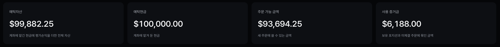 |
| 전략 운용 패널 | 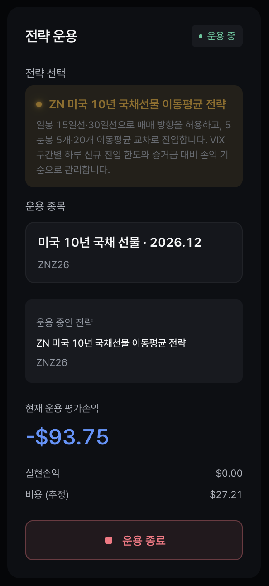 |
| 일봉 차트 (15·30일선) | 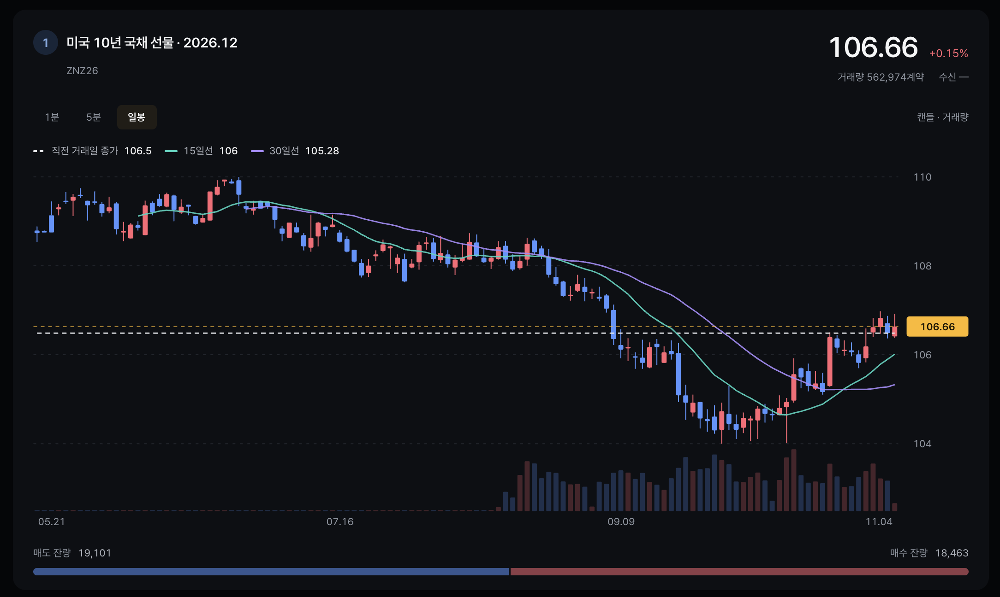 |
| 5분봉 차트 (5·20 이동평균) |  |
| 현재 판단 | 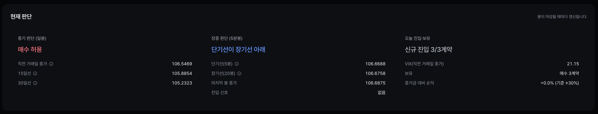 |
| 보유 포지션 | 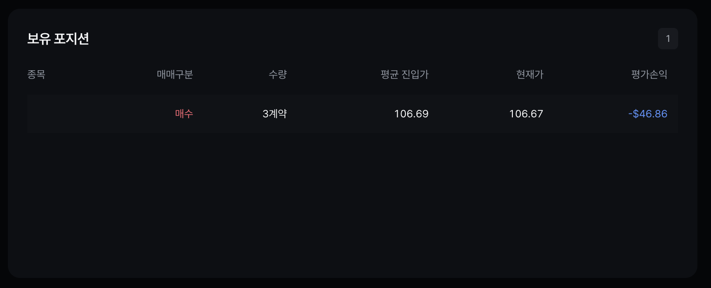 |
| 모의매매 이력 | 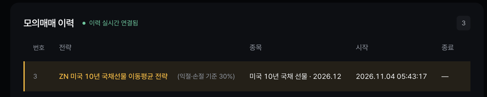 |
| 체결 탭 (3건) | 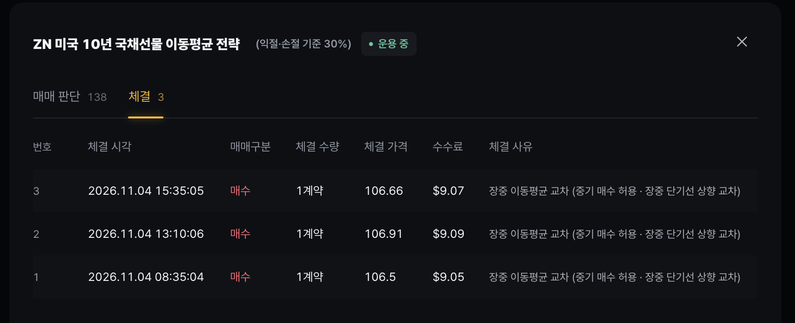 |
| 매매 판단 탭 |  |
| 판단 #22 — 08:35 매수 | 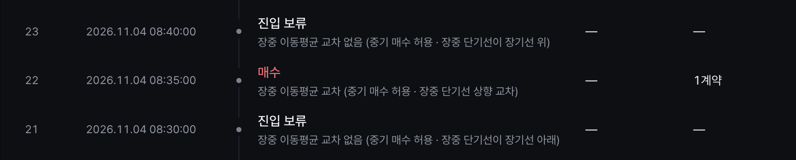 |
| 판단 #77 — 13:10 매수 |  |
| 판단 #106 — 15:35 매수 |  |

### 6-2. 백테스트 (프로그램 내부 시뮬레이션)

기간 2026-08-11 ~ 2026-11-03, 초기자금 $100,000, 슬리피지 1틱. 근거: [results/week03_zn_treasury_futures/backtest/](results/week03_zn_treasury_futures/backtest/)

| 익절·손절 기준 | 실행 일시 | 거래 수 | 승·패 | 총손익 | 수수료 | 순손익 | 수익률 | 최대 낙폭 |
| --- | --- | --- | --- | --- | --- | --- | --- | --- |
| 5% | [052356](results/week03_zn_treasury_futures/backtest/20261104_052356/result.json) | 200 | 79·121 | −$7,328.13 | $3,615.25 | −$10,943.37 | −10.94% | $11,228.32 (11.20%) |
| 10% | [051901](results/week03_zn_treasury_futures/backtest/20261104_051901/result.json) | 199 | 107·92 | +$218.75 | $3,596.57 | −$3,377.82 | −3.38% | $7,186.78 (7.03%) |
| 15% | [051842](results/week03_zn_treasury_futures/backtest/20261104_051842/result.json) | 200 | 105·95 | +$1,031.25 | $3,614.53 | −$2,583.28 | −2.58% | $15,018.76 (14.94%) |
| 20% | [051814](results/week03_zn_treasury_futures/backtest/20261104_051814/result.json) | 200 | 111·89 | +$7,296.88 | $3,614.64 | +$3,682.24 | +3.68% | $23,819.54 (19.27%) |
| **30%** | [053010](results/week03_zn_treasury_futures/backtest/20261104_053010/result.json) | 171 | 127·44 | +$53,125.00 | $3,086.29 | **+$50,038.71** | **+50.04%** | $37,781.86 (21.27%) |
| 40% | [053103](results/week03_zn_treasury_futures/backtest/20261104_053103/result.json) | 135 | 99·36 | +$52,343.75 | $2,441.68 | +$49,902.07 | +49.90% | $48,564.03 (25.04%) |
| 50% | [053042](results/week03_zn_treasury_futures/backtest/20261104_053042/result.json) | 105 | 69·36 | +$34,859.38 | $1,895.85 | +$32,963.53 | +32.96% | $54,658.29 (29.85%) |

**실행 화면**

| 화면 | 캡처 |
| --- | --- |
| 결과 화면 (기준 40%) |  |
| 테스트 조건 입력 패널* | 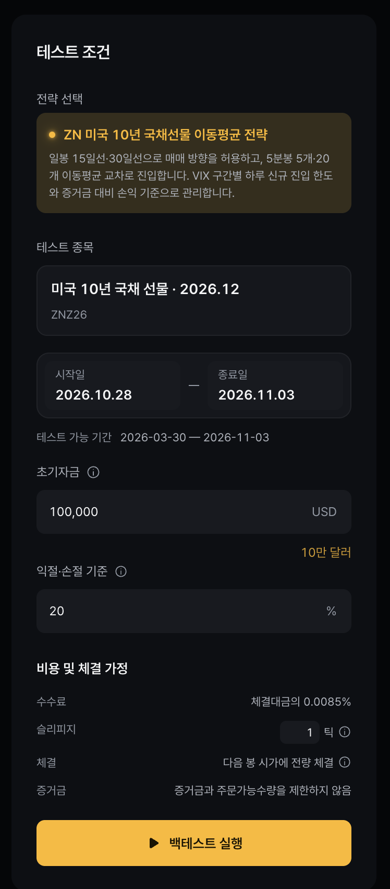 |
| 결과 화면 (기준 30%, 9/24 툴팁) |  |
| 실행 이력 |  |
| 실행 상세 — 매매 판단 (30%) |  |
| 실행 상세 — 체결 (30%) |  |

\* 이 캡처의 시작일 입력값(2026.10.28)은 입력 화면 상태. 실행 기간은 위 표(2026-08-11 ~ 2026-11-03).

**이력 비교 (A 10% · B 20% · C 30% · D 40%)**

| 화면 | 캡처 |
| --- | --- |
| 비교할 실행 선택 | 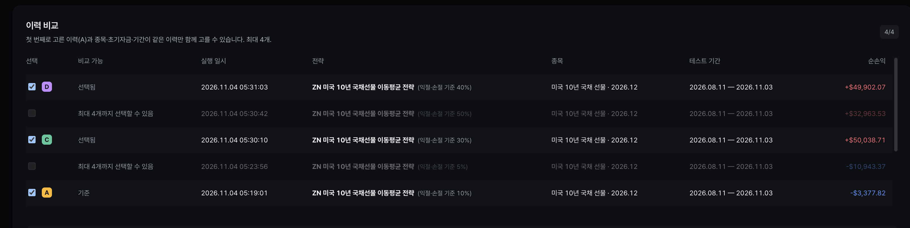 |
| 비교할 수치 선택 | 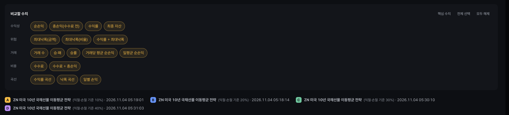 |
| 설정값 비교 |  |
| 수치 비교 카드 | 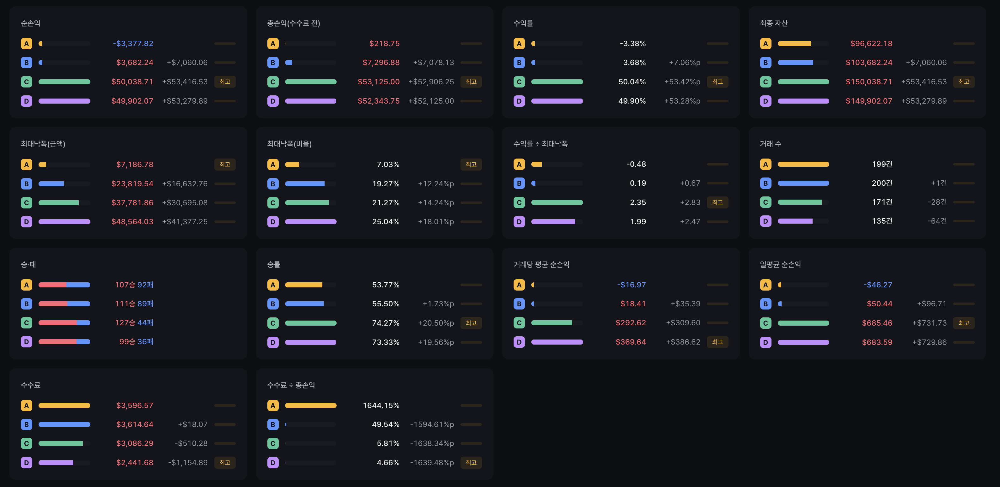 |
| 수익률 곡선 |  |
| 낙폭 곡선 | 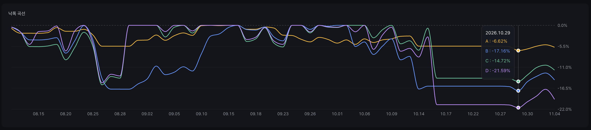 |
| 일별 손익 | 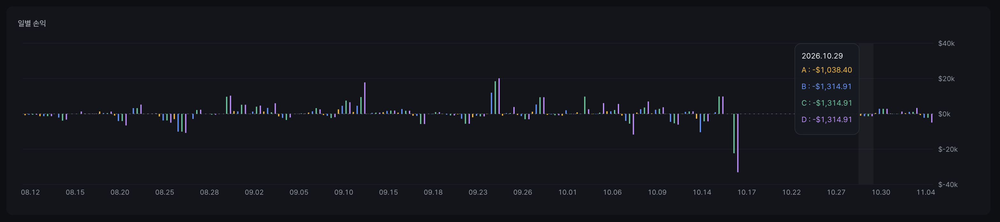 |

## 7. 해석과 한계

### 7-1. 손익 원인

- 모의매매: TODO (3건 모두 매수 진입. 총손익 $0.00에 수수료만큼 순손실. 운용 종료 시점 가격에 일괄 청산되어 규칙 청산이 아님)
- 백테스트: TODO (익절·손절 기준에 따른 성과 차이 해석. 확인한 사실: 기준 5→30%에서 거래 수 200→171, 승률 39.5%→74.3%로 상승, 기준 40·50%에서는 거래 수가 135·105로 줄고 최대 낙폭이 커짐)

### 7-2. 전략의 한계

TODO — 후보 항목:

- 기준값(5~50%)을 같은 기간 데이터로 비교해 고른 점 → 과적합 가능성, 구간 밖 검증 없음.
- 백테스트는 증거금·주문가능수량 제한을 적용하지 않음.
- 백테스트 진입 대부분이 매도(진입 체결 200건 중 매도 185건) — 기간 내 중기 신호 편중 여부 확인 필요.
- 모의매매는 하루 1회, 매수 3건뿐이라 통계적 의미 없음.
- 수수료는 추정값, 모의 체결은 실제 시장 체결과 다를 수 있음.

### 7-3. 예상과 다른 점

TODO

## 8. 오류 제보·개선·향후 계획

- **확인된 오류 기록:** 운용 종료 시 취소 요청 3건이 `7037 이미 처리완료된 [주문] 건 입니다.`로 거부됨. 해당 주문은 이미 체결된 청산 주문이었음 (`journal/2026-11-04.jsonl`, `level: warning`). TODO: 제보 여부 기재.
- 개선 사항: TODO
- 향후 계획: TODO
