# 3주차 · 해외상품·거래소 전략 구현 — 미싱링커

**제출일: 2026/11/06(금) 23:59까지**

> 수치는 모두 `results/`의 원본 파일에서 읽은 값. 환경 구분: 모의매매는 **NH 해외 모의계좌 주문**, 백테스트는 **프로그램 내부 시뮬레이션**. 시뮬레이션 체결을 모의계좌 체결로 표기하지 않음.

| 항목 | 내용 |
| --- | --- |
| 팀 | 미싱링커 (Missing Linker), 07팀 — 양민수·이한용 |
| 과제 | 해외상품·거래소 전략 구현 |
| 팀 과제 주제 | **미국 국채 — CME ZN(10년)** |
| 전략 이름 | ZN 미국 10년 국채선물 이동평균 전략 (`week03_zn_treasury_futures`) |
| 대상 종목 | 미국 국채 — CME ZN(10년 국채선물) 2026년 12월물 `ZNZ26`, 거래승수 1,000, 1틱 0.015625 |
| 판단 주기 | 일봉(중기 방향) + 완성된 5분봉(장중 진입) |
| 실행 환경 | NH선물 해외 모의투자(`TRADING_ENV=mock`) · 과거 분봉 백테스트 |
| 코드 저장소 | [pioneer-1st-code-team07](https://github.com/NH-Futures-Pioneer-1-Team07/pioneer-1st-code-team07) (기본 브랜치 `dev`, **3주차 코드는 `week3` 브랜치**, 기준 커밋 `c2b469a`) |
| 작성일 | 2026-11-05 (KST) |

## 폴더 구성

| 경로 | 내용 |
| --- | --- |
| [README.md](README.md) | 3주차 보고서 |
| [.env.example](.env.example) | 비밀값을 제외한 모의환경 설정 템플릿 (코드 저장소의 `backend/.env`로 복사해 사용) |
| [results/](results/) | 실행 원본 기록 (`meta.json`·`result.json`·`journal/`). 백테스트 7건, 모의매매 1건 |
| [screenshots/전략/](screenshots/전략/) | 전략 설명용 캡처 1장 |
| [screenshots/모의매매/](screenshots/모의매매/) | 모의매매 화면 캡처 13장 |
| [screenshots/백테스트/](screenshots/백테스트/) | 백테스트 화면 캡처 13장 |

## 1. 과제 요약

**요구사항:** NH선물 Open API로 해외 선물 상품에 대한 규칙 기반 전략을 구현하고, 실제 실행 기록으로 결과를 분석.

**팀 과제 주제:** 미국 국채 — CME ZN(10년). CME 거래소의 미국 10년 국채선물 ZN 2026년 12월물(`ZNZ26`)을 대상으로 함.

**한 것:**

- 미국 10년 국채선물(ZN) 단독 이동평균 전략 구현. 일봉 15·30일선으로 매매 방향을 허용하고, 5분봉 5·20 이동평균 교차로 진입.
- VIX 구간별 하루 신규 진입 한도, 증거금 대비 손익 기준 전량 청산, 중기 신호 반전 시 전량 청산 적용.
- 해외 모의계좌 주문(모의매매 1건)과 과거 분봉 백테스트(익절·손절 기준 5~50%, 7건) 실행.
- 실행 기록·화면 캡처 정리, 익절·손절 기준별 성과 비교.

**핵심 결과:**

- **백테스트(시뮬레이션, 2026-08-11 ~ 2026-11-03):** 익절·손절 기준 7가지 중 30%가 순손익 +$50,038.71(+50.04%)로 가장 높았고, 40%(+$49,902.07)·50%(+$32,963.53)가 뒤를 이음. 5·10·15%는 순손실(−$10,943.37 ~ −$2,583.28), 20%는 +$3,682.24.
- **모의매매(NH 해외 모의계좌, 2026-11-04 05:43:17 ~ 19:07:46 KST, 약 13시간 24분):** 5분봉 상향 교차로 매수 1계약씩 3회 진입, 운용 종료 시 전량 청산. 총손익 $0.00, 순손익 −$54.41(수수료 추정값 포함).

## 2. 실행 방법

### 2-1. 사전 준비

| 항목 | 준비 내용 |
| --- | --- |
| uv | 설치(`brew install uv` 등). Python 3.12 이상(`backend/.python-version`=3.12)은 uv가 자동 설치 |
| Node.js | 22.12 이상, npm 포함 (`frontend/package.json`의 `engines`) |
| NH선물 키 | 3주차 ZN 전략은 **해외 모의투자 키**를 사용 (실시간 시세 웹소켓도 해외 키로 연결) |
| VIX 데이터 | `backend/data/vixcls.csv`가 저장소에 포함되어 있어 따로 받을 필요 없음 (FRED `VIXCLS` 일 종가). 실행 시점 파일 범위 1990-01-02 ~ 2026-11-02. 갱신: `uv run python -m app.data.vix` |

### 2-2. 코드 내려받기

> **브랜치 안내:** 코드 저장소의 기본 브랜치는 `dev`이지만, **3주차 코드는 `week3` 브랜치에서 진행**함. 제출 기준 커밋은 `week3` 브랜치의 `c2b469a`이며, 이 시점 기준으로 `dev`에는 3주차 변경(25커밋)이 반영되어 있지 않음. 3주차 결과를 재현하려면 반드시 `week3` 브랜치를 받을 것(`--branch week3`를 빼면 `dev`가 받아짐).

```bash
git clone --branch week3 https://github.com/NH-Futures-Pioneer-1-Team07/pioneer-1st-code-team07.git
cd pioneer-1st-code-team07
```

이미 `dev`를 받아 둔 경우:

```bash
git fetch origin week3
git switch week3
```

### 2-3. 설정

```bash
cp backend/.env.example backend/.env
```

`backend/.env`를 열어 발급받은 해외 모의투자 키를 입력하고 키 항목 앞의 `#`를 지워야 적용됨.

```dotenv
TRADING_ENV=mock
NH_OVERSEAS_APP_KEY=발급받은_해외_모의투자_APP_Key
NH_OVERSEAS_APP_SECRET=발급받은_해외_모의투자_APP_Secret_Key
```

- `TRADING_ENV=mock`: 모의 환경. 키도 모의투자용이어야 함.
- 인증정보는 로컬 `backend/.env`에만 저장. 실제 값이 있는 `.env`·키·토큰·계좌 식별정보는 제출 대상에서 제외.

### 2-4. 실행

**터미널 1 — 백엔드**

```bash
cd backend
uv sync --locked
uv run uvicorn app.main:create_app --factory --reload
```

백엔드 확인: `http://127.0.0.1:8000/health`에 응답이 오면 정상. `uv sync --locked`는 최초 설치 또는 잠금 파일 변경 시에만 실행.

**터미널 2 — 프론트엔드**

```bash
cd frontend
npm ci
npm run dev
```

`npm ci`는 최초 설치 시에만 실행. 브라우저에서 [http://127.0.0.1:5173](http://127.0.0.1:5173) 접속(포트가 사용 중이면 Vite 터미널에 표시된 주소 사용).

실행이 안 되면 `backend/.env`(`TRADING_ENV=mock`, 키 앞 `#` 제거)와 모의투자용 키 여부부터 확인. 해외 종목 조회·실행이 `503`이면 `NH_OVERSEAS_APP_KEY`·`NH_OVERSEAS_APP_SECRET` 입력 여부 확인.

### 2-5. 화면에서 실행

**백테스트 (프로그램 내부 시뮬레이션)**

- 메뉴 **백테스트**에서 전략(ZN 이동평균)·기간·초기자금·**익절·손절 기준(%)**·슬리피지를 정해 **백테스트 실행**.
- 봉 마감 신호는 다음 봉 시가에 체결. 체결마다 슬리피지와 수수료(0.0085%) 반영.
- 증거금·주문가능수량 제한은 미적용. 모의계좌에는 주문하지 않음.
- 실행 이력에서 상세 기록 확인, 같은 종목·초기자금·기간의 이력 최대 4건 비교.

이 보고서 결과(6-2절)의 재현 입력값:

| 항목 | 값 |
| --- | --- |
| 전략·종목 | ZN 미국 10년 국채선물 이동평균 전략 · `ZNZ26` |
| 기간 | 2026-08-11 ~ 2026-11-03 |
| 초기자금 | $100,000 |
| 슬리피지 | 1틱 |
| 익절·손절 기준 | 5, 10, 15, 20, 30, 40, 50% 중 하나씩 7번 실행 (기본값 20%) |

**모의매매 (NH 해외 모의계좌 주문)**

- 메뉴 **모의매매**에서 전략을 고르고 익절·손절 기준을 정한 뒤 **운용 시작**. 시작 이후 완성된 5분봉부터 판단.
- 운용 중에는 현재 판단·보유 포지션·판단 기록·체결을 화면에서 확인. 주문 접수와 체결을 구분해 확인(체결 탭).
- **운용 종료** 시 미체결 주문을 취소하고 보유분을 시장가로 청산.
- 운용 시작과 청산은 해외 모의계좌에 실제로 주문을 전송.

이 보고서 결과(6-1절)의 입력값: 익절·손절 기준 30%, 운용 시작 2026-11-04 05:43:17(KST), 운용 종료 같은 날 19:07.

### 2-6. 실행 기록

- 저장 위치: `backend/runs/<전략 id>/<backtest|paper>/<실행 일시>/` → 이 폴더의 `results/`로 복사.
- 복사 후 `results/`·`.env.example`·README에서 APP Key·Secret·토큰·계좌번호 등 식별정보가 없음을 확인함. 기록의 `order_no`는 모의계좌 주문번호이며 계좌번호가 아님. `.env.example`의 키 값은 비어 있음. 화면 캡처 27장도 계좌번호·키·토큰이 보이지 않음을 확인함.

## 3. 전략과 매매 계획

### 전략 선정 배경

미국 10년 국채선물(ZN)은 통화정책과 경기 전망에 따른 금리 기대의 영향을 받는 상품이다. 이러한 흐름을 살펴보고자 장중 진입 신호에 앞서 중기 추세를 확인하기로 했다. 직전 거래일의 종가와 일봉 이동평균선을 기준으로 매매 방향을 정하고, 이후 5분봉 이동평균선의 교차로 구체적인 진입 시점을 잡았다.

또한 국채선물은 계약당 거래 규모가 커서 진입 수량을 신중하게 정할 필요가 있었다. 이에 시장 상황에 따라 하루 신규 진입 한도를 조절하고자 VIX를 활용했다. VIX는 S&P 500의 향후 30일 기대 변동성을 나타내는 지표다. 주식시장의 불안이 커지면 안전자산 선호가 강해져 미국 국채 수요가 늘어날 수 있다는 가설에 따라, VIX가 높을수록 매수 허용일의 신규 진입 한도를 높이고 매도 허용일의 한도는 낮췄다.

2주차에는 장중 차트의 움직임만으로 진입을 판단했다. 중장기 추세는 고려하지 않아, 왜 그 방향으로 거래하는지 설명하기 어려웠다. 또 체결 건수를 확보하는 데 집중하면서 거래가 반복될 때 누적되는 수수료와 슬리피지를 충분히 고려하지 못한 점을 극복하고자 했다.

### 3-1. 대상 상품

| 항목 | 내용 |
| --- | --- |
| 팀 과제 주제 | 미국 국채 — CME ZN(10년) |
| 대상 종목 | 미국 10년 국채선물(ZN) 2026년 12월물 `ZNZ26` (거래소 코드 FCME) |
| 거래승수 / 틱 | 1,000 / 0.015625 (1틱 = $15.625) |
| 증거금(매니페스트 값) | $2,083 / 계약 |
| 월물 | 2026년 12월물(`ZNZ26`, 만기 연월 202612) 1개만 사용 |

### 3-2. 진입·청산·손절 규칙

**진입은 두 가지 신호를 모두 고려해 결정**

| 구분 | 보는 범위 | 사용 자료 | 역할 |
| --- | --- | --- | --- |
| 중기 신호 | 며칠간의 흐름 | 일봉 15일선·30일선과 직전 거래일 종가 | 그날 **어느 방향**(매수·매도)으로만 진입할지 허용 |
| 장중 신호 | 하루 안의 움직임 | 5분봉 5개·20개 이동평균 교차 | 허용된 방향 안에서 **언제** 진입할지 결정 |

- 중기 신호가 허용하지 않은 방향의 장중 신호는 무시. 중기 신호가 중립이면 장중 신호가 나와도 진입하지 않음.
- 두 신호가 같은 방향일 때만 진입하므로, 장중 교차 하나만으로는 진입하지 않음.
- 진입 수량은 두 신호 외에 하루 신규 진입 한도(VIX)와 전체 보유 한도(30계약)의 제한을 받음.

**① 중기 신호 (일봉, 직전 거래일 종가 기준)**

| 중기 신호 | 조건 | 허용 방향 |
| --- | --- | --- |
| 상승 추세 | 종가 > 15일선 > 30일선 (종가가 두 선 위이고, 15일선이 30일선 위) | 매수 |
| 하락 추세 | 종가가 15일선과 30일선 모두 아래 (두 선의 순서는 무관) | 매도 |
| 중립 | 그 외 | 신규 진입 없음 |

매수는 15일선이 30일선 위일 때만 허용하고, 매도는 두 선의 순서를 보지 않음.

**② 장중 신호 (5분봉 SMA 5 / 20)**

- 매수: 단기선(5봉 이동평균)이 장기선(20봉 이동평균)을 아래에서 위로 **상향 교차**하고, 해당 봉 종가가 단기선·장기선 **두 선 모두 위**에 있을 때.
- 매도: 단기선이 장기선을 위에서 아래로 **하향 교차**하고, 해당 봉 종가가 단기선·장기선 **두 선 모두 아래**에 있을 때.
- 5분봉이 마감될 때마다 판단. 장이 열리면 첫 완성 봉부터 판단하며, 이동평균은 전일 5분봉에 이어서 계산.
- 중기 신호가 허용한 방향의 신호만 진입.
- 체결: 모의매매는 교차 봉 마감 직후 시장가 1계약, 백테스트는 다음 봉 시가에 1계약 체결.

**진입 제한**

| 제한 | 내용 |
| --- | --- |
| 신호당 수량 | 1계약 |
| 하루 신규 진입 한도 | 아래 VIX 표. 하루는 **한국 시간 날짜** 기준(00:00에 새로 시작). 매수·매도 진입 수량을 합산하고, 청산해도 사용한 한도는 복구하지 않음 |
| 전체 보유 한도 | 전날 보유분을 합쳐 30계약. 도달하면 추가 진입하지 않음 |
| VIX를 알 수 없는 경우 | 신규 진입하지 않음 |

**하루 신규 진입 한도 (VIX 직전 거래일 종가)**

| VIX | 매수 허용일 | 매도 허용일 |
| --- | --- | --- |
| V < 15 | 1계약 | 5계약 |
| 15 ≤ V < 20 | 2계약 | 4계약 |
| 20 ≤ V < 25 | 3계약 | 3계약 |
| 25 ≤ V < 30 | 4계약 | 2계약 |
| 30 ≤ V | 5계약 | 1계약 |

"매수 허용일"·"매도 허용일"은 그날 중기 신호가 허용한 방향.

**청산 (익절·손절·중기 반전)**

| 상황 | 동작 |
| --- | --- |
| 중기 신호가 보유 방향과 반대 방향을 허용하는 신호로 바뀜 | 전량 청산 |
| 증거금 대비 합산 손익이 +기준 이상 (익절) | 전량 청산 |
| 증거금 대비 합산 손익이 −기준 이하 (손절) | 전량 청산 |
| 중기 신호가 중립이 됨, 장중 역교차가 나옴 | 계속 보유 |

- **증거금 대비 손익** = 보유 전체의 미실현 손익 ÷ (증거금 $2,083 × 보유 계약 수). 증거금은 NH 계좌 조회값이 아니라 전략 설정 파일(`manifest.json`)의 값.
- **기준:** 익절·손절에 같은 비율 사용. 기본 20%, 화면에서 1~100% 범위로 조절.
- **확인 시점:** 5분봉이 마감될 때만 판정. 봉 중간에 기준을 넘었다 돌아온 경우는 청산하지 않으며, 청산은 기준 도달 봉 마감 후 시장가(백테스트는 다음 봉 시가)로 체결되어 실제 체결 손익이 기준을 넘을 수 있음.
- **판단 순서:** 청산 조건(중기 반전 → 손익 기준)을 먼저 확인하고, 해당하면 그 봉에서는 진입 신호를 보지 않음.
- **이월과 종료:** 장 마감 시 강제 청산 없이 포지션을 이월. 모의매매는 운용 종료 시 청산, 백테스트는 기간 종료 시 남은 보유분을 마지막 봉 종가로 정리.

전략 상세 규격: 코드 저장소 `docs/strategies/week03_zn_treasury_futures.md`.

### 3-3. 근거

2026년 12월물(ZNZ26)은 모의매매를 진행한 11월 기준 가장 가까운 분기 월물이었다. 과제 기간 중 월물을 교체할 필요가 없어, 동일한 종목으로 가격 조회부터 신호 판단과 주문 실행까지 확인하기에 적합하다고 판단했다.

처음에는 장기 추세를 따르는 전략을 고려했으나, 일주일이라는 과제 기간 안에 주문으로 이어지는 과정을 확인하기 어려울 수 있다고 보았다. 이에 일봉 15·30일선으로 중기 방향을 판단하고, 5분봉 5·20선의 교차로 진입 시점을 정했다. 중기 흐름을 따르면서도 장중 신호를 통해 구현한 기능의 작동을 확인하려는 구성이었다.

VIX를 선택한 이유는 주식시장의 불안 수준을 수치로 파악하고 이를 일관된 매매 규칙에 적용할 수 있기 때문이다. 기대 변동성을 활용하면 시장 심리에 대한 주관적 판단을 줄일 수 있다고 보았다. 또한 일별 데이터를 확보할 수 있어 직전 거래일의 값을 기준으로 당일 신규 진입 한도를 정하기에 적합했다.

익절·손절 기준은 보유 포지션에 투입한 자금 대비 손익을 관리하려는 취지로 정했다. 선물에서는 포지션을 구성하는 데 필요한 증거금을 기준으로 삼아, 전체 보유분의 합산 손익이 증거금 대비 일정 비율에 도달하면 전량 청산하도록 했다. 이후 백테스트에서 이 비율을 달리하며 성과와 낙폭의 변화를 비교했다.

장중 5분봉 교차 예시 (노란 원이 단기선·장기선 교차 지점):

| **그림 1. 5분봉 이동평균 교차 예시** |
|:---:|
| 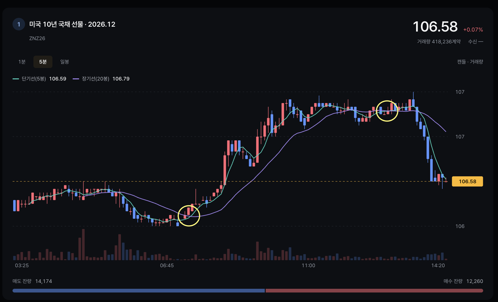 |
| 노란 원이 단기선(5봉)과 장기선(20봉)의 교차 지점. 왼쪽 원은 단기선이 장기선을 아래에서 위로 돌파하는 지점(매수 신호 형태), 오른쪽 원은 두 선이 다시 만나는 구간. |

## 4. 사용 API와 구조

### 4-1. 프로그램 구성

```text
브라우저(React) ──REST /api · WebSocket /ws──▶ 백엔드(FastAPI) ──REST·WebSocket──▶ NH선물 Open API (해외 모의)
                                                   │
                                                   ├─ 전략 코드 (backend/strategies/week03_zn_treasury_futures)
                                                   ├─ VIX 일 종가 (backend/data/vixcls.csv)
                                                   └─ 실행 기록 (backend/runs/)
```

| 구성요소 | 위치 (코드 저장소) | 역할 |
| --- | --- | --- |
| 프론트엔드 | `frontend/src/pages/trading`, `pages/backtest` | 모의매매·백테스트 화면. 조회와 실행 요청만 수행 |
| 화면 요청 처리 | `backend/app/api/` | REST·WebSocket 엔드포인트(전략 목록, 모의매매, 백테스트, 실행 기록, 시세) |
| 전략 | `backend/strategies/week03_zn_treasury_futures/` | ZN 이동평균 전략(`strategy.py`)과 설정(`manifest.json`) |
| 전략 공통 기반 | `backend/strategy_base/` | 전략 인터페이스(`on_bar` 등), 입력·출력 형식 |
| 실행 | `backend/app/runners/` | 백테스트(`backtest.py`)·모의매매(`paper.py`) 실행, 포지션·손익 계산(`ledger.py`, 두 모드 공용), 전략 입력 준비(`inputs.py`) |
| NH 연동 | `backend/app/nh/overseas/`, `nh/hub.py`, `nh/realtime.py` | 해외 시세·주문·계좌 REST 호출, 실시간 체결·호가 웹소켓 수신(시장별 연결을 여러 화면이 공유) |
| 실행 기록 | `backend/app/records/` | 판단·주문·체결·거래를 날짜별로 저장 |
| VIX | `backend/app/data/vix.py` | `vixcls.csv` 읽기·갱신 |

**데이터 흐름:** 5분봉 마감 → 전략 판단(`on_bar`) → 모의매매는 NH 모의계좌에 주문, 백테스트는 프로그램 안에서 체결 계산 → 판단·주문·체결·거래를 실행 기록에 저장. 시세는 실시간 웹소켓으로 수신해 화면에 전달(해외 체결 `FA`·호가 `FB`)하고, 모의매매는 체결 `FA`를 현재 가격으로 사용. 연결이 끊긴 동안은 5초마다 현재가를 조회해 대신하고, 분봉은 조회로 받아 마감된 봉만 전략에 전달.

- 모의매매와 백테스트가 같은 전략 코드를 호출. 프론트엔드는 조회와 실행 요청만 수행.

### 4-2. 사용 API

모의투자 서버 주소: REST `https://apidemo.futures.co.kr`, WebSocket `wss://apidemo.futures.co.kr`. 아래 엔드포인트는 이 주소 뒤에 붙는 경로. 경로와 방식은 코드 저장소 `backend/app/nh/`와 `docs/nh-api/apis/`에서 확인한 값.

| 구분 | API 명 (명세) | 방식 | 엔드포인트 | 쓴 곳 | 코드 위치 |
| --- | --- | --- | --- | --- | --- |
| 인증 | 접근토큰 발급 | POST | `/auth-service/v1/token` | 모든 NH 호출 전 토큰 발급 | `nh/auth.py` |
| 인증 | 웹소켓 키 발급 | GET | `/permission/v1/web-socket-key` | 실시간 연결 전 접속키 발급 | `nh/client.py` |
| 시세(실시간) | 해외_시세체결 (`FA`) | WebSocket | `/trade/ws-stream?access_key={접속키}` | 모의매매 현재 가격, 화면 현재가 | `nh/realtime.py`, `nh/hub.py` |
| 시세(실시간) | 해외_시세호가 (`FB`) | WebSocket | `/trade/ws-stream?access_key={접속키}` | 화면 5호가 | `nh/realtime.py`, `nh/hub.py` |
| 시세 | 해외_차트(분) | POST | `/trade/v1/overseas/chart-minute` | 백테스트 5분봉 이력, 모의매매 완성 봉, 백테스트 가능 기간 계산, 화면 5분 차트 | `nh/overseas/quotes.py` |
| 시세 | 해외_차트(일) | POST | `/trade/v1/overseas/chart-daily` | 중기 신호(15·30일선) 계산, 화면 일봉 차트 | `nh/overseas/quotes.py` |
| 시세 | 해외_현재가 | POST | `/trade/v1/overseas/price` | 실시간 연결이 끊긴 동안 모의매매 현재가 조회, 화면 시세(전일 종가·장 상태 포함) | `nh/overseas/quotes.py` |
| 시세 | 해외_호가 | POST | `/trade/v1/overseas/bid-price` | 화면 5호가 조회(실시간 호가 수신 전·끊김 시) | `nh/overseas/quotes.py` |
| 시세 | 해외_장운영정보 | POST | `/trade/v1/overseas/market-operations` | 화면 장 상태 표시 | `nh/overseas/market_hours.py` |
| 주문 | 해외_주문 (신규·취소 같은 경로) | POST | `/trade/v1/overseas/order` | 모의계좌 진입·청산 주문, 미체결 취소 | `nh/overseas/orders.py` |
| 주문 | 해외_주문내역 | POST | `/trade/v1/overseas/order-history` | 주문 접수와 체결 구분, 미체결 조회 | `nh/overseas/account.py` |
| 계좌 | 해외_예수금조회 | POST | `/trade/v1/overseas/deposit` | 운용 전후 계좌 확인, 화면 계좌 요약 | `nh/overseas/account.py` |
| 계좌 | 해외_잔고내역 | POST | `/trade/v1/overseas/open-interest` | 보유 포지션 확인 | `nh/overseas/account.py` |
| 계좌 | 해외_주문가능수량 | POST | `/trade/v1/overseas/orderable-quantity` | 주문 전 가능 수량 확인 | `nh/overseas/account.py` |

**ZN에서 구독하지 않은 실시간 데이터:** 모의매매 주문·체결 알림(`O1`)은 해외에서 구독하지 않고, 주문 상태는 주문내역(`order-history`) 조회로 확인.

**외부 데이터:** VIX 일 종가(FRED `VIXCLS`), `backend/data/vixcls.csv`에 저장해 두고 백테스트·모의매매가 같은 파일을 읽음.

## 5. 실행 환경

모든 시각은 한국 시간(KST).

| 구분 | 모의매매 | 백테스트 |
| --- | --- | --- |
| 성격 | **NH 해외 모의계좌 주문** | **프로그램 내부 시뮬레이션** (모의계좌 주문 없음) |
| 거래소·통화 | CME(FCME), USD | 동일 |
| 실행 일시 | 2026-11-04 05:43:17 ~ 19:07:46 | 2026-11-04 05:18 ~ 05:31 (7건) |
| 대상 구간 | 당일 운용 | 2026-08-11 ~ 2026-11-03 (73거래일, 5분봉 16,342개) |
| 초기 자금 | 계좌 $100,000 | $100,000 |
| 익절·손절 기준 | 30% | 5, 10, 15, 20, 30, 40, 50% |
| 시세 수신 | 실시간 웹소켓(체결 `FA`), 끊긴 동안 5초마다 현재가 조회. 분봉은 조회 | NH 과거 분봉·일봉 조회 |
| 주문·체결 | 시장가 주문, 주문내역으로 확인한 모의계좌 체결 | 다음 봉 시가에 전량 체결(그날 마지막 봉이면 그 봉 종가) |
| 수수료 | 추정값 0.0085%(`fee_estimated`). 계좌 조회상 실제 수수료 $48.00 | 체결대금의 0.0085%. 기준은 NH선물 개별주식선물 온라인 매매 표준수수료 |
| 슬리피지 | 없음(모의계좌 체결) | 1틱(0.015625), 체결마다 불리한 방향 |
| 증거금·주문가능수량 | 모의계좌 기준 | 제한하지 않음 |
| VIX 입력 | `vixcls.csv`의 직전 거래일 종가 (파일 범위 ~ 2026-11-02, 휴장일 빈 값은 건너뜀) | 모의매매와 같은 파일·같은 규칙 |

## 6. 실행 결과

### 6-1. 모의매매 (NH 해외 모의계좌 주문)

근거: [meta.json](results/week03_zn_treasury_futures/paper/20261104_054317/meta.json), [result.json](results/week03_zn_treasury_futures/paper/20261104_054317/result.json), [journal/](results/week03_zn_treasury_futures/paper/20261104_054317/journal/)

기록 건수(journal): 판단 148, 주문 접수 6(매수 3·매도 3), 체결 6, 거래 3.

| # | 진입 시각 | 방향 | 진입가 | 청산가 | 총손익 | 수수료(추정) | 순손익 | 진입 사유 |
| --- | --- | --- | --- | --- | --- | --- | --- | --- |
| 1 | 08:35:04 | 매수 1계약 | 106.5 | 106.6875 | +$187.50 | $18.12 | +$169.38 | 중기 매수 허용 · 단기선 상향 교차 |
| 2 | 13:10:06 | 매수 1계약 | 106.90625 | 106.6875 | −$218.75 | $18.16 | −$236.91 | 중기 매수 허용 · 단기선 상향 교차 |
| 3 | 15:35:05 | 매수 1계약 | 106.65625 | 106.6875 | +$31.25 | $18.13 | +$13.12 | 중기 매수 허용 · 단기선 상향 교차 |

청산은 3건 모두 19:07 **운용 종료 청산**(시장가). 합계: 총손익 $0.00, 수수료 $54.41(추정), 순손익 −$54.41.
계좌 조회: 운용 후 총자산 $99,952.00, 수수료 $48.00 (`result.json`의 `account`).
표의 순손익(−$54.41)은 수수료를 0.0085%로 추정해 계산한 값이고, 계좌 조회상 실제 변화는 −$48.00(수수료 $48.00, 실현손익 $0.00). 두 값의 차이는 $6.41.

**주문 접수와 체결** (`journal/2026-11-04.jsonl`의 `order`·`fill` 기록)

| 주문번호 | 구분 | 접수 시각 | 체결 시각 | 체결가 |
| --- | --- | --- | --- | --- |
| 0000001165 | 매수 진입 1계약 | 08:35:02 | 08:35:04 | 106.5 |
| 0000001231 | 매수 진입 1계약 | 13:10:03 | 13:10:06 | 106.90625 |
| 0000001251 | 매수 진입 1계약 | 15:35:03 | 15:35:05 | 106.65625 |
| 0000001289 | 매도 청산 1계약 (1번 진입분) | 19:07:42 | 19:07:46 | 106.6875 |
| 0000001290 | 매도 청산 1계약 (2번 진입분) | 19:07:42 | 19:07:46 | 106.6875 |
| 0000001291 | 매도 청산 1계약 (3번 진입분) | 19:07:42 | 19:07:46 | 106.6875 |

주문 6건 접수에 체결 6건. 접수와 체결은 별개 기록이며, 체결은 주문내역 조회로 확인한 값.

> **화면 캡처 안내:** 아래 캡처는 운용 중(2026-11-04 18시 13~17분경) 화면. 평가손익 −$93.75, 예탁자산 $99,882.25, 판단 138건은 그 시점 값이며, 위 표와 거래 기록은 19:07 운용 종료 후 최종값(판단 148건, 순손익 −$54.41, 총자산 $99,952.00).

| **그림 2. 모의매매 전체 화면** |
|:---:|
| 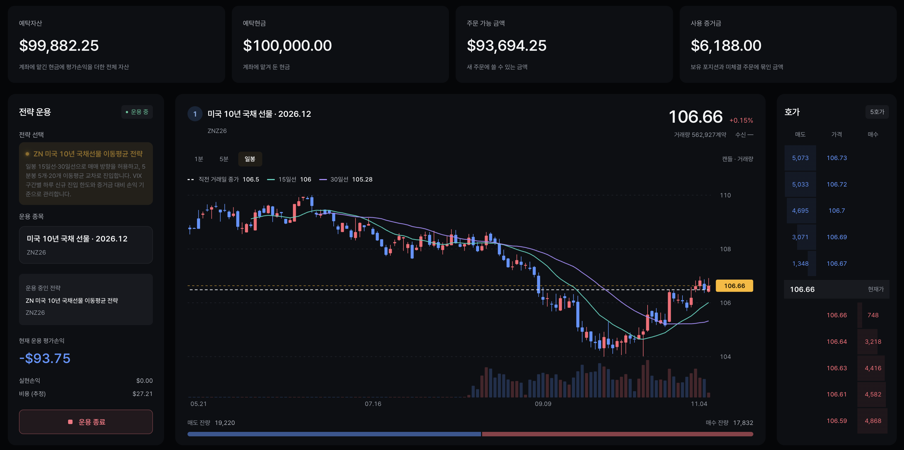 |
| 상단 계좌 요약, 좌측 전략 운용 패널, 가운데 일봉 차트, 우측 5호가로 구성. 운용 중 상태에서 현재가 106.66, 평가손익 −$93.75. |

| **그림 3. 계좌 요약** |
|:---:|
|  |
| 예탁자산 $99,882.25, 예탁현금 $100,000.00, 주문 가능 금액 $93,694.25, 사용 증거금 $6,188.00. 예탁자산은 현금에 평가손익을 더한 값. |

| **그림 4. 전략 운용 패널** |
|:---:|
|  |
| ZN 미국 10년 국채선물 이동평균 전략(ZNZ26) 운용 중. 평가손익 −$93.75, 실현손익 $0.00, 추정 비용 $27.21. 하단 버튼으로 운용 종료. |

| **그림 5. 일봉 차트 (중기 신호)** |
|:---:|
|  |
| 직전 거래일 종가 106.5(흰 점선), 15일선 106, 30일선 105.28. 종가가 두 이동평균 위에 있고 15일선이 30일선보다 높아 매수만 허용하는 상태. |

| **그림 6. 5분봉 차트 (장중 신호)** |
|:---:|
| 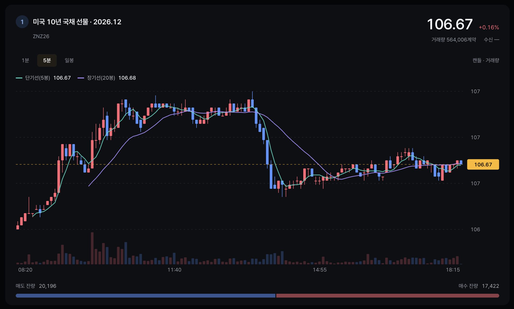 |
| 단기선(5봉) 106.67, 장기선(20봉) 106.68. 두 선이 맞닿은 구간으로 새 교차 신호가 없는 상태. 시간축은 08:20~18:15. |

| **그림 7. 현재 판단 패널** |
|:---:|
|  |
| 중기 판단: 매수 허용. 장중 판단: 단기선이 장기선 아래, 진입 신호 없음. VIX 21.15(20~25 구간)라 하루 신규 진입 한도 3계약 중 3계약 사용, 보유 매수 3계약, 증거금 대비 손익 +0.0%(기준 ±30%). |

| **그림 8. 보유 포지션** |
|:---:|
|  |
| 매수 3계약, 평균 진입가 106.69, 현재가 106.67, 평가손익 −$46.86. |

| **그림 9. 모의매매 이력** |
|:---:|
|  |
| 3번 실행 기록: 익절·손절 기준 30%, 시작 2026.11.04 05:43:17, 종료 시각 없음(운용 중). 이력은 실시간 연결 상태로 갱신. |

| **그림 10. 체결 탭** |
|:---:|
|  |
| 체결 3건. 08:35:04(106.5), 13:10:06(106.91), 15:35:05(106.66)에 각 매수 1계약 체결. 사유는 모두 “중기 매수 허용 · 장중 단기선 상향 교차”. 수수료는 건당 약 $9. |

| **그림 11. 매매 판단 탭** |
|:---:|
| 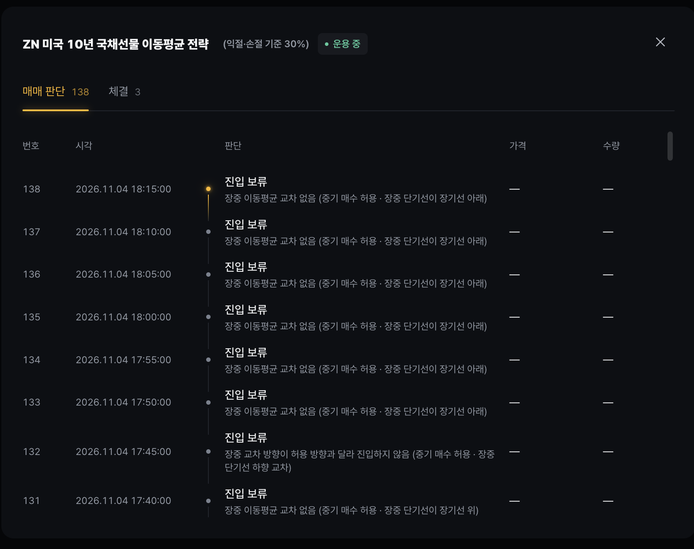 |
| 5분봉마다 기록된 판단 138건(캡처 시점). 최근 판단은 18:15까지 “진입 보류”이며 사유(교차 없음, 허용 방향과 다른 교차)를 함께 표시. |

| **그림 12. 판단 #22 — 08:35 매수** |
|:---:|
|  |
| 단기선 상향 교차 봉에서 매수 1계약 판단. 앞뒤 판단(#21, #23)은 교차 없음으로 진입 보류. |

| **그림 13. 판단 #77 — 13:10 매수** |
|:---:|
| 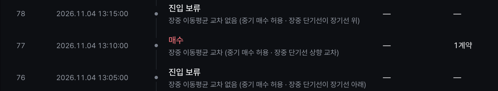 |
| 중기 매수 허용 상태에서 단기선 상향 교차 → 매수 1계약. 체결 탭의 2번 체결(13:10:06)에 대응. |

| **그림 14. 판단 #106 — 15:35 매수** |
|:---:|
| 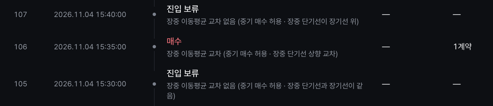 |
| 단기선 상향 교차 → 매수 1계약. 체결 탭의 3번 체결(15:35:05)에 대응. |

### 6-2. 백테스트 (프로그램 내부 시뮬레이션)

기간 2026-08-11 ~ 2026-11-03, 초기자금 $100,000, 슬리피지 1틱. 근거: [results/week03_zn_treasury_futures/backtest/](results/week03_zn_treasury_futures/backtest/)

**열 정의:** 거래 수 = 청산이 끝난 진입분(진입 1계약 단위) 수. 승·패 = 거래별 순손익(수수료 포함)이 0보다 큰 경우를 승, 그 외를 패로 집계.

| 익절·손절 기준 | 실행 일시 | 거래 수 | 승·패 | 총손익 | 수수료 | 순손익 | 수익률 | 최대 낙폭 |
| --- | --- | --- | --- | --- | --- | --- | --- | --- |
| 5% | [052356](results/week03_zn_treasury_futures/backtest/20261104_052356/result.json) | 200 | 79·121 | −$7,328.13 | $3,615.25 | −$10,943.37 | −10.94% | $11,228.32 (11.20%) |
| 10% | [051901](results/week03_zn_treasury_futures/backtest/20261104_051901/result.json) | 199 | 107·92 | +$218.75 | $3,596.57 | −$3,377.82 | −3.38% | $7,186.78 (7.03%) |
| 15% | [051842](results/week03_zn_treasury_futures/backtest/20261104_051842/result.json) | 200 | 105·95 | +$1,031.25 | $3,614.53 | −$2,583.28 | −2.58% | $15,018.76 (14.94%) |
| 20% | [051814](results/week03_zn_treasury_futures/backtest/20261104_051814/result.json) | 200 | 111·89 | +$7,296.88 | $3,614.64 | +$3,682.24 | +3.68% | $23,819.54 (19.27%) |
| **30%** | [053010](results/week03_zn_treasury_futures/backtest/20261104_053010/result.json) | 171 | 127·44 | +$53,125.00 | $3,086.29 | **+$50,038.71** | **+50.04%** | $37,781.86 (21.27%) |
| 40% | [053103](results/week03_zn_treasury_futures/backtest/20261104_053103/result.json) | 135 | 99·36 | +$52,343.75 | $2,441.68 | +$49,902.07 | +49.90% | $48,564.03 (25.04%) |
| 50% | [053042](results/week03_zn_treasury_futures/backtest/20261104_053042/result.json) | 105 | 69·36 | +$34,859.38 | $1,895.85 | +$32,963.53 | +32.96% | $54,658.29 (29.85%) |

**진입 방향과 청산 사유** (`journal/`의 `fill` 기록 집계)

| 익절·손절 기준 | 매수 진입 | 매도 진입 | 익절 청산 | 손절 청산 | 기간 종료 정리 |
| --- | --- | --- | --- | --- | --- |
| 5% | 15 | 185 | 80 | 120 | 0 |
| 10% | 14 | 185 | 107 | 91 | 1 |
| 15% | 15 | 185 | 104 | 89 | 7 |
| 20% | 15 | 185 | 110 | 83 | 7 |
| 30% | 15 | 156 | 126 | 38 | 7 |
| 40% | 15 | 120 | 90 | 30 | 15 |
| 50% | 15 | 90 | 60 | 30 | 15 |

- 모든 실행에서 진입은 대부분 매도였고, 중기 신호 반전으로 청산한 경우는 없음.
- 기간 종료 정리는 백테스트 종료 시 남은 보유분을 마지막 봉 종가로 정리한 청산.

**요약:** 순손익 최고는 기준 30%(+$50,038.71), 최저는 5%(−$10,943.37). 수수료는 기준이 클수록 줄어 50%가 가장 낮음($1,895.85). 최대 낙폭 비율은 10%가 가장 작고(7.03%) 50%가 가장 큼(29.85%).

**실행 화면**

| **그림 15. 백테스트 결과 화면 (익절·손절 기준 40%)** |
|:---:|
| 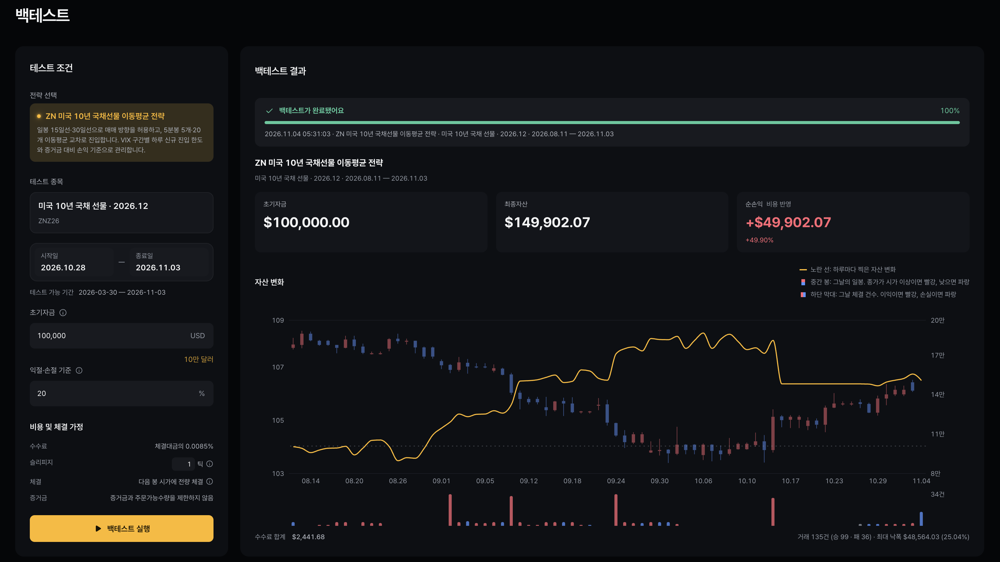 |
| 2026.08.11~2026.11.03, 초기자금 $100,000 → 최종자산 $149,902.07, 순손익 +$49,902.07(+49.90%). 거래 135건(99승 36패), 최대 낙폭 $48,564.03(25.04%), 수수료 합계 $2,441.68. 노란 선은 일별 자산, 봉은 일봉과 일별 체결 건수. |

| **그림 16. 테스트 조건 입력 패널** |
|:---:|
|  |
| 전략·종목(ZNZ26)·기간·초기자금 100,000 USD·익절·손절 기준(%)을 입력. 비용 가정은 수수료 0.0085%, 슬리피지 1틱, 다음 봉 시가 전량 체결, 증거금·주문가능수량 미제한. (캡처의 시작일 2026.10.28은 입력 화면 상태이며 실제 실행 기간은 2026-08-11 ~ 2026-11-03) |

| **그림 17. 백테스트 결과 화면 (기준 30%, 일별 툴팁)** |
|:---:|
| 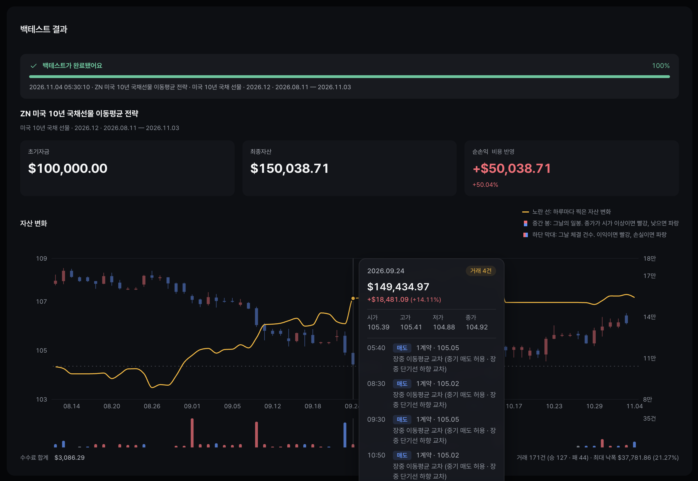 |
| 최종자산 $150,038.71, 순손익 +$50,038.71(+50.04%), 거래 171건(127승 44패), 최대 낙폭 $37,781.86(21.27%). 9월 24일에 마우스를 올리면 그날 자산 $149,434.97과 체결 내역(매도 1계약씩)과 사유를 표시. |

| **그림 18. 실행 이력** |
|:---:|
| 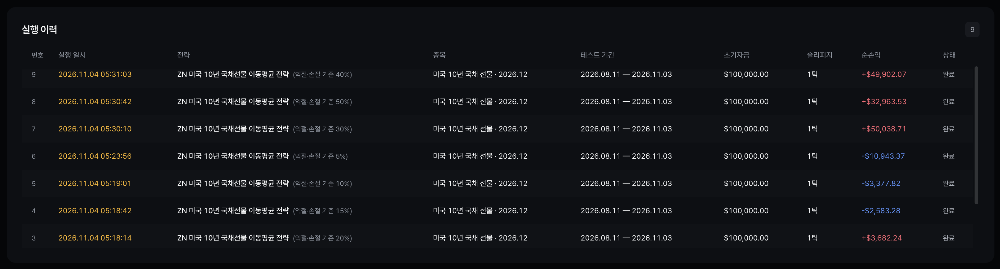 |
| 실행별 일시·익절·손절 기준·기간·초기자금·슬리피지·순손익. 40% +$49,902.07, 50% +$32,963.53, 30% +$50,038.71, 5% −$10,943.37, 10% −$3,377.82, 15% −$2,583.28, 20% +$3,682.24. |

| **그림 19. 실행 상세 기록 — 매매 판단 (30%)** |
|:---:|
| 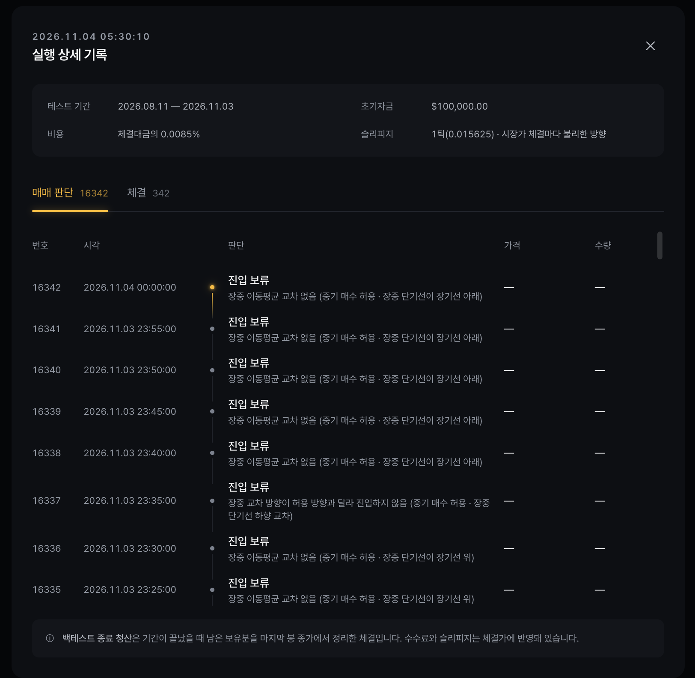 |
| 2026.11.04 05:30:10 실행. 판단 16,342건, 체결 342건. 슬리피지는 1틱(0.015625)을 시장가 체결마다 불리한 방향으로 반영. 하단에 기간 종료 시 남은 보유분은 마지막 봉 종가로 정리한다는 안내. |

| **그림 20. 실행 상세 기록 — 체결 (30%)** |
|:---:|
| 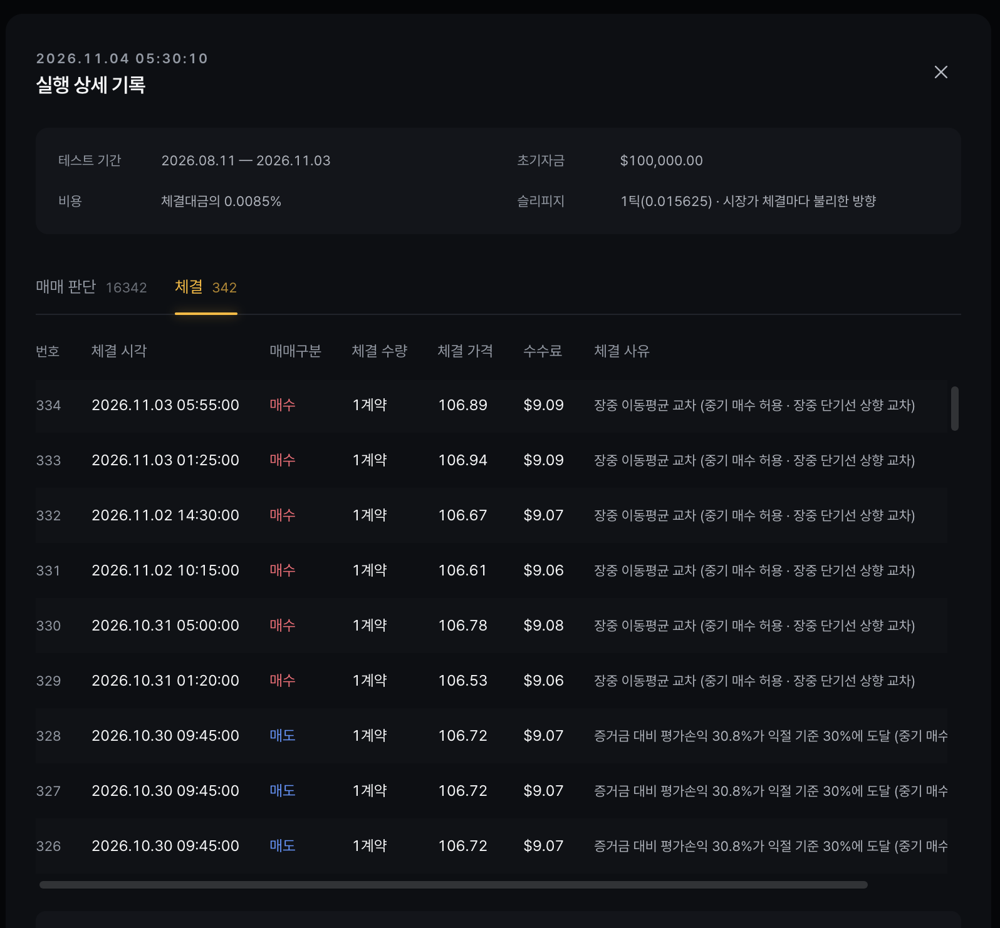 |
| 체결 342건 목록. 2026.10.30 09:45 매도 3건은 “증거금 대비 평가손익 30.8%가 익절 기준 30%에 도달”로 청산. 그 이후 10.31~11.03에 매수 진입. |

| **그림 21. 이력 비교 — 실행 선택** |
|:---:|
|  |
| 같은 종목·초기자금·기간의 이력을 최대 4건 선택. 10%(A), 20%(B), 30%(C), 40%(D) 선택. |

| **그림 22. 이력 비교 — 비교할 수치 선택** |
|:---:|
|  |
| 수익성(순손익·수익률 등), 위험(최대 낙폭), 거래(거래 수·승률), 비용(수수료), 곡선(수익률·낙폭·일별 손익) 항목을 골라 비교. |

| **그림 23. 이력 비교 — 설정값** |
|:---:|
| 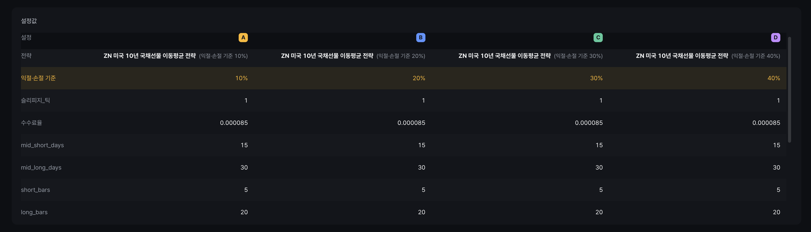 |
| 네 실행의 다른 설정은 익절·손절 기준(10·20·30·40%)뿐이고 슬리피지 1틱, 수수료율 0.000085, 이동평균 기간(15/30일, 5/20봉)은 모두 동일. |

| **그림 24. 이력 비교 — 수치 카드** |
|:---:|
|  |
| 순손익 A −$3,377.82 / B +$3,682.24 / C +$50,038.71 / D +$49,902.07. 승률 A 53.77%, B 55.50%, C 74.27%, D 73.33%. 최대 낙폭 비율은 A 7.03%, B 19.27%, C 21.27%, D 25.04%, 수수료는 D가 가장 낮음($2,441.68). |

| **그림 25. 이력 비교 — 수익률 곡선** |
|:---:|
| 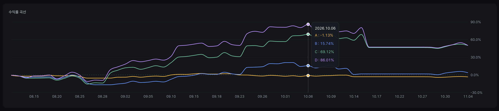 |
| C(30%)와 D(40%)가 9월 이후 급등해 10월 6일 각각 69.12%, 86.01%에 도달(A −1.13%, B 15.74%). 10월 중순 급락 이후 두 곡선은 거의 겹쳐 약 50%로 마감. |

| **그림 26. 이력 비교 — 낙폭 곡선** |
|:---:|
|  |
| 10월 29일 기준 낙폭 A −6.62%, B −17.16%, C −14.72%, D −21.59%. 기준이 클수록 낙폭이 깊은 경향. |

| **그림 27. 이력 비교 — 일별 손익** |
|:---:|
|  |
| 일별 손익 막대. 10월 중순에 C·D의 큰 손실일이 나타남. 10월 29일에는 A −$1,038.40, B·C·D −$1,314.91. |

## 7. 해석과 한계

### 7-1. 손익 원인

**모의매매 (2026-11-04, 순손익 −$54.41)**

- **거래:** 3건 모두 중기 상승 추세(매수 허용)에서 5분봉 단기선 상향 교차로 매수 진입(진입가 106.5, 106.90625, 106.65625). 청산은 익절·손절·중기 반전이 아니라 19:07 운용 종료 청산(106.6875). 건별 총손익 +$187.50, −$218.75, +$31.25로 합계 $0.00. 순손실 −$54.41은 수수료(추정 $54.41).
- **가격 흐름(5분봉 종가, 한국 시간):** 08:15 저점 106.390625에서 올라 13:35 고점 106.921875(약 34틱 상승). 이어 14:05까지 30분 동안 106.578125로 0.34375(22틱, 1계약당 약 $344) 하락했고, 그 뒤 마감까지 106.6 안팎에서 움직임.
- **시장 상황:** 모의매매 전날인 2026-11-03은 미국 중간선거일. 위 하락 구간(13:35~14:05)은 미국 동부 시간으로 11-03 23:35~11-04 00:05로 선거 당일 밤 개표 시간대와 겹침.
- **하락 구간에서 전략의 동작:**
  - 중기 신호는 하루 내내 상승 추세(매수 허용)였고, 13:10에 두 번째 매수(106.90625)가 들어간 지 25분 뒤 고점에서 하락이 시작됨.
  - 13:50에 단기선이 장기선을 하향 교차했지만 매수만 허용하는 날이라 "진입하지 않음"으로 보류. 이날 하향 교차는 06:00, 12:15, 13:50, 17:45 네 번 있었고 모두 같은 이유로 무시됨.
  - 보유 중 증거금 대비 평가손익은 최대 +19.5%(13:10, 1계약), 최저 −6.0%(14:05, 2계약)로 기준 ±30%에 닿지 않아 익절·손절이 한 번도 작동하지 않음.
- **해석:** 이날 5분봉 종가 기준 고저 폭(0.53125, 34틱)은 증거금 대비 ±30% 기준을 건드릴 만큼 크지 않았음. 그래서 하락과 반등이 모두 규칙 청산 없이 지나갔고, 결과는 종료 청산 시점의 가격(106.6875)이 정함. 하락을 만난 매수 보유가 −6.0%에서 멈춘 것은 기준이 커서가 아니라 하락 폭 자체가 작았기 때문. 13:50의 하향 교차는 8-3의 개선안(상승 추세에서도 하향 교차 시 매도 허용)이 적용됐다면 매도 후보 신호였음. 다만 이날 하루 3건으로는 이 규칙의 효과를 판단할 수 없음.

**백테스트 (2026-08-11 ~ 2026-11-03, 기준 7가지)**

| 익절·손절 기준 | 승률 | 건당 평균 이익 | 건당 평균 손실 | 총손익 | 수수료 | 순손익 |
| --- | --- | --- | --- | --- | --- | --- |
| 5% | 39.5% | +$86 | −$147 | −$7,328.13 | $3,615.25 | −$10,943.37 |
| 10% | 53.8% | +$193 | −$261 | +$218.75 | $3,596.57 | −$3,377.82 |
| 15% | 52.5% | +$303 | −$362 | +$1,031.25 | $3,614.53 | −$2,583.28 |
| 20% | 55.5% | +$398 | −$455 | +$7,296.88 | $3,614.64 | +$3,682.24 |
| 30% | 74.3% | +$604 | −$607 | +$53,125.00 | $3,086.29 | +$50,038.71 |
| 40% | 73.3% | +$783 | −$767 | +$52,343.75 | $2,441.68 | +$49,902.07 |
| 50% | 65.7% | +$966 | −$936 | +$34,859.38 | $1,895.85 | +$32,963.53 |

건당 평균은 거래별 순손익(수수료 포함) 기준.

- **손실 구간(5~15%):** 총손익이 −$7,328.13 ~ +$1,031.25로 수수료(약 $3.6천)를 넘지 못해 순손실. 승률이 39.5~53.8%로 낮고 건당 평균 손실이 평균 이익보다 큼. 거래의 대부분(5%는 200건 전부, 10%는 199건 중 198건)이 익절 또는 손절로 청산됨.
- **이익 구간(30~40%):** 승률이 74.3%·73.3%로 높고, 건당 평균 이익과 손실은 거의 같음. 거래 수가 171·135건으로 줄어 수수료도 $3,086·$2,442로 감소.
- **50%:** 승률 65.7%, 수수료 최저($1,895.85)지만 최대 낙폭 비율이 29.85%로 가장 큼. 기간 종료 시 정리한 보유분이 15건.
- **진입 방향:** 8~9월 진입은 모두 매도, 매수 진입은 10월부터 시작(기준 30%: 8월 매도 38건, 9월 매도 84건, 10월 매도 34·매수 10건, 11월 매수 5건). 일봉상 가격은 8월 108대에서 10월 중순 104 부근까지 내려간 뒤 반등.
- **최대 손실일:** 30%·40%·50% 기준 모두 2026-10-15에 매도 포지션 30계약(전체 보유 한도)이 한꺼번에 손절됨. 손절 거래의 순손익 합계는 30% −$19,972, 40% −$26,411, 50% −$32,505. 이 30건이 40%·50% 기준 실행의 손절 전부(각 30건).
- **해석(추정):** 기준이 작으면 정상적인 가격 변동에도 청산되어 승률이 낮고 수수료가 누적됨. 기준이 30~40%이면 하락 추세 구간의 매도 포지션이 오래 유지되어 이익이 크게 쌓였지만, 10월 중순 반등에서 30계약이 한 번에 손절되며 이익의 상당 부분(30% 기준 총손익 $53,125 중 약 $20천)을 반납.

### 7-2. 전략의 한계

- **표본·검증:** 기준값(5~50%)을 같은 기간 데이터로 한 번씩 비교해 고름. 구간 밖(다른 기간) 검증이 없어 과적합 가능성이 있음. 모의매매는 하루 3건이라 통계적 의미가 없음.
- **한 방향 집중:** 8~9월 매도 진입이 이어져 보유 한도 30계약까지 한 방향으로 쌓임. 하루 신규 진입 한도와 보유 한도는 있지만 일일 손실 한도가 없어, 10월 15일처럼 반등 하루에 30계약이 모두 손절됨.
- **중기 반전 청산 미작동:** 백테스트 7건 모두 중기 신호 반전으로 청산한 경우가 없어 이 규칙의 효과를 검증하지 못함.
- **증거금 미반영:** 백테스트는 증거금·주문가능수량을 제한하지 않음. 30계약 보유 시 증거금은 설정값 기준 약 $62,490(30 × $2,083)으로 초기자금 $100,000의 약 62%.
- **봉 마감 판정:** 익절·손절을 5분봉 마감 때만 확인하므로, 봉 중간의 급변동에는 반응하지 않고 기준을 넘은 뒤 체결되어 실제 손익이 기준보다 커질 수 있음.
- **하루 기준:** 하루 신규 진입 한도를 한국 시간 날짜로 세므로, 해외장이 거의 하루 종일 열려 있어 CME 거래일 기준과 한도가 초기화되는 시점이 다름.
- **VIX 범위:** VIX는 `vixcls.csv`의 직전 거래일 종가이며 파일 범위가 2026-11-02까지임. 이후 날짜는 마지막 값(21.15)이 경고 없이 계속 쓰이고, 파일이 없거나 해당 날짜 이전 값이 없으면 VIX를 알 수 없어 신규 진입을 하지 않음(오류 없이 진행). 재실행 전 `uv run python -m app.data.vix`로 갱신 필요.
- **실시간 연결 의존:** 모의매매의 현재 가격은 웹소켓 체결(`FA`)에 의존하고, 연결이 끊기면 5초 주기 조회로 대신하므로 그 사이 가격 반영이 늦어질 수 있음.
- **체결 가정:** 수수료는 추정값이고, 모의 체결은 실제 시장 체결과 다를 수 있음.

### 7-3. 예상과 다른 점

예상대로 잘 동작했지만, 모의매매가 2026-11-04 하루(약 13시간 24분)의 짧은 기간에 진행되었기에 생각보다 저조한 수익률을 보여주었다. 장기적인 투자 전략이기에 단기적으로는 어쩔 수 없이 조금은 손해를 볼 수 있다고 생각했으나, 8절에서 작성한 것과 같이 더 수익을 높일 수 있는 방법들을 생각해보는 계기가 되었다.

## 8. 향후 계획

현재 매매 로직에서 개선할 수 있다고 생각한 4가지.

### 8-1. 한 번에 다 매수 혹은 매도

- **현재:** 장중 신호가 나올 때마다 1계약씩 나누어 진입하고, 하루 신규 진입 한도(VIX 구간별 1~5계약)까지 신호가 반복될 때마다 늘림.
- **개선 방향:** 중기 신호가 상승 추세(매수 허용)일 때 단기선이 장기선을 처음 상향 교차하는 시점에 그날 한도만큼 한 번에 진입. 매도 허용일도 같은 방식으로 적용.
- **생각한 이유:** 중기 추세가 오를 것이라고 보고 매수한다면 이후 교차를 기다리며 나누어 사는 것보다 처음 교차에서 먼저 사는 편이 더 유리하다고 판단. 앞으로도 계속 오를 것이라는 전제와 일관됨.

### 8-2. 처음보다 내린 값에서만 매수

- **현재:** 중기 신호가 허용한 방향의 장중 교차가 나오면 가격과 관계없이 진입.
- **개선 방향:** 8-1에서 한 걸음 더 나아가, 처음 매수한 시점보다 가격이 더 떨어진 뒤 단기선이 장기선을 다시 상향 교차할 때만 추가 매수.
- **생각한 이유:** 처음 매수 시점보다 더 내려온 가격에서 사면 같은 상승 추세에서 더 낮은 단가로 진입하게 되어 이익을 볼 수 있다고 판단.

### 8-3. 단기선이 장기선을 아래로 뚫으면 매도 허용

- **현재:** 중기 신호가 상승 추세이면 매수만 허용하고, 하락 추세이면 매도만 허용. 허용하지 않은 방향의 장중 교차는 무시.
- **개선 방향:** 상승 추세로 판단한 날에도 단기선이 장기선을 아래로 뚫고 내려가는(하향 교차) 신호가 나오면 매도를 허용.
- **생각한 이유:** 하루 종일 상승만 하는 날은 거의 없다고 보고, 상승하다가 내려오는 구간에서도 이익을 얻기 위함.

### 8-4. 손절 기준 강화

- **현재:** 익절과 손절에 같은 비율(기본 20%)을 사용.
- **개선 방향:** 익절과 손절 기준을 따로 두고, 손절 비율을 익절보다 작게 설정.
- **생각한 이유:** 익절과 손절이 같은 수치일 필요는 없다고 판단. 손절을 더 빨리 하면 손실이 작아지는 구조를 만들 수 있다고 생각함.
