# 4주차 · 복수상품·스프레드 전략 — 미싱링커

**제출일: 2026/11/13(금) 23:59까지**

> 수치는 모두 `results/`의 원본 파일과 이를 집계한 자료에서 읽은 값. 환경 구분: 모의매매는 **NH 해외 모의계좌 연동 운용**이며, 이번 두 실행에서는 **주문·체결이 발생하지 않음**. 백테스트와 파라미터 탐색은 **프로그램 내부 시뮬레이션**. 시뮬레이션 체결을 모의계좌 체결로 표기하지 않음.

| 항목 | 내용 |
| --- | --- |
| 팀 | 미싱링커 (Missing Linker), 07팀 — 양민수·이한용 |
| 과제 | 복수상품·스프레드 전략 |
| 팀 과제 주제 | **미국 국채 — CME ZF(5년)·ZN(10년), Z3N(3년)·ZN(10년)** |
| 전략 이름 | ZF·ZN 스프레드 (`week04_zf_zn_spread`), Z3N·ZN 스프레드 (`week04_z3n_zn_spread`) |
| 대상 종목 | 2026년 12월물 `ZFZ26`·`ZNZ26`·`Z3NZ26` |
| 판단 주기 | 일봉 스프레드 분포(진입·청산 경계) + 완성된 5분봉(장중 판단) |
| 실행 환경 | NH선물 해외 모의투자(`TRADING_ENV=mock`) · 과거 분봉 백테스트 |
| 코드 저장소 | [pioneer-1st-code-team07](https://github.com/NH-Futures-Pioneer-1-Team07/pioneer-1st-code-team07) (기본 브랜치 `dev`, **4주차 코드는 `week4` 브랜치**, 기준 커밋 `e189ed5`) |
| 작성일 | 2026-11-12 (KST) |

## 폴더 구성

| 경로 | 내용 |
| --- | --- |
| [README.md](README.md) | 4주차 보고서 |
| [.env.example](.env.example) | 비밀값을 제외한 모의환경 설정 템플릿 |
| [summarize_results.py](summarize_results.py) | 실행 기록·거래·탐색 결과 집계와 손익 대조 |
| [results/](results/) | 실행 원본 기록. 백테스트 3건, 모의매매 2건 |
| [results/sweeps/](results/sweeps/) | 파라미터 탐색 원본 168건과 거래·체결 파일 |
| [results/analysis/](results/analysis/) | 기존 분석 보고서의 내용 보존 사본(`report.txt`)·비교표(`table.csv`) |
| [results/strategies/](results/strategies/) | 두 전략의 설정 원본(`manifest.json`) |
| [results/summary/](results/summary/) | 원본에서 계산한 실행 요약·거래 표·비용 분해 |
| [results/provenance.json](results/provenance.json) | 복사한 원본 경로·기준 커밋·파일 해시 |
| [screenshots/모의매매/](screenshots/모의매매/) | 모의매매 이력·판단·체결 화면 4장 |
| [screenshots/백테스트/](screenshots/백테스트/) | 백테스트 결과·체결 화면 4장 |
| [screenshots/분석/](screenshots/분석/) | 두 전략의 분석 요약·후보 비교 화면 4장 |

## 1. 과제 요약

**요구사항:** NH선물 Open API로 복수상품을 함께 거래하는 스프레드 전략을 구현하고, 실행 기록으로 동작과 결과를 분석.

**팀 과제 주제:** 미국 국채선물의 만기별 상대적인 움직임. 5년물·10년물 조합을 먼저 구현하고, 같은 규칙을 3년물·10년물 조합에도 적용.

**한 것:**

- 일봉 스프레드의 최근 분포로 밴드를 만들고, 5분봉이 밴드 안에서 밖으로 벗어나면 평균회귀 방향으로 진입하는 전략 구현.
- ZF 3계약·ZN 2계약, Z3N 1계약·ZN 1계약을 각각 한 세트로 구성. 두 종목 봉 합성, 승수 차이 반영, 한쪽만 체결될 때 원상복구하는 처리 구현.
- NH 해외 모의계좌 연동 운용 2건과 전체 기록이 남는 백테스트 3건 확인.
- 기존 파라미터 탐색 168건(5·10년물 112건, 3·10년물 56건)과 분석 보고서를 함께 검토해 거래비용·관찰 기간·거래 건수 비교.

**핵심 결과:**

- **백테스트(시뮬레이션):** 5·10년물은 같은 기간(2026-08-11~11-11)에 일봉 40개 기준 −$334.87(4건), 60개 기준 +$328.66(2건). 3·10년물은 2026-09-09~11-11에 일봉 25개 기준 −$164.92(4건).
- **모의매매(NH 해외 모의계좌 연동, 2026-11-11):** 5·10년물 판단 24건, 3·10년물 판단 5건. 진입 조건을 충족하지 않아 두 실행 모두 주문·체결·거래 0건, 순손익 $0.00.
- **해석:** 스프레드가 청산 기준으로 돌아와도 거래비용을 넘지 못하면 손실. 양수 결과도 거래가 2~4건에 그쳐 전략의 안정성을 판단하기에는 부족함.

## 2. 실행 방법

### 2-1. 사전 준비

| 항목 | 준비 내용 |
| --- | --- |
| uv | 설치(`brew install uv` 등). Python 3.12는 `backend/.python-version` 기준 |
| Node.js | 22.12 이상, npm 포함 (`frontend/package.json`의 `engines`) |
| NH선물 키 | **해외 모의투자 키** 사용. 해외 시세·주문·계좌와 실시간 웹소켓에 적용 |
| 시세 자료 | NH 과거 일봉·5분봉. 3년물 일봉이 비어 있으면 두 종목 모두 5분봉에서 일봉 합성 |

### 2-2. 코드 내려받기

> **브랜치 안내:** 기본 브랜치는 `dev`이지만 **4주차 코드는 `week4` 브랜치**에서 진행함. 보고서 작성 시 `week4`의 `e189ed5`를 기준으로 확인. 기록에 포함된 실행 당시 설정은 각 `meta.json`을 기준으로 함.

```bash
git clone --branch week4 https://github.com/NH-Futures-Pioneer-1-Team07/pioneer-1st-code-team07.git
cd pioneer-1st-code-team07
```

이미 받은 경우:

```bash
git fetch origin week4
git switch week4
git pull --ff-only origin week4
```

작성 시점 코드 자체를 고정해 확인하려면 `git switch --detach e189ed5` 사용.

### 2-3. 설정

```bash
cp backend/.env.example backend/.env
```

`backend/.env`에서 해외 모의투자 키 항목 앞의 `#`를 지우고 발급값 입력.

```dotenv
TRADING_ENV=mock
NH_OVERSEAS_APP_KEY=발급받은_해외_모의투자_APP_Key
NH_OVERSEAS_APP_SECRET=발급받은_해외_모의투자_APP_Secret_Key
```

인증정보는 로컬 `backend/.env`에만 저장. 실제 값이 있는 설정 파일·키·토큰·계좌 식별정보는 제출 대상에서 제외.

### 2-4. 실행

**터미널 1 — 백엔드**

```bash
cd backend
uv sync --locked
uv run uvicorn app.main:create_app --factory --reload
```

백엔드 확인: `http://127.0.0.1:8000/health`. `uv sync --locked`는 최초 설치 또는 잠금 파일 변경 시 실행.

**터미널 2 — 프론트엔드**

```bash
cd frontend
npm ci
npm run dev
```

브라우저에서 [http://127.0.0.1:5173](http://127.0.0.1:5173) 접속. 포트가 사용 중이면 Vite 터미널에 표시된 주소 사용.

### 2-5. 화면에서 실행

**백테스트 (프로그램 내부 시뮬레이션)**

- 메뉴 **백테스트**에서 전략·기간·초기자금·일봉 쌍 개수·진입 백분위·청산 여유 비율·슬리피지를 입력하고 **백테스트 실행**.
- 봉 마감 신호는 다음 봉 시가에 체결. 그날 마지막 봉이면 그 봉 종가를 사용하고, 종료 시 남은 포지션은 마지막 봉 종가로 정리. 수수료·슬리피지는 각 체결에 반영.
- 실행 이력에서 상세 기록 확인. 같은 종목·기간·초기자금의 이력끼리 비교 가능.

이 보고서 결과(6-2절)의 재현 입력값:

| 전략 | 기간 | 일봉 쌍 개수 | 진입 백분위 | 청산 여유 비율 |
| --- | --- | --- | --- | --- |
| ZF·ZN 기본값 | 2026-08-11~2026-11-11 | 40 | 0% | 0.1% |
| ZF·ZN 비교값 | 같은 기간 | 60 | 0% | 0.1% |
| Z3N·ZN 현재 기본값 | 2026-09-09~2026-11-11 | 25 | 0% | 0.1% |

공통: 초기자금 $100,000, 슬리피지 1틱, 수수료율 0.0085%. 화면에서는 10%를 `10`, 0.1%를 `0.1`로 입력하지만 저장값은 각각 `0.1`, `0.001`임.

**모의매매 (NH 해외 모의계좌 연동)**

- 메뉴 **모의매매**에서 전략과 설정을 고른 뒤 **운용 시작**. 시작 이후 완성된 봉부터 판단.
- 진입 신호가 나면 두 상품을 반대 방향으로 주문. 주문 접수와 체결은 별도로 확인.
- **운용 종료**는 미체결 취소와 보유분 정리를 요청함. 이번 기록은 시작·종료 모두 보유분이 없었고 전략 주문도 발생하지 않음.
- 실제 기록의 설정은 ZF·ZN `60 / 10% / 0.1%`, Z3N·ZN `25 / 10% / 0.1%`. 백테스트의 진입 백분위 0%와 다름.

**검증 리포트 (기존 파라미터 탐색 분석)**

메뉴 **검증 리포트**에서 두 전략의 분석 요약·후보 조합·기간별 성과 확인. 6-3절의 결과는 11월 11일 작성된 기존 탐색 자료이며 11월 12일 백테스트와 구분.

### 2-6. 실행 기록

- 실행 저장 위치: 코드 저장소 `backend/runs/<전략 id>/<backtest|paper>/<실행 일시>/` → 이 폴더의 `results/<전략 id>/`로 복사.
- 탐색 원본은 `backend/sweeps/`, 분석 원본은 `backend/reports/`. 제출본에는 원본 JSONL·CSV와 분석 문서의 내용 보존 사본(`report.txt`)을 함께 저장.
- 원본과 복사본의 SHA-256은 [provenance.json](results/provenance.json)에서 확인. 원본 중 코드 저장소에서 추적하지 않던 실행 산출물도 포함되어 있어, 기준 커밋은 코드 확인 기준이며 모든 결과가 해당 커밋에서 생성되었다는 뜻은 아님. 별도 설치나 API 호출 없이 다음 명령으로 보고서 수치 재집계 가능.

```bash
# 제출 저장소 루트에서
python3 week04/summarize_results.py
```

NH 조회 자료는 조회 시점·누적 이력에 따라 달라질 수 있음. 같은 입력으로 다시 실행한 값이 저장된 결과와 같다고 보장하지 않으며, 제출 수치는 보존한 원본을 기준으로 함.

## 3. 전략과 매매 계획

### 전략 선정 배경

3주차에는 미국 10년 국채선물(ZN)의 가격이 상승할지, 하락할지를 판단하는 데 집중했다. 일봉 이동평균선으로 매매 방향을 정하고, 5분봉 이동평균선의 교차로 진입 시점을 잡았다. 개별 상품의 추세를 따라가는 방식이었기 때문에, 보유한 방향과 반대로 가격이 움직이면 손실을 감수해야 했다.

4주차에는 미국채 가격의 상승·하락을 예측하는 데서 나아가, 만기가 다른 미국채 사이의 스프레드를 탐구해보고자 했다. 미국채 가격이 전반적으로 오르거나 내리는 상황에서도 만기가 다른 두 상품의 움직임이 항상 같지는 않을 것이다. 그렇다면 이러한 둘 사이의 상대적인 움직임을 매매에 활용할 수 있을지 탐구해보고 싶었다.

이에 미국 5년 국채선물(ZF)과 10년 국채선물(ZN)을 반대 방향으로 함께 거래하는 전략을 설계했다. 최근 거래일 일봉의 스프레드 최저값과 최고값으로 밴드를 구성하고, 스프레드가 밴드 끝단을 벗어나면 진입한다. 이후 중앙값 부근으로 돌아오면 청산하는 방식이다. 이번 전략에서는 이러한 회귀가 실제로 나타나는지, 거래비용을 반영한 뒤에도 수익으로 이어지는지를 확인하고자 한다.


### 3-1. 대상 상품과 스프레드의 의미

대상 상품은 CME의 미국 5년 국채선물과 10년 국채선물이다. 두 상품 모두 2026년 12월물을 사용한다. 운용 중에는 월물을 교체하지 않는다.

| 구분 | 미국 5년 국채선물 | 미국 10년 국채선물 |
| --- | --- | --- |
| 상품 코드 | ZF | ZN |
| 거래 종목 | `ZFZ26` | `ZNZ26` |
| 계약당 거래승수 | 1포인트당 $1,000 | 1포인트당 $1,000 |
| 최소 가격 변동 단위 | 0.0078125포인트 | 0.015625포인트 |
| 한 세트의 수량 | 3계약 | 2계약 |

이 전략에서 사용하는 스프레드는 다음과 같다.

**스프레드 = 3 × ZF 가격 − 2 × ZN 가격**

이는 **선물가격에 거래 수량을 반영한 가격 스프레드**다. 두 국채의 금리 차이를 직접 계산하지는 않았다. 일봉에서는 두 종목의 일봉 종가를, 장중에는 같은 시각에 마감한 두 종목의 5분봉 종가를 사용한다.

ZF와 ZN은 금리가 같은 폭으로 움직여도 계약당 손익의 크기가 다르다. 따라서 한 계약씩 반대 방향으로 보유하는 것만으로는 공통적인 금리 움직임의 영향을 충분히 상쇄하기 어렵다. 이번 전략에서는 양쪽의 금리 민감도를 비슷하게 맞추려는 취지로, [CME의 5년물·10년물 스프레드 구성](https://www.cmegroup.com/trading/interest-rates/intercommodity-spread.html)을 참고해 ZF 3계약과 ZN 2계약을 한 세트로 정했다.

스프레드를 매수한다는 것은 ZF 3계약을 매수하면서 ZN 2계약을 매도한다는 뜻이다. 반대로 스프레드를 매도할 때는 ZF 3계약을 매도하고 ZN 2계약을 매수한다. 전자는 스프레드가 상승할 때, 후자는 하락할 때 이익을 얻는 구조다. 두 상품의 거래승수가 같으므로, 한 세트를 보유한 상태에서 스프레드가 유리한 방향으로 0.1포인트 움직이면 거래비용을 제외한 합산 손익은 $100이 된다.

### 3-2. 진입·청산과 운용 규칙

#### 매매 기준 설정

아래는 5년물·10년물 기본값(40개 / 0% / 0.1%)의 규칙이다. 비교 실행에서는 일봉 개수와 진입·청산 비율을 바꾸되 같은 판단 방식을 사용한다.

매 거래일에는 당일을 제외한 최근 40개의 유효한 일봉 스프레드로 진입과 청산 기준을 정한다. 같은 거래일에 두 종목 모두 유효한 종가와 거래량이 있는 자료만 사용한다. 일봉은 NH 기준일이 같은 두 종목끼리 묶는다. 다만 현재 전략 코드는 봉의 한국 시간 날짜로 하루를 구분해 해외영업일을 근사하므로, 실제 CME 세션과의 차이가 남아 있다.

| 기준 | 계산 방법 | 의미 |
| --- | --- | --- |
| 진입 하단 | 최근 40개 일봉 스프레드의 최저값 | 최근 범위의 아래쪽 경계 |
| 진입 상단 | 최근 40개 일봉 스프레드의 최고값 | 최근 범위의 위쪽 경계 |
| 중앙값 | 40개 값을 정렬한 뒤 20번째와 21번째 값의 평균 | 청산 목표의 중심 |
| 청산 하단 | 중앙값 − 중앙값 절댓값의 0.1% | 스프레드 매수 포지션의 청산 기준 |
| 청산 상단 | 중앙값 + 중앙값 절댓값의 0.1% | 스프레드 매도 포지션의 청산 기준 |

계산한 기준은 당일 동안 고정하고, 다음 거래일에 다시 계산한다. 전부터 보유한 포지션에도 새 청산 기준을 적용한다. 유효한 일봉 쌍이 40개보다 적으면 해당 기준을 사용하는 신규 진입과 가격 조건 청산은 보류한다.

#### 진입 조건 : 밴드의 상단이나 하단을 벗어날 때

진입은 **범위 안에 있던 스프레드가 밖으로 벗어나는 순간**에 판단한다. 직전 5분봉의 스프레드는 진입 하단과 상단 사이에 있으면서 현재 5분봉이 범위를 벗어났는지 확인한다.

| 상황 | 진입 방향 | 주문 구성 | 기대하는 움직임 |
| --- | --- | --- | --- |
| 현재 스프레드가 진입 상단을 초과 | 스프레드 매도 | ZF 3계약 매도 + ZN 2계약 매수 | 스프레드 하락 |
| 현재 스프레드가 진입 하단 미만 | 스프레드 매수 | ZF 3계약 매수 + ZN 2계약 매도 | 스프레드 상승 |

상단이나 하단과 같은 값에서는 진입하지 않는다. 이미 범위 밖에 머물고 있다는 이유만으로 뒤늦게 진입하지도 않는다. 매도 진입은 청산 상단이 진입 상단보다 낮을 때, 매수 진입은 청산 하단이 진입 하단보다 높을 때만 허용한다. 진입 위치에서 중심 방향으로 움직여야 청산 기준에 도달하는 구조를 유지하기 위해서다.

보유 한도는 한 세트다. 포지션이나 처리 중인 전략 주문이 있으면 추가 진입하지 않는다. 진입 판단에 사용하는 두 봉은 한국 시간 날짜가 같고 시작 시각 차이가 정확히 5분이어야 한다. 재진입은 청산 판단 시점 이후 시작한 두 개의 연속된 5분봉에서 조건을 다시 확인하고, 보유분과 진행 중인 주문이 없을 때 허용한다. 현재 코드는 실제 청산 체결 완료 시각을 재진입 기준 시각으로 저장하지 않는다.

#### 청산 : 중앙값 부근으로 돌아올 때

보유 중에는 완성된 5분봉마다 스프레드가 청산 기준에 도달했는지 확인한다. 조건을 충족하면 두 종목 모두 보유 방향과 반대되는 시장가 주문으로 정리한다.

| 보유 포지션 | 청산 조건 |
| --- | --- |
| 스프레드 매도 | 현재 스프레드가 청산 상단 이하 |
| 스프레드 매수 | 현재 스프레드가 청산 하단 이상 |

예를 들어 중앙값이 100이라면 청산 하단은 99.9, 청산 상단은 100.1이다. 상단 이탈 후 스프레드를 매도했다면 100.1 이하로 내려왔을 때, 하단 이탈 후 매수했다면 99.9 이상으로 올라왔을 때 청산한다. 이 수치는 규칙을 설명하기 위한 예시이며 실제 관측값은 아니다.

청산 조건이 충족되지 않으면 다음 거래일로 포지션을 이월할 수 있다. 현재 구현에는 종료 시각을 미리 지정하는 기능이 없다. 사용자가 운용 종료를 요청하면 미체결 주문을 취소하고 남은 포지션을 정리한다. 월물 교체와 만기 임박 자동 청산도 구현하지 않아, 만기 전에 직접 운용을 종료해야 한다.

#### 체결 관리와 손절 기준

이 전략은 두 종목이 정해진 수량만큼 함께 체결되어야 한 세트가 완성된다. 한쪽 주문만 체결되면 의도한 스프레드 포지션이 구성되지 않으므로, 진입 체결을 기다릴 제한 시간은 코드에서 30초로 고정했다. 주문이 거절되거나 목표 수량에 못 미친 채 종료된 경우, 또는 제한 시간 안에 전량 체결을 확인하지 못한 경우에는 미체결 주문을 취소하고 실제 체결된 수량도 청산한다. 운용 종료 시에도 미체결 주문을 먼저 취소한 뒤 남은 보유량을 확인해 정리한다.

현재 설계에는 손실 금액이나 스프레드의 추가 이탈 폭에 따른 별도 손절 기준은 정하지 않았다. 중앙값 부근으로 복귀하지 않으면 운용 종료까지 손실을 보유할 수 있다.

### 3-3. 설계 근거와 확인할 점

이번 전략은 3주차의 방향성 예측을 다른 관점에서 확장하려는 시도다. ZF와 ZN을 함께 관찰하면서 두 상품 사이의 가격 관계가 어떻게 변하는지 살펴보고자 했다. 한쪽을 매수하고 다른 쪽을 매도하는 구성에서는 개별 상품의 손익뿐 아니라 두 포지션의 합산 손익이 중요하다.

최근 40개 일봉의 최저값과 최고값을 진입 기준으로 삼은 것은, 장중 움직임이 최근에 관찰한 범위를 넘어섰는지 명확히 판단하기 위해서다. 다만 과거 범위를 벗어났다는 사실만으로 가격 관계가 비정상적이거나 반드시 되돌아온다고 볼 수는 없다. 이번에는 이 구간을 회귀 가능성을 검증할 출발점으로 사용한다.

청산 목표는 최근 분포의 중심을 나타내는 중앙값으로 정하여, 중심 수준(±0.1%)에 가까워졌을 때 거래를 마치도록 설계했다. 40개 일봉과 0.1%라는 설정은 최적값은 아니며, 거래 빈도와 보유 기간, 비용 차감 후 손익을 통해 적절성을 확인해야 한다.

스프레드가 돌아왔다는 사실과 수익 여부는 구분해야 한다. 두 종목의 진입·청산에 각각 비용이 발생하고, 신호를 확인한 가격과 실제 체결 가격도 달라질 수 있다. 또한 거래일마다 청산 기준이 바뀌므로, 청산 신호가 발생했다고 해서 반드시 유리한 가격에 거래를 마치지 않는다.

### 3-4. 3년물·10년물로 확장

5년물·10년물에서 비용을 넘는 움직임을 충분히 얻기 어려웠기 때문에, 10년물의 짝을 3년물로 바꿔 같은 회귀 규칙을 적용했다. 만기 차이를 넓히면 상대적인 움직임도 달라질 수 있다고 보았으나, 종목 변경만으로 수익성이 개선된다고 가정하지는 않았다.

| 항목 | 5년물·10년물 | 3년물·10년물 |
| --- | --- | --- |
| 한 세트 주문 수량 | ZF 3계약, ZN 2계약 | Z3N 1계약, ZN 1계약 |
| 스프레드 가격 | `3 × ZF − 2 × ZN` | `2 × Z3N − ZN` |
| 개별 거래승수 | 둘 다 $1,000/포인트 | Z3N $2,000, ZN $1,000/포인트 |
| 스프레드 승수 | $1,000/포인트 | $1,000/포인트 |
| 한 세트 증거금(설정값) | $8,251 | $4,063 (Z3N 증거금은 추정) |
| 슬리피지 1틱(두 상품 각각 1호가) | 0.0546875포인트 | 0.0234375포인트 |
| 현재 기본 일봉 쌍 개수 | 40 | 25 |
| 진입 백분위 / 청산 여유 기본값 | 0% / 0.1% | 0% / 0.1% |
| 일봉 자료 | NH 일봉 | 두 종목 모두 5분봉에서 합성한 일봉 |

설정 근거: [ZF·ZN manifest](results/strategies/week04_zf_zn_spread/manifest.json), [Z3N·ZN manifest](results/strategies/week04_z3n_zn_spread/manifest.json). 3년물 식의 `2`는 두 계약을 주문한다는 뜻이 아니라 **거래승수 차이를 맞추는 가격 가중치**임. 스프레드 매수는 Z3N 1계약 매수·ZN 1계약 매도이며, 매도는 그 반대.

`Z3NZ26`의 NH 일봉이 비어 있어 두 종목 모두 5분봉에서 일봉을 합성했다. 한쪽은 NH 정산가, 다른 쪽은 마지막 체결가를 쓰면 가격 기준이 섞이기 때문이다. 합성 일봉은 한국 시간에서 7시간을 뺀 날짜로 묶고 마지막 5분봉 종가를 종가로 사용한다. 다만 전략 입력은 일봉의 날짜만 확인하므로, 백테스트의 00~07시 판단에 아직 확정되지 않았을 합성 일봉이 포함될 가능성이 있다. 원본 분봉 입력 전체가 실행 기록에 보존되어 있지 않아 이번 결과에 미친 영향은 확정하지 못했으며, 일봉 종료 시각 기준으로 다시 검증해야 한다(7-2절).

**탐색 파라미터:** 일봉 쌍 개수(`window_days`), 진입 백분위(`entry_pct`), 청산 여유 비율(`exit_buffer_ratio`)을 조절. 진입 백분위 0%는 최저값·최고값, 10%는 하위 10%·상위 10% 분위수(선형 보간)를 경계로 사용. 청산 여유 0%는 중앙값 자체를 청산 기준으로 사용. 현재 화면 허용 범위는 각각 5~120개, 0~49%, 0~10%이며 실제 일봉이 부족하면 판단을 보류.

전략 상세 규격과 구현: 코드 저장소 `docs/strategies/week04_zf_zn_spread.md`, `docs/strategies/week04_z3n_zn_spread.md`, `backend/strategies/week04_*/strategy.py`.

## 4. 사용 API와 구조

### 4-1. 프로그램 구성

```text
브라우저(React) ──REST /api · WebSocket /ws──▶ 백엔드(FastAPI) ──REST·WebSocket──▶ NH선물 Open API (해외 모의)
                                                   │
                                                   ├─ 두 종목 봉 합성 → 공통 스프레드 전략 판단
                                                   ├─ 모의매매: 두 종목 주문·체결 확인·원상복구
                                                   ├─ 백테스트: 스프레드 1세트 체결·손익 계산
                                                   └─ runs/ · sweeps/ · reports/
```

| 구성요소 | 위치 (코드 저장소) | 역할 |
| --- | --- | --- |
| 프론트엔드 | `frontend/src/pages/` | 모의매매·백테스트·검증 리포트 화면 |
| 화면 요청 처리 | `backend/app/api/` | 전략 목록·시세·실행·기록 조회 |
| 전략 | `backend/strategies/week04_zf_zn_spread/`, `week04_z3n_zn_spread/` | 일봉 분포와 5분봉 진입·청산 규칙. 3년물 전략은 공통 규칙 재사용 |
| 봉 합성 | `backend/app/runners/spread.py`, `series.py` | 같은 시각의 유효한 두 종목 봉 연결, 승수 반영, 일봉 합성 |
| 두 상품 주문 | `backend/app/runners/spread_broker.py` | 한 세트를 개별 상품 주문으로 분해, 체결 확인과 원상복구 |
| 실행·손익 | `backend/app/runners/` | 모의매매·백테스트 실행, `ledger.py`로 공통 손익 계산 |
| NH 연동 | `backend/app/nh/overseas/`, `nh/hub.py`, `nh/realtime.py` | 해외 시세·주문·계좌 조회, 웹소켓 연결 |
| 실행 기록 | `backend/app/records/` | 판단·주문·체결·거래·이벤트를 날짜별 JSONL로 저장 |
| 조합 탐색·분석 | `backend/app/sweep/`, `app/reports/` | 조합별 결과 축적, 비교표와 분석 문서 조회 |

**데이터 흐름:** 두 종목의 같은 시각 5분봉 → 가격 가중치로 스프레드 합성 → 일봉 분포의 경계와 비교 → 신호가 있으면 모의매매는 개별 상품 주문, 백테스트는 한 세트의 체결 계산 → 판단·체결·거래 기록 저장.

합성 봉의 고가·저가는 두 상품이 동시에 해당 가격을 기록했는지 알 수 없어 합성 시가·종가의 최댓값·최솟값으로 둠. 따라서 합성 캔들의 고저를 실제 장중 스프레드 고저로 해석하지 않음. 전략은 완성 봉의 종가로 판단.

### 4-2. 사용 API

모의투자 서버 주소: REST `https://apidemo.futures.co.kr`, WebSocket `wss://apidemo.futures.co.kr`. 아래는 프로그램의 연결 구조이며, **이번 두 모의매매 기록에서는 진입 신호가 없어 전략 주문·체결 확인 경로의 실제 작동까지 검증하지 못함**.

| 구분 | API 명 | 방식 | 엔드포인트 | 쓴 곳 |
| --- | --- | --- | --- | --- |
| 인증 | 접근토큰 발급 | POST | `/auth-service/v1/token` | NH 호출 인증 |
| 인증 | 웹소켓 키 발급 | GET | `/permission/v1/web-socket-key` | 실시간 연결 준비 |
| 시세 | 해외_시세체결 `FA`·시세호가 `FB` | WebSocket | `/trade/ws-stream?access_key={접속키}` | 개별 종목 실시간 시세와 화면 갱신 |
| 시세 | 해외_차트(분) | POST | `/trade/v1/overseas/chart-minute` | 5분봉 짝짓기·백테스트·합성 일봉 |
| 시세 | 해외_차트(일) | POST | `/trade/v1/overseas/chart-daily` | 일봉 스프레드 밴드. 빈 응답이면 합성 일봉 사용 |
| 시세 | 해외_현재가 | POST | `/trade/v1/overseas/price` | 개별 종목 현재가와 스프레드 표시 |
| 시세 | 해외_호가 | POST | `/trade/v1/overseas/bid-price` | 호가 조회 |
| 시세 | 해외_장운영정보 | POST | `/trade/v1/overseas/market-operations` | 장 상태 표시 |
| 주문 | 해외_주문 | POST | `/trade/v1/overseas/order` | 진입·청산·미체결 취소 경로 |
| 주문 | 해외_주문내역 | POST | `/trade/v1/overseas/order-history` | 주문 접수·체결·미체결 구분 |
| 계좌 | 해외_예수금조회 | POST | `/trade/v1/overseas/deposit` | 운용 전후 계좌 상태 |
| 계좌 | 해외_잔고내역 | POST | `/trade/v1/overseas/open-interest` | 보유 포지션 확인 |
| 계좌 | 해외_주문가능수량 | POST | `/trade/v1/overseas/orderable-quantity` | 종목별 주문 가능 여부 확인 경로 |

경로와 호출 위치는 `backend/app/nh/`와 `docs/nh-api/apis/`에서 확인. 해외 주문 상태는 `order-history` 조회로 확인하며, 3주차에서 사용한 VIX는 이번 전략의 판단에 사용하지 않음.

## 5. 실행 환경

모든 시각은 한국 시간(KST).

| 구분 | 모의매매 | 백테스트·파라미터 탐색 |
| --- | --- | --- |
| 성격 | **NH 해외 모의계좌 연동 운용** | **프로그램 내부 시뮬레이션** |
| 계좌 주문 | 신호 발생 시 전송하는 구조. 이번 기록은 주문 없음 | 없음 |
| 거래소·통화 | CME(FCME), USD | 동일 |
| 실행 일시 | 2026-11-11, 두 실행 | 전체 기록 백테스트 2026-11-12 12:44~12:48. 기존 분석 갱신일 2026-11-11 |
| 대상 구간 | 당일 운용(6-1절) | 최신 실행 구간은 6-2절, 탐색 구간은 6-3절 |
| 초기자금 | 기존 모의계좌와 연결. 계좌 누적 손익과 이번 전략 손익을 구분 | $100,000 |
| 수량 | 전략당 최대 1세트 | 동일 |
| 체결 | 두 종목 개별 주문 후 주문내역 확인 | 다음 봉 시가 전량 체결 가정 |
| 수수료 | 0.0085% 추정 방식. 이번 실행은 체결 없어 $0 | 0.0085% 가정. 해외 국채선물 실제 수수료 확인값이 아님 |
| 슬리피지 | 모의계좌 체결가 사용 | 진입·청산마다 두 종목 각각 1호가 불리하게 반영 |
| 증거금·주문가능수량 | 종목별 주문가능수량을 계약 비율로 나눈 뒤 작은 값을 세트 주문 한도로 사용 | 제한하지 않음 |
| 데이터 한계 | 같은 시각의 두 종목 봉이 있어야 판단 | 3년물 일봉 합성·5분봉 공백, 조회 시점별 데이터 차이 |

백테스트 비용은 양쪽 상품의 가격·수량·승수를 반영한 체결대금 기준. 현재 엔진은 조회 구간의 평균 합산 명목가격을 수수료 기준가로 사용하므로, 실행 기간이나 데이터가 바뀌면 거래가 같아도 수수료가 조금 달라질 수 있음.

## 6. 실행 결과

### 6-1. 모의매매 (NH 해외 모의계좌 연동)

근거: [5·10년물 실행 원본](results/week04_zf_zn_spread/paper/20261111_130254/), [3·10년물 실행 원본](results/week04_z3n_zn_spread/paper/20261111_161507/), [집계 결과](results/summary/run-summary.json).

| 항목 | 5년물·10년물 | 3년물·10년물 |
| --- | --- | --- |
| 운용 시작 | 2026-11-11 13:02:54 | 2026-11-11 16:15:07 |
| 운용 종료 | 2026-11-11 15:09:20 | 2026-11-11 17:20:51 |
| 설정(일봉 / 진입 / 청산) | 60 / 10% / 0.1% | 25 / 10% / 0.1% |
| 판단 기록 | 24건 | 5건 |
| 진입 경계 안 | 23건 | 4건 |
| 연속한 직전 봉 없음 | 1건 | 1건 |
| 주문 접수 / 체결 / 거래 | 0 / 0 / 0건 | 0 / 0 / 0건 |
| 총손익 / 수수료 / 순손익 | 모두 $0.00 | 모두 $0.00 |
| 계좌 실현손익·수수료 변화 | 모두 $0.00 | 모두 $0.00 |

**주문 접수와 체결:** 두 실행 모두 `journal/`에 주문·체결·거래 항목이 없음. 신호 판단과 기록 저장은 확인했지만, 두 상품의 실제 동시 체결과 한쪽 체결 시 원상복구는 이번 운용 기록으로 확인하지 못함. 계좌에 남아 있는 기존 누적 손익·수수료는 이번 전략의 손익에 포함하지 않음.

**실행 화면:** 아래 캡처는 2026-11-12에 저장 이력을 다시 연 화면. 상단의 현재 계좌·시세 상태와 11월 11일 운용 이력은 구분해서 봄. 모든 캡처는 2560×1440(16:9) 원본이며, 본문 표시 너비만 줄임.

| **그림 1. 모의매매 운용 이력** |
|:---:|
| 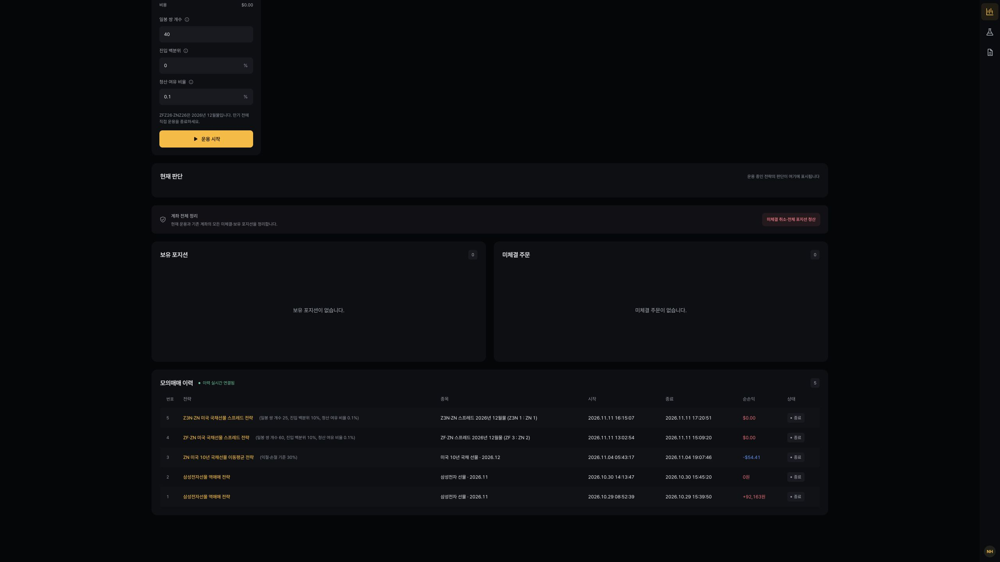 |
| 두 전략의 시작·종료 시각과 순손익 $0.00. 과거 2·3주차 이력도 화면에 함께 표시되며 이번 집계에는 포함하지 않음. |

| **그림 2. 5년물·10년물 판단 기록** |
|:---:|
| 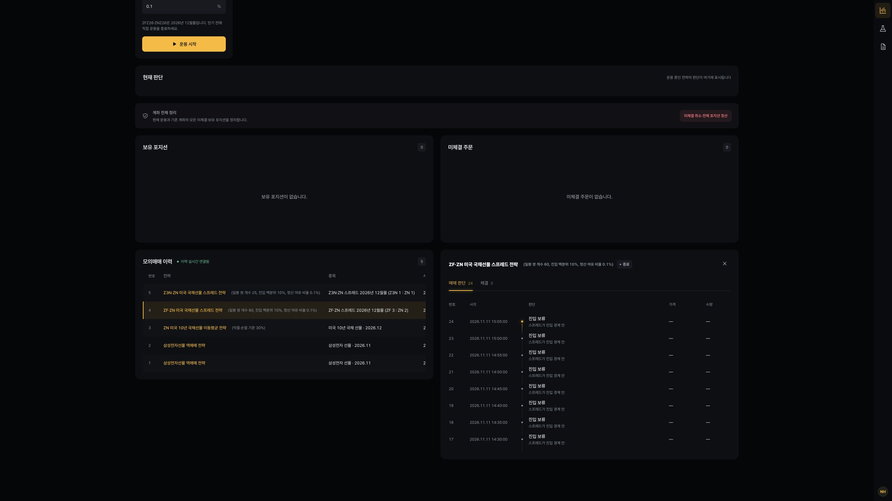 |
| 일봉 60개·진입 10%·청산 여유 0.1%. 판단 24건, 체결 0건. 스프레드가 진입 경계 안에 있어 진입 보류. |

| **그림 3. 3년물·10년물 판단 기록** |
|:---:|
| 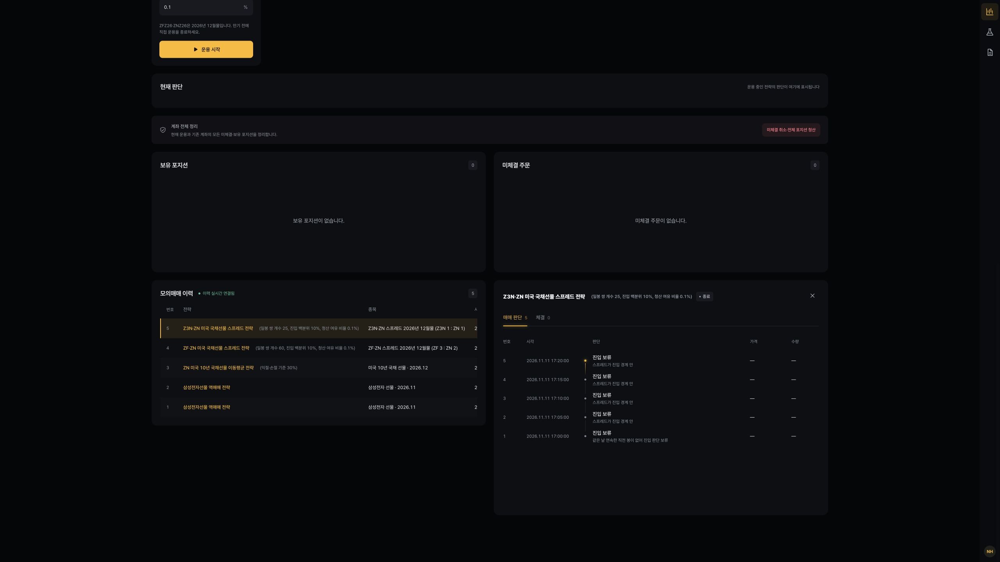 |
| 일봉 25개·진입 10%·청산 여유 0.1%. 판단 5건 중 첫 판단은 연속 봉 부족, 나머지는 진입 경계 안. |

| **그림 4. 3년물·10년물 체결 기록** |
|:---:|
| 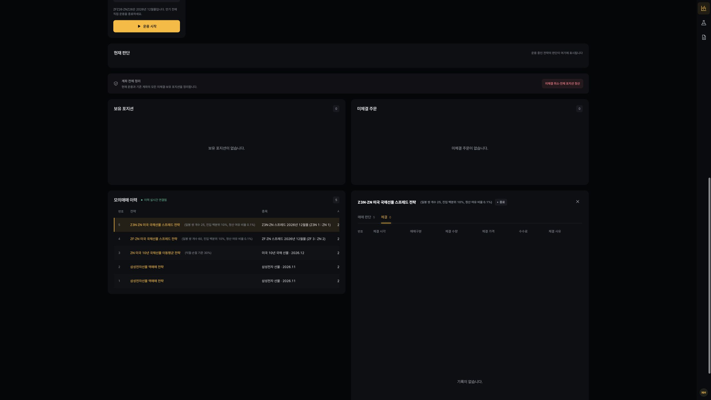 |
| 체결 탭 0건. 운용 종료 표시를 주문·체결 성공으로 해석하지 않음. |

### 6-2. 백테스트 (프로그램 내부 시뮬레이션)

근거: [ZF·ZN 40개](results/week04_zf_zn_spread/backtest/20261112_124437/), [ZF·ZN 60개](results/week04_zf_zn_spread/backtest/20261112_124551/), [Z3N·ZN 25개](results/week04_z3n_zn_spread/backtest/20261112_124806/). 각 폴더의 `meta.json`·`result.json`·`journal/`을 함께 보존.

**설정별 성과**

| 전략·일봉 개수 | 기간 | 총손익 | 수수료 | 순손익 | 수익률 | 거래(승/패) | 최대 낙폭 |
| --- | --- | --- | --- | --- | --- | --- | --- |
| ZF·ZN 40개 | 08-11~11-11 | +$23.44 | $358.31 | −$334.87 | −0.33% | 4(0/4) | $1,390.09(1.39%) |
| ZF·ZN 60개 | 08-11~11-11 | +$507.81 | $179.16 | +$328.66 | +0.33% | 2(2/0) | $1,152.08(1.15%) |
| Z3N·ZN 25개 | 09-09~11-11 | +$46.88 | $211.80 | −$164.92 | −0.16% | 4(1/3) | $662.32(0.66%) |

모두 2026년, 초기자금 $100,000, 진입 백분위 0%, 청산 여유 0.1%. 총손익은 **슬리피지 반영 후·수수료 차감 전**, 순손익은 수수료까지 차감한 값. 반올림 전 값으로 계산하므로 표의 반올림 금액끼리 빼면 1센트 차이가 날 수 있음.

기록 건수: ZF·ZN 40개는 판단 17,675·체결 8·거래 4건, 60개는 판단 17,675·체결 4·거래 2건. Z3N·ZN은 판단 9,183·체결 8·거래 4건. 여기서 체결 수량 1은 **스프레드 한 세트**이며 개별 상품 한 계약과 다름.

**거래별 결과**

아래 진입·청산가는 슬리피지가 반영된 합성 스프레드 가격. 모든 거래는 1세트이며 시각은 KST. 상세 원본은 [trades.csv](results/summary/trades.csv).

| 전략·일봉 | 진입 시각 | 청산 시각 | 방향 | 진입가 | 청산가 | 총손익 | 수수료 | 순손익 |
| --- | --- | --- | --- | --- | --- | --- | --- | --- |
| ZF·ZN 40 | 08-11 00:45 | 08-20 01:50 | 매도 | 102.0234375 | 102.0078125 | +$15.62 | $89.58 | −$73.95 |
| ZF·ZN 40 | 08-28 23:45 | 08-31 22:55 | 매수 | 101.7031250 | 101.7812500 | +$78.12 | $89.58 | −$11.45 |
| ZF·ZN 40 | 09-02 05:20 | 09-03 21:55 | 매수 | 101.7343750 | 101.7578125 | +$23.44 | $89.58 | −$66.14 |
| ZF·ZN 40 | 09-04 21:35 | 10-01 21:55 | 매수 | 101.6718750 | 101.5781250 | −$93.75 | $89.58 | −$183.33 |
| ZF·ZN 60 | 08-18 03:25 | 08-19 23:40 | 매도 | 102.3828125 | 102.0312500 | +$351.56 | $89.58 | +$261.98 |
| ZF·ZN 60 | 09-11 02:00 | 10-01 22:50 | 매수 | 101.5234375 | 101.6796875 | +$156.25 | $89.58 | +$66.67 |
| Z3N·ZN 25 | 09-30 03:20 | 09-30 16:15 | 매도 | 100.3046875 | 100.2968750 | +$7.81 | $52.95 | −$45.14 |
| Z3N·ZN 25 | 09-30 21:35 | 10-15 03:20 | 매도 | 100.3359375 | 100.3437500 | −$7.81 | $52.95 | −$60.76 |
| Z3N·ZN 25 | 10-29 02:00 | 11-06 03:10 | 매수 | 99.9453125 | 100.0546875 | +$109.38 | $52.95 | +$56.43 |
| Z3N·ZN 25 | 11-10 18:10 | 11-12 00:00 | 매수 | 99.9062500 | 99.8437500 | −$62.50 | $52.95 | −$115.45 |

ZF·ZN 6건은 모두 청산 경계 도달로 정리. Z3N·ZN은 3건이 청산 경계 도달, 마지막 1건이 **백테스트 종료 청산**. 입력 종료일은 11월 11일이지만 마지막 기록 시각은 다음 날 00:00이며, 표에는 원본 시각을 그대로 적음.

**실행 화면**

왼쪽 테스트 조건의 날짜는 캡처 시점의 새 실행 입력값(11-05~11-11)이며, 이미 저장된 결과의 기간은 오른쪽 결과 제목과 실행 이력의 기간을 기준으로 함. 캡처를 위해 새 백테스트를 실행하지 않았음.

| **그림 5. 5년물·10년물 기본값 결과** |
|:---:|
| 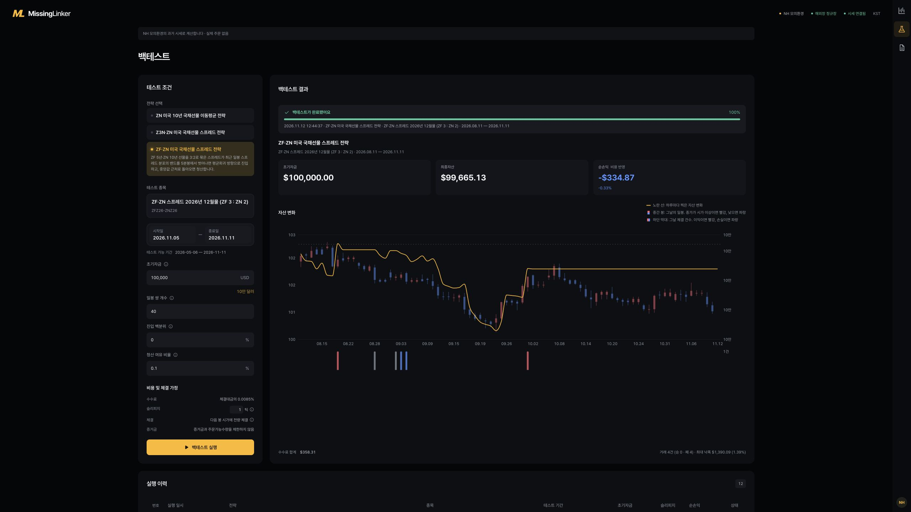 |
| 일봉 40개, 최종자산 $99,665.13, 순손익 −$334.87. 거래 4건 모두 비용 차감 후 손실. |

| **그림 6. 5년물·10년물 60개 결과** |
|:---:|
| 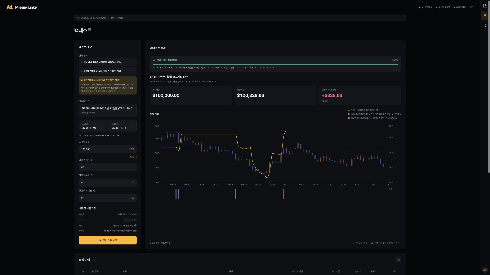 |
| 최종자산 $100,328.66, 순손익 +$328.66. 거래 2건, 최대 낙폭 $1,152.08(1.15%). |

| **그림 7. 3년물·10년물 25개 결과** |
|:---:|
| 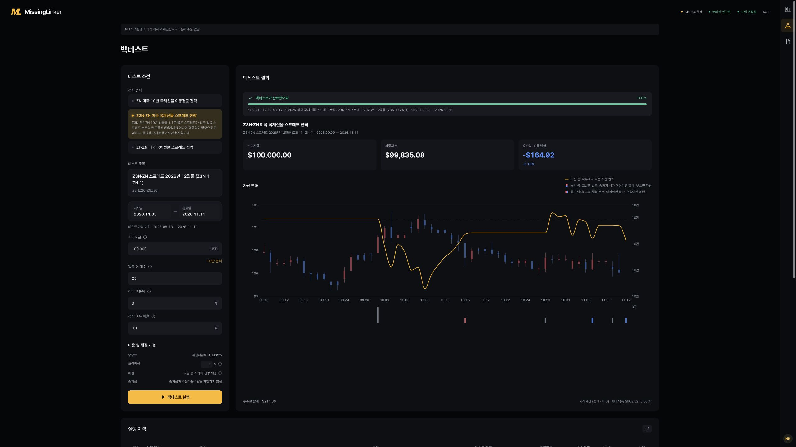 |
| 최종자산 $99,835.08, 순손익 −$164.92. 거래 4건(1승 3패), 수수료 $211.80. |

| **그림 8. 3년물·10년물 시뮬레이션 체결** |
|:---:|
| 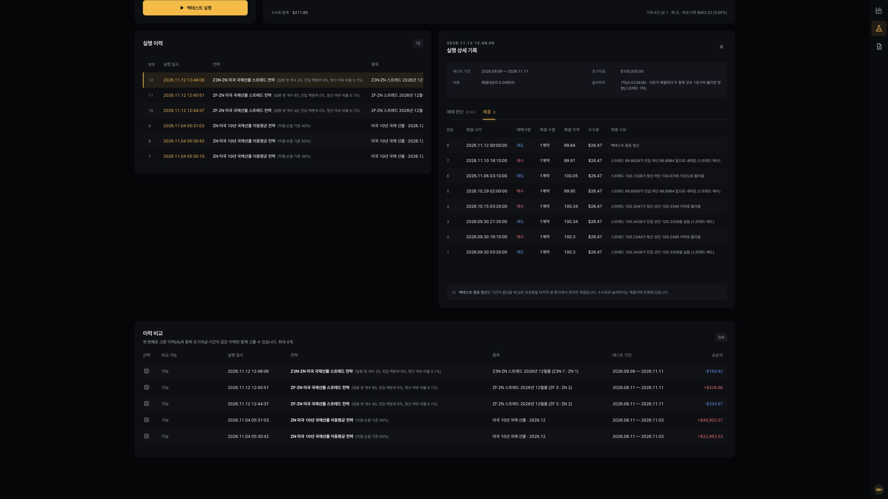 |
| 체결 8건. 마지막 체결은 11월 12일 00:00의 백테스트 종료 청산. 화면의 1계약은 합성 종목 1세트로 기록된 수량. |

### 6-3. 파라미터 탐색과 분석 보고서

근거: [ZF·ZN 탐색 원본](results/sweeps/week04_zf_zn_spread/), [Z3N·ZN 탐색 원본](results/sweeps/week04_z3n_zn_spread/), [기존 분석 보고서·비교표](results/analysis/). 기존 분석은 2026-11-11 기준이며, 위 11월 12일 실행과 별도 자료.

| 항목 | 5년물·10년물 | 3년물·10년물 |
| --- | --- | --- |
| 전체 기간 | 2026-08-11~11-10 | 2026-09-01~11-10 |
| 구간1 | 08-11~09-15 | 09-01~09-21 |
| 구간2 | 09-16~10-13 | 09-22~10-12 |
| 구간3 | 10-14~11-10 | 10-13~11-10 |
| 조합 / 결과 수 | 28조합 × 4기간 = 112건 | 14조합 × 4기간 = 56건 |
| 공통 비용·자금 | 슬리피지 1틱, 수수료 0.0085%, $100,000 | 동일 |

전체 기간과 세 구간은 각각 포지션 없이 시작하는 독립 실행. 구간별 손익을 더해도 전체 손익과 같지 않음. 같은 자료에서 설정을 여러 번 고른 결과이므로, 미래 구간에 대한 별도 검증으로 보지 않음.

**주요 조합 비교** — 설정은 `일봉 쌍 개수 / 진입 백분위 / 청산 여유 비율` 순서. 정확한 조합 식별자는 `results.jsonl`의 `id`와 비교표에서 확인.

| 전략 | 설정 | 전체 순손익 | 거래 수 | 해석 |
| --- | --- | --- | --- | --- |
| ZF·ZN | 10 / 0% / 0.1% | −$10,988.96 | 57 | 짧은 관찰 기간에서 잦은 거래·비용 누적 |
| ZF·ZN | 40 / 0% / 0.1% | −$334.89 | 4 | 현재 기본값의 탐색 결과 |
| ZF·ZN | 60 / 0% / 0.1% | +$328.65 | 2 | 기존 분석 보고서가 고른 후보 |
| ZF·ZN | 60 / 0% / 0% | +$477.09 | 2 | 위 후보보다 전체 순손익이 높지만 표본은 동일하게 적음 |
| Z3N·ZN | 5 / 0% / 0.1% | −$4,358.69 | 47 | 짧은 관찰 기간에서도 수익성 개선으로 이어지지 않음 |
| Z3N·ZN | 25 / 0% / 0.1% | +$188.07 | 5 | 현재 기본값의 탐색 결과 |
| Z3N·ZN | 25 / 0% / 0% | +$537.96 | 4 | 기존 분석 보고서가 고른 후보 |
| Z3N·ZN | 40 / 0% / 0.1% | $0.00 | 0 | 탐색 당시 기본값. 거래 없어 성과 판단 불가 |

**기간별 확인:** ZF·ZN `60 / 0% / 0.1%`의 구간별 순손익은 −$124.48 / +$293.23 / $0.00. Z3N·ZN `25 / 0% / 0%`는 $0.00 / +$136.17 / +$58.04. 양수 전체 결과만 보고 기간별로 일관된 전략이라고 판단하기 어려움.

**기존 분석과 최신 실행의 차이:** Z3N·ZN `25 / 0% / 0.1%`는 탐색에서 +$188.07(5건)이었으나 최신 실행은 −$164.92(4건). 시작·종료일이 다르고 일봉·분봉 입력과 진입 기록도 달라 동일 조건의 재현 결과가 아님. 탐색에 있던 9월 22일 수익 거래가 최신 실행에는 없으며, 최신 판단에는 연속 봉 부족이 기록됨. 기간 차이 하나만으로 손익 차이의 원인을 단정하지 않음.

ZF·ZN 기존 분석 화면에는 60개·청산 0.1%를 “가장 나았다”라고 쓴 표현이 있으나, 원본 비교표에는 청산 0%의 순손익이 더 높음. 여기서는 **기존 분석이 고른 후보**로 표현하고, 최고 순손익과 구분함. 원본 분석 사본과 캡처는 수정하지 않고 보존.

| **그림 9. 5년물·10년물 분석 요약** |
|:---:|
| 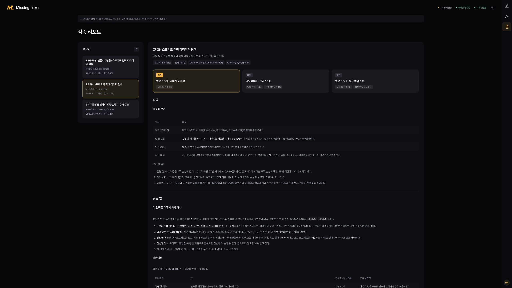 |
| 탐색 112건. 추천 후보도 전체 거래가 2건뿐이라 기존 분석의 신뢰 수준은 낮음. “가장 나았다” 표현은 위 원본 비교표 대조 설명 참고. |

| **그림 10. 5년물·10년물 후보 비교** |
|:---:|
| 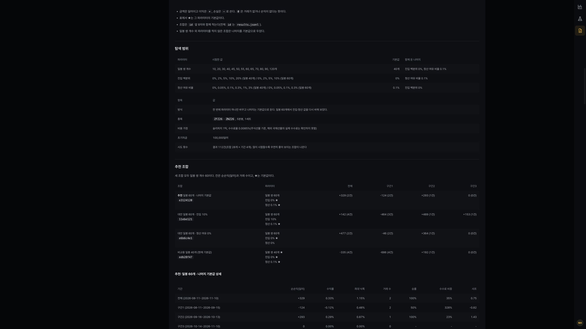 |
| 일봉 60개에서 진입·청산 조건을 바꾼 후보와 일봉 40개 기본값 비교. 구간별 손익 부호가 다름. |

| **그림 11. 3년물·10년물 분석 요약** |
|:---:|
| 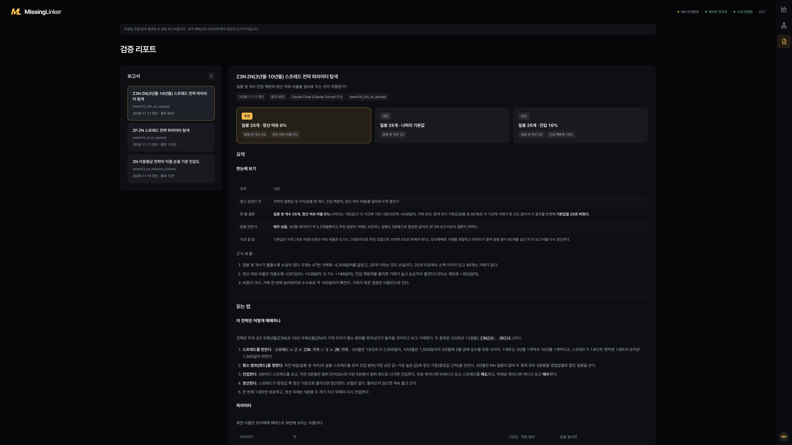 |
| 탐색 56건. 일봉 25개·청산 여유 0% 후보와 데이터·거래 표본 부족을 함께 설명. |

| **그림 12. 3년물·10년물 후보 비교** |
|:---:|
| 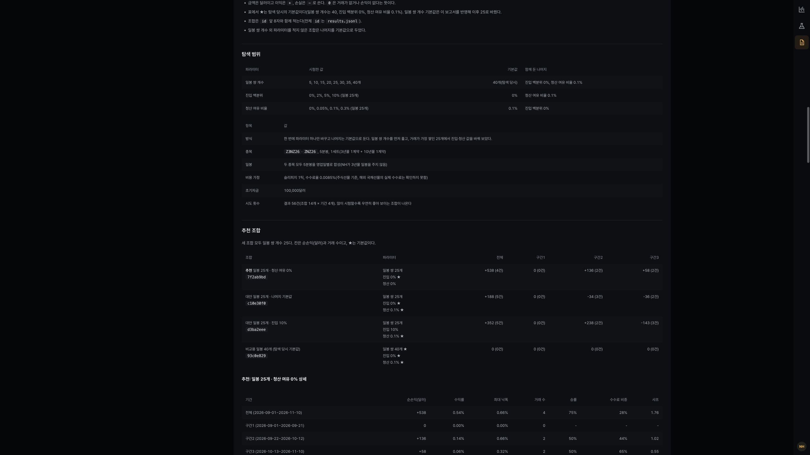 |
| 일봉 25개에서 청산 여유와 진입 백분위를 바꿔 비교. 화면의 양수 탐색 결과는 최신 백테스트 −$164.92와 다른 실행 자료. |

## 7. 해석과 한계

### 7-1. 손익 원인

**모의매매 (2026-11-11, 두 실행 모두 순손익 $0.00)**

- **5년물·10년물:** 판단 시 스프레드 범위는 101.0390625~101.09375, 진입 하단·상단은 101.0015625~101.90703125. 경계 밖으로 벗어나지 않아 주문하지 않음.
- **3년물·10년물:** 스프레드 범위는 99.953125~99.984375, 진입 하단·상단은 99.953125~100.5484375. 하단과 같은 값은 있었지만 진입은 하단 **미만**이어야 하므로 조건 미충족.
- **해석:** $0.00은 손실을 억제한 매매 성과라기보다 거래가 발생하지 않은 결과. 짧은 운용 동안 신호를 기다리는 동작은 확인했으나 체결·청산·원상복구 검증은 남아 있음.

**백테스트 — 스프레드 변화와 거래비용**

| 전략·일봉 | 슬리피지 차감 전 손익 | 슬리피지 영향 | 총손익(슬리피지 반영) | 수수료 | 순손익 |
| --- | --- | --- | --- | --- | --- |
| ZF·ZN 40개 | +$460.94 | $437.50 | +$23.44 | $358.31 | −$334.87 |
| ZF·ZN 60개 | +$726.56 | $218.75 | +$507.81 | $179.16 | +$328.66 |
| Z3N·ZN 25개 | +$234.38 | $187.50 | +$46.88 | $211.80 | −$164.92 |

근거: [비용 분해](results/summary/cost-summary.csv). 슬리피지 영향은 각 체결의 `수량 × 슬리피지 틱 수 × 스프레드 틱 크기 × 승수` 합계. 차감 전 손익은 저장된 총손익에 이 금액을 더한 계산값이며, 슬리피지 0틱으로 새로 실행한 결과가 아님.

- **5년물·10년물 40개:** 4건 중 3건은 총손익이 양수였지만 모두 왕복 수수료보다 작았음. 마지막 매수는 약 27.01일 보유한 뒤 진입가보다 낮은 가격에서 청산해 −$183.33. 중앙값 복귀만으로 이익을 보장하지 못함.
- **5년물·10년물 60개:** 40개보다 거래 수가 줄어 비용 부담이 작았고, 두 거래의 총손익도 수수료를 넘음. 다만 두 번째 매수는 약 20.87일 보유했으며 최대 낙폭 $1,152.08이 최종 이익보다 큼. 승률 100%라도 충분히 검증된 결과는 아님.
- **3년물·10년물 25개:** 10월 29일 매수는 +$56.43이었지만 다른 3건의 손실을 만회하지 못함. 마지막 매수는 회귀 청산 전에 기간이 끝나 −$115.45로 정리. 일봉 부족 1,788건·연속 봉 부족 679건으로 판단 기회도 제한됨.
- **탐색 결과:** 일봉 개수를 줄여 거래를 늘린 조합은 오히려 손실이 커졌음. 5년물·10년물 10개는 57건, 3년물·10년물 5개는 47건으로 거래가 늘었지만 비용 차감 후 성과는 악화. 거래 기회를 늘리는 것과 수익 기회를 늘리는 것은 다름.

### 7-2. 전략의 한계

- **검증 기간의 제약** : 구현과 분석을 단순화하기 위해 월물 교체 없이 동일한 12월물만 사용했다. 이 때문에 두 종목의 거래 자료가 함께 확보되는 기간으로 검증 범위가 제한되었다. 또한 밴드를 구성하려면 먼저 충분한 일봉 쌍을 확보해야 한다. 5년물·10년물 기본값은 40개, 3년물·10년물 현재 기본값은 25개이며, 자료가 부족한 구간에서는 판단을 보류한다. 이번 5년물·10년물 실행은 시작 전 일봉을 확보해 판단했지만, 3년물·10년물 실행에서는 일봉 부족으로 1,788번 판단을 보류했다.

  이러한 조건에서는 금리 상승이나 하락이 장기간 이어지는 상황과, 그 흐름이 전환되는 상황을 충분히 살펴보기 어렵다. 따라서 이번 결과만으로는 회귀가 지연될 때 어느 정도의 손실과 보유 기간을 감수해야 하는지 판단하기 어렵다.

- **거래비용을 감당하기 어려움** : 두 종목을 함께 거래할 때 발생하는 슬리피지를 줄이고자 유동성을 중요하게 고려했고, 기존에 거래하던 10년물의 짝으로 5년물을 선택했다. 그러나 거래가 활발한 조합이라는 점만으로 비용을 차감한 뒤에도 충분한 수익을 얻을 수 있는 것은 아니었다.

  이번 테스트에서는 진입부터 청산까지의 유리한 변화 폭이 작아 수수료와 슬리피지를 감당하기 어려운 경우가 나타났다. 두 상품의 공통적인 움직임을 상쇄한 뒤 남는 차이가 거래비용을 넘을 만큼 충분한지, 장단기 금리차의 변화를 활용하려는 목적에 5년물·10년물 조합이 적절한지 추가 검토가 필요하다.

- **적은 거래 건수로 인한 검증 부족** : 검증 기간이 짧고 밴드의 양 끝을 벗어날 때만 진입하다 보니, 성과를 평가할 수 있는 거래 건수가 충분하지 않았다. 표본이 적으면 특정 거래 한두 건의 결과가 전체 손익을 크게 좌우하므로, 수익률이나 승률만으로 전략의 효과를 판단하기 어렵다.

- **손절과 보유 기간 제한의 부재** : 중앙값으로 돌아오지 않으면 손실을 보유할 수 있다. 또한 중앙값 자체가 매일 바뀌므로, 진입 당시 기대했던 가격이 아닌 곳에서 청산될 수 있다. 이번에도 장기간 기다린 뒤 손실로 끝난 거래가 있었다.

- **모의체결과 데이터의 제약** : 백테스트는 두 상품이 정해진 가격에 함께 체결된다고 가정한다. 실제 두 상품의 체결 시차·부분체결·취소 지연을 반영하지 않으며, 이번 모의매매에는 이를 확인할 체결이 없었다. 3년물은 일봉을 합성해야 하고 5분봉도 비어 있는 구간이 있어, 같은 규칙을 적용해도 판단 기회가 다르다.

- **합성 일봉의 미래 정보 포함 가능성** : `series.py`는 07시부터 다음 날 07시 전까지의 분봉을 앞 날짜의 일봉으로 묶지만, `inputs.py`는 일봉 날짜가 판단 날짜보다 앞서는지만 확인한다. 따라서 새벽 시간대 백테스트에서 당시에는 아직 완성되지 않았을 일봉을 사용할 가능성이 있다. 이는 코드 검토에서 확인한 제약이며, 해당 실행의 영향 크기는 확인하지 못했다. 3년물 결과는 저장된 실행 결과로 기록하되, 미래 정보를 배제한 성과로 확정하지 않는다.

- **비용·자금 가정의 제약** : 수수료는 해외 국채선물 실제 비용이 아닌 추정값이고, 백테스트는 증거금·주문가능수량을 제한하지 않는다. 초기자금 $100,000에 한 세트만 운용한 결과이므로 낮은 낙폭 비율만으로 전략이 안전하다고 보기도 어렵다.

### 7-3. 예상과 다른 점

두 국채선물을 반대 방향으로 함께 보유하면 공통적인 가격 움직임을 줄이면서 상대적인 변화에서 이익을 얻을 수 있을 것으로 보았다. 실제로 청산 기준으로 돌아오는 거래는 있었지만, 움직임의 크기가 거래비용을 넘지 못하는 경우가 많았다. 스프레드 회귀 여부와 비용 차감 후 수익 여부를 따로 확인해야 한다는 점을 알게 되었다.

관찰 기간을 짧게 하면 단기 회귀를 더 많이 포착할 수 있을 것으로 생각했으나, 기존 탐색에서는 거래 증가가 비용과 손실의 증가로 이어졌다. 3년물·10년물도 기존 탐색에서는 양수 후보가 있었지만 최신 실행은 손실이었다. 종목이나 설정을 바꾼 한 번의 좋은 결과만으로 개선을 판단하기 어렵다는 점을 확인했다.

모의매매에서는 두 상품의 주문과 청산까지 관찰하고자 했으나, 운용 중 신호가 발생하지 않아 판단 기록만 남았다. 다음에는 운용 시간을 충분히 확보하고 실제 체결 여부와 체결 비용을 함께 확인할 필요가 있다.

## 8. 향후 계획

현재 전략과 검증 과정에서 개선할 수 있다고 생각한 4가지.

### 8-1. 3년물·10년물과 관찰 기간 비교 보강

- **현재:** 5년물·10년물에서 확인한 한계를 바탕으로 3년물·10년물 조합과 짧은 관찰 기간까지 비교함. 다만 두 전략의 데이터 기간과 일봉 생성 방식이 달라 직접적인 우열 판단에는 제약이 있음.
- **개선 방향:** 같은 기간·비용·자금 기준으로 두 조합을 비교하고, 40거래일보다 짧은 관찰 기간이 단기 회귀를 포착하는지 추가 확인. 이미 탐색한 자료와 이후에 쌓일 검증 자료를 분리.
- **생각한 이유:** 종목이나 기간을 바꾸는 것만으로 성과가 개선된다고 단정할 수는 없음. 실제 거래 가능성과 거래비용을 함께 고려하고 충분한 거래 표본을 확보해 비교할 필요가 있음.

### 8-2. 실제 체결 비용 확인

- **현재:** 백테스트는 두 상품 각각 1호가의 슬리피지와 수수료율 0.0085%를 가정. 모의매매 두 건은 체결이 없어 비용 비교가 불가능했음.
- **개선 방향:** 모의계좌에서 두 종목의 신호 시각·주문 접수·체결 시각·가격·실제 수수료를 기록하고, 같은 시점의 시뮬레이션과 대조. 한쪽만 체결될 때 취소·원상복구까지 확인.
- **생각한 이유:** 이번 결과에서는 거래비용이 작은 회귀 이익을 대부분 상쇄했음. 체결 비용과 두 상품 체결 시차가 실제로 어느 정도인지 먼저 확인해야 함.

### 8-3. 손실과 보유 기간 제한 검토

- **현재:** 별도 손절과 보유 기간 제한 없이 중앙값 복귀를 기다림. 종료 시각 지정·만기 자동 청산도 없음.
- **개선 방향:** 합산 손실 한도, 최대 보유 기간, 만기 전 종료 기준을 각각 둔 경우의 손익·낙폭·회귀 기회 손실을 비교.
- **생각한 이유:** 스프레드가 과거 범위를 벗어났다는 이유만으로 돌아온다고 볼 수 없음. 오래 보유하다 손실로 청산된 거래가 있어, 기다리는 시간과 손실의 크기를 함께 제한할 필요를 느낌.

### 8-4. 데이터와 실행 기준 맞추기

- **현재:** 3년물 일봉은 5분봉으로 합성하고, 장중 연속 봉 판정과 합성 일봉의 날짜 기준이 다름. 기존 탐색과 최신 백테스트의 입력 자료도 완전히 같지 않음.
- **개선 방향:** 원본 일봉·분봉과 조회 시점을 함께 고정해 보존하고, 두 종목의 세션 경계와 누락 봉을 대조. 합성 일봉의 종료 시각이 판단 시각보다 앞선 경우에만 사용하도록 확인한 뒤, 같은 입력 자료로 탐색 후보를 다시 검증하고 이후 기간으로 확인.
- **생각한 이유:** 파라미터 변경의 효과와 데이터 변경의 효과를 구분해야 결과를 설명할 수 있음. 자료가 없는 경우를 전략 성과가 나쁜 경우와 섞지 않고 기록할 필요가 있음.

**오류·문의:** 3년물 일봉 부재와 희소한 분봉은 코드 저장소의 확인 기록 및 이번 판단 보류 기록에 근거한 제약이다. API 명세 위반이나 운영진이 확인한 장애로 단정하지 않음. 이번 제출 자료에는 별도 오류 제보·운영진 답변 근거가 없어, 제보 완료로 기재하지 않음.
