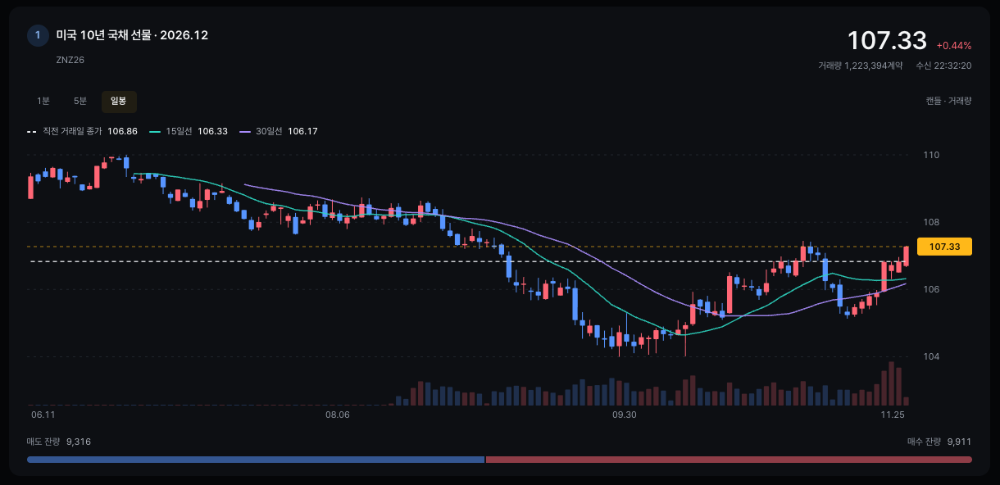
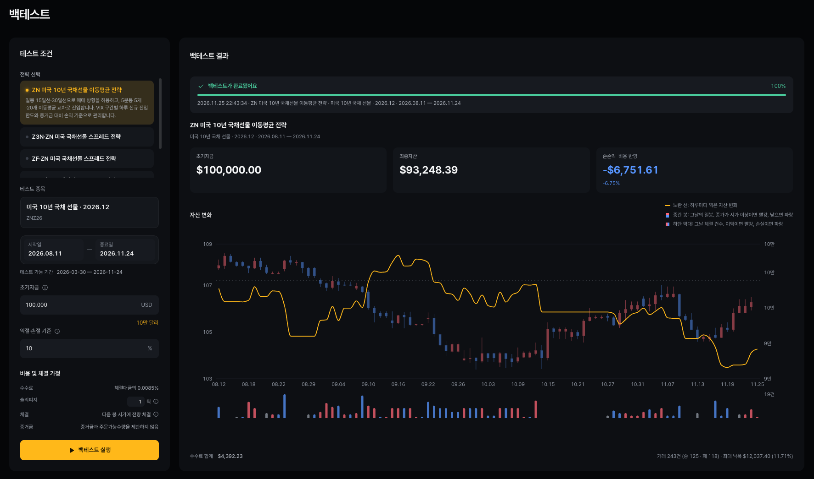
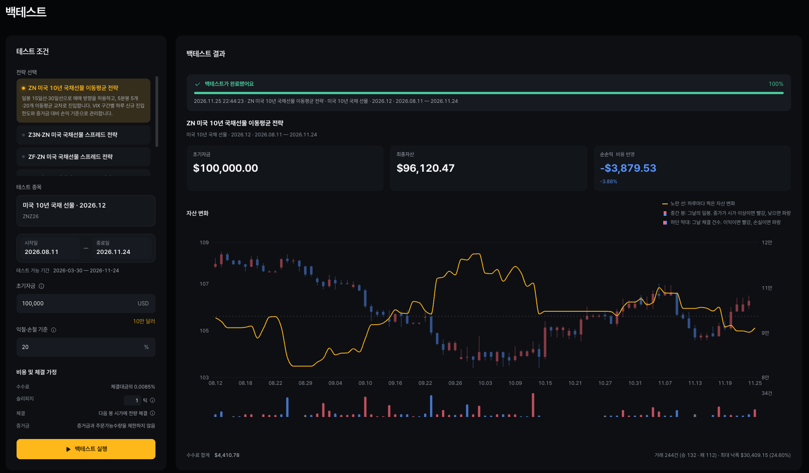
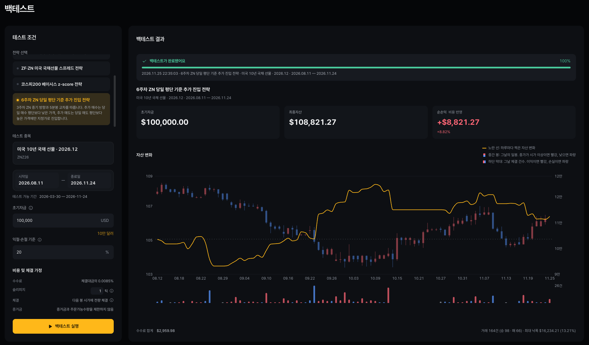
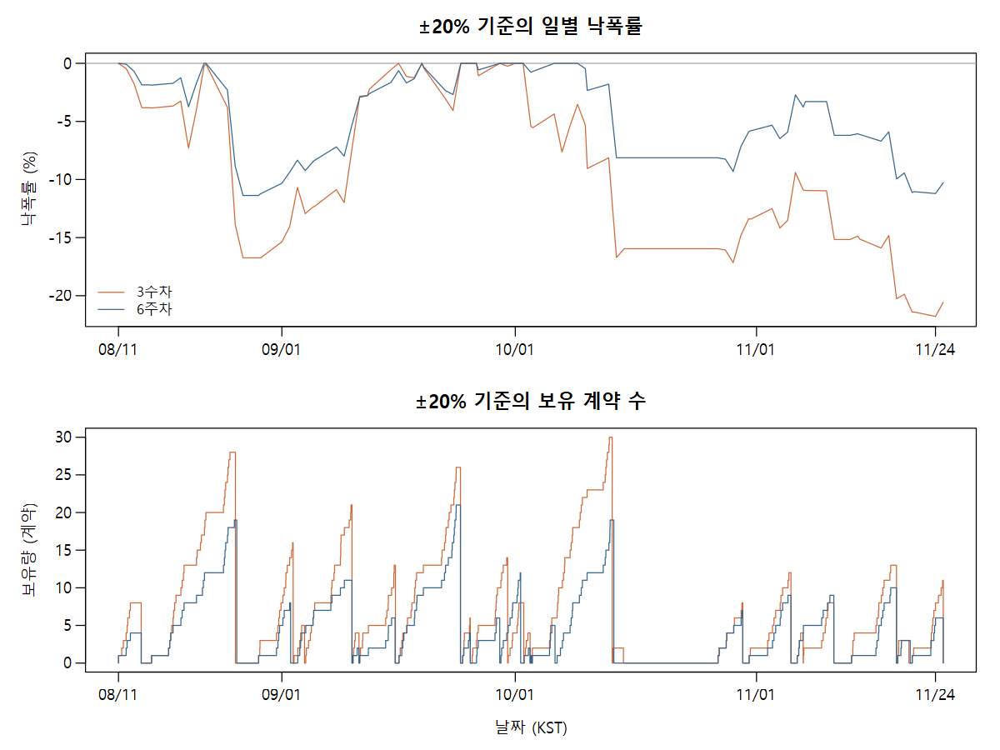
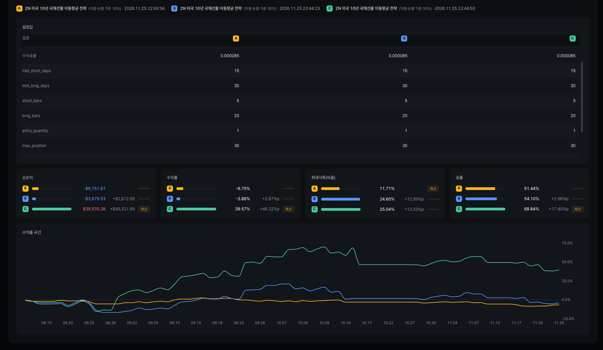
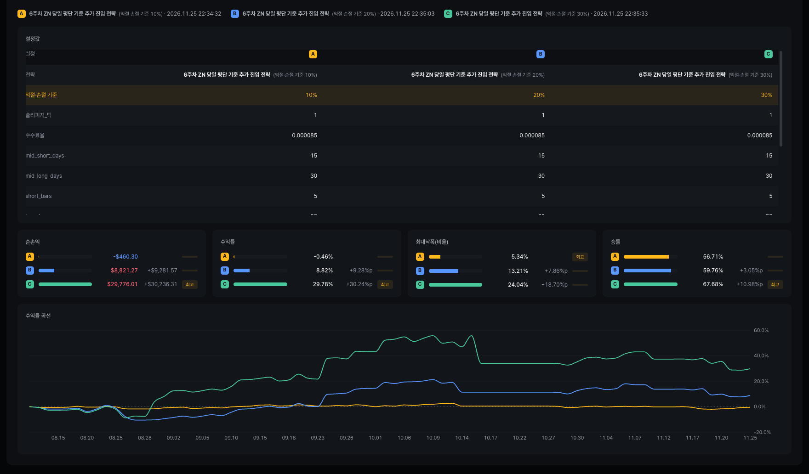
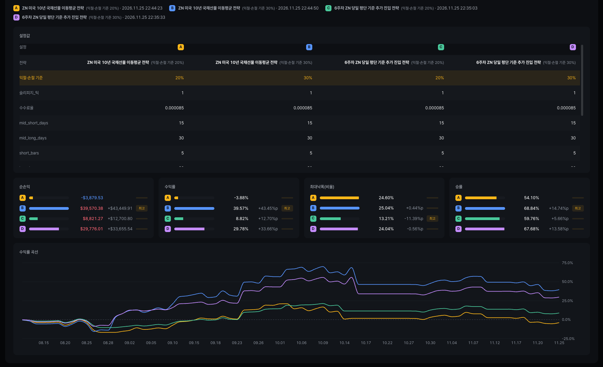

# 6주차 · 전략 + 위험관리 — 미싱링커

제출 마감 2026년 11월 27일(금) 23:59 KST

| 항목 | 내용 |
| --- | --- |
| 팀 | 미싱링커(Missing Linker), 07팀 · 양민수, 이한용 |
| 과제 기간 | 2026-11-21 ~ 2026-11-27 |
| 기존 전략 | [3주차 ZN 미국 10년 국채선물 이동평균 전략](../week03/README.md) |
| 개선 전략 | ZN 당일 평단 기준 추가 진입 전략 (`week06_zn_intraday_average_entry`) |
| 대상 상품 | CME 미국 10년 국채선물 2026년 12월물 `ZNZ26` |
| 검증 환경 | 과거 시세를 사용한 프로그램 내부 백테스트 6건, NH 해외 모의계좌 운용 1건 |
| 코드 | [코드 저장소 week6 브랜치](https://github.com/NH-Futures-Pioneer-1-Team07/pioneer-1st-code-team07/tree/week6) · 기준 커밋 [`871f037`](https://github.com/NH-Futures-Pioneer-1-Team07/pioneer-1st-code-team07/tree/871f03704d75dc89d22c37c36f85878745f495d1) |
| 작성일 | 2026-11-26 KST |

## 폴더 구성

| 경로 | 내용 |
| --- | --- |
| [README.md](README.md) | 6주차 보고서 |
| [.env.example](.env.example) | 해외 시세 조회와 백테스트 비용 설정 템플릿 |
| [results/](results/) | 백테스트 6건과 모의매매 1건의 원본 설정·결과·이벤트 로그, 비교 지표 CSV |
| [results/20261125_201115/](results/20261125_201115/) | 11월 25~26일 NH 해외 모의계좌 운용 원본 (`meta.json`·`result.json`·날짜별 `journal/`) |
| [results/figures/](results/figures/) | ±20% 낙폭·보유량 비교 그래프 |
| [summarize.py](summarize.py) | 원본에서 [비교 지표 CSV](results/summary.csv)를 재생성하는 집계 스크립트 |
| [screenshots/](screenshots/) | 백테스트 결과·비교 화면과 모니터링 항목 캡처 |

## 1. 과제 요약

### 1.1 공지의 필수 제출 항목

| 공지 항목 | 보고서 내용 |
| --- | --- |
| 1. 사용 전략 요약 | [3.1 6주차 전략 요약](#31-6주차-전략-요약)에서 대상 월물, 매매 방향, 진입·청산 흐름, 기반이 된 3주차 전략을 설명한다. |
| 2. 위험관리 규칙과 설정 근거 | [3.2 위험관리 규칙과 설정 근거](#32-위험관리-규칙과-설정-근거)에서 손절선, 분할 매수·분할 매도, 보유·손실 한도, 실시간 모니터링을 항목별로 설명한다. |
| 3. 위험관리 적용 전후 비교 | [6.1 손익 비교](#61-위험관리-전후-손익-비교)와 [6.2 위험 지표 비교](#62-같은-청산-기준의-위험-지표-비교)에서 동일 조건으로 실행한 백테스트 6건을 비교한다. |
| 4. 위험관리가 작동한 기록 | [6.3 위험관리 작동 기록](#63-위험관리-작동-기록)에서 손절·익절, 추가 매수·매도, 일일 진입 한도, 미체결 만료의 판단·주문·체결 근거를 확인한다. |
| 실제 모의매매 실행 결과 | [6.4 모의매매 실행 기록](#64-모의매매-실행-기록)에서 NH 해외 모의계좌의 진입 체결과 미완료 청산 기록을 확인한다. |

### 1.2 수행 배경과 핵심 결과

중간발표에서 3주차 전략의 증거금 대비 ±30% 전량 청산 기준이 넓다는 피드백을 받았다. 보유량이 커질수록 같은 비율에서도 청산 기준에 해당하는 손실액이 커진다. 장중 신호가 반복될 때 매수 단가가 높아지거나 매도 단가가 낮아져도 계속 진입하는 구조가 이 위험을 키울 수 있다고 보았다.

6주차에는 당일 체결 평단보다 유리한 가격에서만 1계약씩 추가하도록 바꾸고, 기존 ±30%와 더 좁은 ±20%, ±10%를 시험했다. 두 전략을 같은 종목·기간·비용으로 다시 실행해 총 6건을 비교했다. 손익과 함께 최대 낙폭, 일별 하방 변동성, 최저 일간 수익률, 최대 동시 보유량, 증거금 차감 가정 잔액을 확인했다.

같은 청산 기준끼리 비교하면 최대 낙폭과 최대 보유량은 세 기준에서 모두 감소했다. ±20%에서는 최대 낙폭이 24.60%에서 13.21%로, 최대 동시 보유량이 30계약에서 21계약으로 줄었고 순손익은 −\$3,879.53에서 +\$8,821.27로 바뀌었다. ±30%에서는 순손익이 감소하고 최저 일간 수익률도 악화됐다. 이 표본에서는 위험과 수익을 함께 고려해 ±20%를 후속 검증 후보로 골랐다.

실제 NH 해외 모의계좌에서도 한 차례 운용했다. 매수 1계약은 체결됐지만 종료 시 청산 체결을 확인하지 못해 실행 상태가 오류로 끝났다. 이 기록은 완료된 왕복 거래나 실현 손익으로 해석하지 않고, [6.4절](#64-모의매매-실행-기록)에서 주문·체결·종료 상태를 따로 설명한다.

## 2. 실행 방법

코드 저장소의 `week6` 브랜치에는 두 전략이 모두 들어 있다. Python 3.12 이상 환경 관리를 위한 `uv`와 Node.js 22.12 이상을 준비한다.

```bash
git clone --branch week6 https://github.com/NH-Futures-Pioneer-1-Team07/pioneer-1st-code-team07.git
cd pioneer-1st-code-team07
git checkout 871f03704d75dc89d22c37c36f85878745f495d1
cp backend/.env.example backend/.env
```

[설정 템플릿](.env.example)에 따라 로컬 `backend/.env`에 `TRADING_ENV=mock`, 해외 모의투자 APP Key와 Secret Key, 백테스트 수수료율 `0.000085`와 슬리피지 `1`틱을 설정한다. 인증정보는 로컬 파일에 보관한다.

두 터미널에서 백엔드와 프론트엔드를 각각 실행한다.

```bash
cd backend
uv sync --locked
uv run uvicorn app.main:create_app --factory --reload
```

```bash
cd frontend
npm ci
npm run dev
```

1. 브라우저에서 `http://127.0.0.1:5173`에 접속하고 백테스트를 연다.
2. ZN 미국 10년 국채선물 이동평균 전략 또는 6주차 ZN 당일 평단 기준 추가 진입 전략을 선택한다.
3. 종목 `ZNZ26`, 기간 `2026-08-11 ~ 2026-11-24`, 초기자금 `100,000 USD`, 슬리피지 `1틱`을 확인한다. 전략별 익절·손절 기준 입력칸에 `10`, `20`, `30`을 차례로 넣어 6회 실행한다.
4. 실행 이력에서 완료 상태와 결과를 확인한다. 코드 저장소의 `backend/runs/<전략 ID>/backtest/<실행 ID>/`에 설정, 결과, 일자별 로그가 저장된다.

제출 저장소에는 6건의 `meta.json`과 `result.json`을 그대로 보관했다. 원본 `journal/`은 실행별 `journal.tar.gz`에 담았다. 제출 저장소 루트에서 `python3 week06/summarize.py`를 실행하면, API 호출 없이 원본 로그와 결과로부터 [비교 지표 CSV](results/summary.csv)를 재생성할 수 있다.

## 3. 전략과 매매 계획

### 3.1 6주차 전략 요약

6주차는 [3주차 ZN 이동평균 전략](../week03/README.md)을 기반으로 CME 미국 10년 국채선물 2026년 12월물 `ZNZ26`을 거래한다. 일봉으로 매매 방향을 정하고, 완성된 5분봉의 교차로 진입 시점을 정한다. 같은 날 신호가 반복되면 당일 평단과 진입 한도를 확인한 뒤 1계약씩 추가한다.

| 단계 | 6주차 판단 |
| --- | --- |
| 중기 방향 | 직전 일봉 종가 > 15일 SMA > 30일 SMA이면 매수만 허용한다. 종가가 두 SMA보다 낮으면 매도만 허용한다. 그 외에는 중립으로 신규 진입을 보류한다. |
| 장중 진입 시점 | 완성된 5분봉의 5봉 SMA와 20봉 SMA가 교차하고, 교차봉 종가가 매수 시 두 선 위, 매도 시 두 선 아래에 있어야 한다. 교차 방향과 중기 방향이 일치할 때 진입을 검토한다. |
| 보유와 청산 | 중기 방향이 보유 포지션의 반대 방향으로 바뀌면 우선 전량 청산한다. 그 외에는 5분봉 마감마다 보유분의 평가손익률을 확인해 익절·손절 여부를 결정한다. |

### 3.2 위험관리 규칙과 설정 근거

#### 3.2.1 손절선과 익절선

5분봉 마감 시 보유분 전체의 미실현 손익 ÷ (계약당 기준 증거금 \$2,083 × 보유 계약 수)를 계산한다. 평가손익률이 −X% 이하이면 손절, +X% 이상이면 익절로 판단하고 보유분 전량을 시장가로 청산한다. 증거금으로 나누면 보유 계약 수가 달라져도 계약당 손실에 같은 기준을 적용할 수 있다.

6주차 전략의 기본값은 ±20%다. 기존 ±30%를 그대로 비교 기준에 두고, 양쪽 청산선을 10%p씩 좁힌 ±20%와 ±10%도 시험했다. 청산 기준을 좁혔을 때 낙폭이 얼마나 줄고 수익 기회와 비용이 어떻게 달라지는지 비교하기 위해 익절선과 손절선을 같은 폭으로 조정했다. [전량 청산 근거 로그](#63-위험관리-작동-기록)

#### 3.2.2 분할 매수와 분할 매도

신호당 1계약씩 진입해 여러 교차 신호에 수량을 나눈다. 아래의 분할 매수·분할 매도 규칙은 모두 매수·매도 포지션의 추가 진입에 적용하며, 청산 신호가 나오면 보유분 전체를 한 번에 정리한다.

| 구분 | 가격 조건 | 주문 |
| --- | --- | --- |
| 같은 방향의 당일 첫 진입 | 방향·교차·수량 한도 충족 | 시장가 1계약 |
| 추가 매수 | 교차봉 종가가 당일 매수 평단 미만 | 평단보다 낮은 호가 중 가장 높은 가격에 1계약 지정가 |
| 추가 매도 | 교차봉 종가가 당일 매도 평단 초과 | 평단보다 높은 호가 중 가장 낮은 가격에 1계약 지정가 |

당일 매수·매도 평단은 한국 시간 같은 날짜에 체결된 방향별 신규 진입가의 수량 가중평균이다. 당일 청산한 진입분의 신규 체결가도 포함한다. 전일 진입분, 청산 체결가, 미체결 수량은 계산에서 제외한다.

교차봉 종가와 지정가에 모두 평단 조건을 적용해, 신호가 나온 뒤 가격이 달라져도 추가 매수 단가는 낮추고 추가 매도 단가는 높이도록 했다. 추가 주문은 같은 한국 날짜의 바로 다음 5분봉에서만 유효하다. 다음 봉 마감과 자정 중 먼저 도래하는 시각에 주문을 만료시켜 추가 진입이 교차 직후의 기회에 한정되도록 한다. [추가 매수·매도 근거 로그](#63-위험관리-작동-기록)

#### 3.2.3 보유 한도와 손실 한도

| 항목 | 6주차 기준과 근거 |
| --- | --- |
| 전체 보유 한도 | 최대 30계약. 전일 이월분과 미체결 신규 주문 잔량을 합산해 예정 보유량을 제한한다. 3주차와 동일한 상한을 적용해 같은 한도에서 추가 진입 규칙의 영향을 비교했다. |
| 하루 신규 진입 한도 | 하루 1~5계약. 직전 VIX 관측일 종가와 매수·매도 방향에 따라 배정하고 한도 도달 시 해당 날짜의 신규 진입을 중지한다. 제출한 신규 주문의 계약 수를 세며, 청산이나 지정가 만료 후에도 사용량을 유지한다. 한국 시간 자정에 초기화한다. |
| 보유 포지션 손실 한도 | 손절선에 도달하면 보유분을 전량 정리한다. 손절 뒤에도 당일 진입 한도가 남으면 이후 교차에서 신규 진입할 수 있다. |

| 직전 VIX 종가 | 15 미만 | 15 이상 20 미만 | 20 이상 25 미만 | 25 이상 30 미만 | 30 이상 |
| --- | ---: | ---: | ---: | ---: | ---: |
| 매수 허용일 한도 | 1계약 | 2계약 | 3계약 | 4계약 | 5계약 |
| 매도 허용일 한도 | 5계약 | 4계약 | 3계약 | 2계약 | 1계약 |

주식시장의 불안이 높을수록 국채 선호가 강해질 수 있다는 3주차 가설에 따라 VIX가 높을 때 매수 한도를 늘리고 매도 한도를 줄였다. VIX를 확인할 수 없으면 신규 진입을 보류한다. [일일 한도 동작 근거 로그](#63-위험관리-작동-기록)

#### 3.2.4 실시간 모니터링

- 가격과 위험 상태 · 현재 판단 화면에서 일봉 방향, 5분봉 교차, 현재가와 당일 평단의 차이, 일일 진입 한도 사용량, 보유 계약 수, 증거금 대비 평가손익률을 확인한다. 가격이 바뀔 때 평단과의 거리를 살펴보고, 추가 진입과 손절은 각각 완성된 교차봉 종가와 5분봉 마감 평가손익률로 판정한다.
- 주문 상태와 대응 · 판단 사유, 주문 제출, 체결, 미체결을 확인한다. 미체결 신규 진입 주문이 있으면 새 진입을 보류해 주문이 겹치는 것을 막는다. 추가 지정가가 유효 시한까지 체결되지 않으면 취소한다.

모니터링 항목은 [4절의 화면 캡처](#4-사용-api와-구조)에서 확인할 수 있다. 자동 대응의 작동 근거는 6주차 백테스트의 [미체결 만료 로그](#63-위험관리-작동-기록)로 제시했다.

### 3.3 3주차 대비 변경한 부분

| 항목 | 3주차 중간발표 전략 | 6주차 전략 |
| --- | --- | --- |
| 추가 진입 | 방향·교차·수량 한도를 충족할 때마다 1계약 시장가 | 유리한 교차봉 종가와 체결가를 조건으로 1계약 지정가 |
| 추가 주문의 유효기간 | 해당 없음(시장가 즉시 진입) | 교차 직후 같은 날짜의 다음 5분봉까지 |
| 전량 청산 비율 | 발표안 ±30% | 기본값 ±20%. ±10·20·30%를 각각 실행해 같은 기준별 비교와 청산 기준을 좁힌 효과를 검토 |

## 4. 사용 API와 구조

| 사용처 | 인터페이스·구현 | 역할 |
| --- | --- | --- |
| 인증 | NH `POST /auth-service/v1/token` | 해외 시세 조회용 접근토큰 발급 |
| 과거 시세 | NH `POST /trade/v1/overseas/chart-minute`, `POST /trade/v1/overseas/chart-daily` | 5분봉 이력 및 중기 신호 계산용 일봉 조회. 분봉은 저장된 이력 재사용 가능 |
| VIX | FRED `VIXCLS` 일 종가 | 직전 관측일의 VIX를 공급. 실행 시 최신 값 조회, 실패 시 저장된 데이터 사용 |
| 백테스트 | 앱 `POST /api/backtests` · `backend/app/runners/backtest.py` | 전략 실행, 시가·장중 지정가 체결 모형, 장부 및 로그 집계 |
| 모의매매 | `backend/app/runners/paper.py`, `backend/app/nh/overseas/orders.py`, `backend/app/nh/overseas/account.py` | NH 해외 모의계좌 진입·청산 주문, 주문내역으로 접수·체결 확인 |
| 전략 | `backend/strategies/week03_zn_treasury_futures/`, `backend/strategies/week06_zn_intraday_average_entry/` | 6주차 전략이 3주차의 신호·청산 로직을 상속하고 신규 진입 판단을 확장 |

백테스트는 조회한 시세로 앱 내부에서 주문·체결·청산을 재현한다. 아래 캡처는 일봉 방향, 장중 교차, 현재가와 당일 평단의 차이, 판단 사유를 어떻게 표시하는지 보여준다. 평단 패널은 현재가와 평단을 수시로 비교하고, 전략은 완성된 교차봉 종가로 추가 진입을 판단한다.

<details>
<summary>모니터링 화면 · 일봉, 5분봉, 현재 판단, 평단, 판단 사유</summary>

일봉 · 직전 거래일 종가와 15·30일 이동평균선



5분봉 · 5·20봉 이동평균선과 장중 가격 흐름


현재 판단 · 일봉 방향, 장중 교차, 당일 평단 조건을 한 화면에서 확인


당일 평단 · 당일 평단과 현재가의 차이, 교차봉 종가 기준 안내


판단 사유 · 진입 보류 사유 확인


</details>

## 5. 실행 환경

### 5.1 백테스트 공통 조건

| 항목 | 공통 조건 |
| --- | --- |
| 실행 일시 | 2026-11-25 22:34~22:45 KST |
| 시세 범위 | 2026-08-11 ~ 2026-11-24 · KST 날짜 구간별 91개 관측일, 5분봉 20,484개 |
| 계약 사양 | `ZNZ26` · 승수 \$1,000/포인트 · 1틱 0.015625포인트(\$15.625/계약) |
| 초기자금과 거래 비용 | \$100,000 · 체결대금의 0.0085%를 체결 시마다 비용 가정으로 차감 · 슬리피지 1틱 |
| 시장가 체결 | 봉 마감에 나온 신호는 다음 봉 시가에 불리한 방향으로 1틱을 반영해 전량 체결. 당일 마지막 봉에서 나온 주문은 그 봉 종가에 반영 |
| 지정가 체결 | 다음 봉 시가가 지정가 조건을 충족하거나 모형의 봉 내부 가격 경로가 지정가에 닿으면 체결. 슬리피지가 지정가를 침범하지 않도록 제한 |
| 기간 종료 | 남은 포지션은 최종 봉 종가 기준으로 정리 |
| 자금 제약 | 전략의 진입·보유 한도 적용. 계좌 주문가능수량, 증거금 부족에 따른 강제청산은 모형에서 미적용 |

6건의 실행 원본에서 기간과 공통 설정, 91개 일봉, 20,484개 봉 마감 판단의 시각·이동평균·종가·VIX 입력이 일치함을 확인했다. 같은 청산 기준에서 6주차의 평단 조건과 이를 반영한 지정가 진입 방식이 진입 빈도와 체결 가격 양쪽에 어떤 영향을 주는지 비교했다.


### 5.2 모의매매 실행 환경

| 항목 | 내용 |
| --- | --- |
| 환경 | NH 해외 모의계좌 (`mode: paper`) |
| 전략·상품 | 6주차 ZN 당일 평단 기준 추가 진입 전략 · `ZNZ26` |
| 설정 | 증거금 대비 익절·손절 ±20%, 진입 1계약, 최대 보유 30계약 |
| 운용 시각 | 2026-11-25 20:11:15 ~ 2026-11-26 00:38:02 KST (약 4시간 26분 47초) |
| 종료 상태 | 오류 · 종료 확인 시간이 지나 완료되지 않음 |

원본: [실행 설정](results/20261125_201115/meta.json) · [최종 결과](results/20261125_201115/result.json) · [11월 25일 판단·주문·체결 로그](results/20261125_201115/journal/2026-11-25.jsonl) · [11월 26일 종료 로그](results/20261125_201115/journal/2026-11-26.jsonl) · [코드 저장소 원본](https://github.com/NH-Futures-Pioneer-1-Team07/pioneer-1st-code-team07/tree/week6/backend/runs/week06_zn_intraday_average_entry/paper/20261125_201115)

## 6. 실행 결과

### 6.1 위험관리 전후 손익 비교

같은 익절·손절 기준에서 당일 평단 기준 적용 전인 3주차와 적용 후인 6주차를 비교한다. 순손익은 수수료를 반영한 값이다. 거래 건수는 원본 결과의 `trade_count`로, 전량 청산에서 한 번에 정리한 여러 진입분이 각각 집계될 수 있다.

| 전략 | 익절·손절 | 순손익 | 수익률 | 거래 건수 | 수수료 | 원본 실행 |
| --- | ---: | ---: | ---: | ---: | ---: | --- |
| 3주차 | ±10% | −\$6,751.61 | −6.75% | 243 | \$4,392.23 | [224334](results/20261125_224334/) |
| 6주차 | ±10% | −\$460.30 | −0.46% | 164 | \$2,960.30 | [223432](results/20261125_223432/) |
| 3주차 | ±20% | −\$3,879.53 | −3.88% | 244 | \$4,410.78 | [224423](results/20261125_224423/) |
| 6주차 | ±20% | +\$8,821.27 | +8.82% | 164 | \$2,959.98 | [223503](results/20261125_223503/) |
| 3주차 | ±30% | +\$39,570.38 | +39.57% | 215 | \$3,882.74 | [224450](results/20261125_224450/) |
| 6주차 | ±30% | +\$29,776.01 | +29.78% | 164 | \$2,958.37 | [223533](results/20261125_223533/) |

<details>
<summary>6건 실행 상세 화면</summary>

±10% · [3주차](screenshots/week03-10.png) / [6주차](screenshots/week06-10.png)




±20% · [3주차](screenshots/week03-20.png) / [6주차](screenshots/week06-20.png)





±30% · [3주차](screenshots/week03-30.png) / [6주차](screenshots/week06-30.png)


</details>

### 6.2 같은 청산 기준의 위험 지표 비교

각 셀은 3주차 → 6주차 순이다.

| 청산 기준 | 최대 낙폭률 | 일별 하방 변동성 | 최저 일간 수익률 | 최대 동시 보유량 | 최저 증거금 차감 가정 잔액 |
| --- | ---: | ---: | ---: | ---: | ---: |
| ±10% | 11.71% → 5.34% | 0.71% → 0.43% | −3.03% → −2.11% | 15 → 8계약 | \$66,773 → \$85,519 |
| ±20% | 24.60% → 13.21% | 2.10% → 1.31% | −10.46% → −6.71% | 30 → 21계약 | \$31,454 → \$54,376 |
| ±30% | 25.04% → 24.04% | 2.32% → 1.95% | −13.22% → −13.96% | 30 → 27계약 | \$26,642 → \$52,017 |


- 최대 낙폭률은 5분봉 종가 기준 평가자산의 직전 최고점 대비 하락률 중 최댓값이다. 엔진은 기간 종료 강제 정리 후의 평가자산을 마지막으로 반영한다.
- 일별 하방 변동성은 일별 평가자산 수익률 중 양수 값을 0으로 놓고 전체 관측일에 대해 계산한 제곱평균제곱근이다. 첫날 기준 자산은 초기자금이다. 최저 일간 수익률은 같은 일별 평가자산 수익률 시계열의 최솟값이다.
- 최대 동시 보유량은 체결 로그의 순포지션을 시간 순서대로 복원해 구했다. 최저 증거금 차감 가정 잔액은 5분봉 판단 시점의 평가자산(비용 차감)에서 보유량 × \$1,875를 뺀 값의 최솟값이다. 같은 계약당 금액을 가정했을 때 남는 여유를 비교한 값으로, 실제 NH 계좌의 유지증거금·주문가능금액과는 다른 지표다. 청산 판단에는 매니페스트의 계약당 \$2,083을 사용한다.

<a href="results/figures/6-2-drawdown-position.png"></a>

*그림 1. 위는 일별 평가자산 기준 낙폭률, 아래는 체결 로그로 복원한 순보유 계약 수의 절댓값.*

### 6.3 위험관리 작동 기록

6주차 ±20%의 시뮬레이션 로그에서 판단(`decision`), 주문(`order`), 체결(`fill`), 거래 확정(`trade`)을 대조했다. 시각은 KST이며, 표의 행 번호는 원본 로그의 `seq`다. 봉 마감과 다음 봉 시작은 같은 경계 시각으로 기록될 수 있다. [발췌 로그](results/20261125_223503/selected-events.jsonl) · [전체 로그 압축본](results/20261125_223503/journal.tar.gz)

| 위험관리 항목 | 시각 | 확인한 동작 | 원본 근거 |
| --- | --- | --- | --- |
| 손절선 | 8/13 22:10 | 평가손익률이 −21.4%로 손절 기준(−20%)을 하회해 보유 중인 매도 4계약을 108.625에 모두 매수 청산했다. 이 청산의 계약별 순손익 합계는 −\$1,854.96이다. | `seq 620–633` |
| 익절선 | 9/2 02:55 | 평가손익률 +20.1%로 익절 기준에 도달해 보유 중인 매도 8계약을 107.421875에 모두 매수 청산했다. 계약별 순손익 합계는 +\$3,072.38이다. | `seq 4196–4221` |
| 분할 진입 보류 | 8/11 09:55 | 매도 교차봉 종가 108.046875가 당일 매도 평단 108.125보다 낮아 추가 매도를 보류했다. 같은 신호에서 3주차는 시장가 매도 1계약이 108.03125에 체결됐다. | `seq 78` · [3주차 ±20%의 대응 로그](results/20261125_224423/selected-events.jsonl) |
| 분할 매도 | 8/11 23:35 | 매도 교차봉 종가 108.21875가 당일 매도 평단 108.125보다 높았다. 108.140625에 매도 1계약 지정가 주문을 내고 다음 봉 시가 모형에서 108.21875에 체결됐다. | `seq 191–193` |
| 분할 매수 | 10/28 04:15~04:20 | 매수 교차봉 종가 106.078125가 당일 매수 평단 106.09375보다 낮았다. 106.078125에 낸 매수 1계약 지정가 주문이 다음 봉 장중에 체결돼 당일 매수 평단이 106.0859375로 낮아졌다. | `seq 15708–15711` |
| 하루 신규 진입 한도 | 8/12 17:10 | 직전 VIX 종가 15.28에 해당하는 매도 한도 4계약을 모두 사용했다. 평단 조건을 충족한 매도 신호에서도 추가 주문을 보류했다. | 전체 로그 `journal/2026-08-12.jsonl`의 `seq 349` |
| 미체결 주문 대응 | 8/12 04:35~04:40 | 108.1875 매도 지정가 주문이 다음 봉에서 미체결로 만료돼 취소됐다. | `seq 248–250` |

6주차 ±20%에서는 평단 조건에 걸려 추가 진입을 보류한 판단이 195회, 일일 진입 한도에 걸려 보류한 판단이 51회 있었다. 추가 진입 지정가 98건 가운데 94건이 체결됐고 4건이 만료됐다. 최대 동시 보유량은 21계약이었다. 익절 판단 12회, 손절 판단 7회가 기록됐다. 위 익절과 손절에서 여러 체결 행은 한 번의 전량 청산 결정으로 정리한 계약별 기록이다.

### 6.4 모의매매 실행 기록

NH 해외 모의계좌 실행 `20261125_201115`의 원본 로그에서 판단 51건, 주문 2건(로그 행 3건), 체결 1건을 확인했다. 주문 접수와 체결은 구분했다. 11월 25일 22:35에 매수 신호가 발생해 시장가 매수 1계약을 제출했고, 주문내역에서 22:35:04에 107.34375로 체결된 기록을 확인했다. 로그 행 3건 중 한 건은 종료 주문의 취소 요청 상태 기록이다.

| 시각 (KST) | 기록 | 확인한 내용 |
| --- | --- | --- |
| 11/25 22:35:00~22:35:04 | 매수 판단·주문·체결 | 중기 매수 허용과 장중 상향 교차로 매수 1계약 시장가 주문 제출. 주문내역에 107.34375 체결 1건이 기록됐다. |
| 11/26 00:36:32 | 운용 종료 청산 주문 | 보유 매수 1계약의 매도 시장가 청산 주문을 제출하고 취소 요청을 기록했다. 이후 청산 체결은 로그에 없다. |
| 11/26 00:38:02 | 종료 오류 | 종료 확인 시간이 지나 실행이 `error` 상태로 끝났다. 결과 파일에는 매수 1계약이 미청산 lot으로 남아 있다. |

| 결과 항목 | 원본 값 |
| --- | ---: |
| 총손익 (`gross_pnl`) | \$0.00 |
| 수수료 추정 | \$9.12 |
| 순손익 (`net_pnl`) | −\$9.12 |
| 완료 거래 수 | 0 |
| 미청산 보유 기록 | 매수 1계약 |

순손익은 결과 파일이 계산한 추정 수수료를 반영한 실행 요약이다. 보유분 청산 체결이 없어 완료된 거래의 실현 손익은 확인할 수 없다. 따라서 −\$9.12를 왕복 거래 손익으로 해석하지 않는다.

## 7. 해석과 한계

### 7.1 청산 기준별로 달라진 효과

- ±10%에서는 평단 필터 적용 후 낙폭과 노출이 6건 중 가장 작았다. 순손실은 \$6,751.61에서 \$460.30으로 줄었다. 6주차의 비용 차감 전 손익은 +\$2,500.00이었지만 수수료 \$2,960.30을 반영하면 적자가 남았다.
- ±20%에서는 최대 낙폭률이 11.39%p 줄었고, 순손익이 \$12,700.80 개선됐다. 3주차의 244건에서 6주차 164건으로 거래가 줄며 수수료가 \$1,450.80 감소했다. 비용 차감 전 손익도 \$531.25에서 \$11,781.25로 늘어, 이 표본의 손익 개선에는 거래 비용과 체결 결과가 모두 기여했다.
- ±30%에서는 최대 낙폭률 감소가 1.00%p에 그쳤고 순손익이 \$9,794.37 줄었다. 두 전략 모두 10월 15일에 일간 수익률 최저를 기록했다. 이날 6주차의 자산 감소액은 3주차보다 작았지만, 직전 평가자산도 더 낮아 일간 수익률은 −13.22%에서 −13.96%로 악화됐다. 평단 조건으로 추가 진입을 제한해도 기준이 넓으면 급반전 시 큰 손실이 남을 수 있다.


중간발표의 3주차 ±30%에서 후속 후보 6주차 ±20%로 옮기는 경우, 진입 규칙과 청산 기준을 함께 바꾸게 된다. 이번 표본에서 최대 낙폭률은 25.04% → 13.21%, 최대 동시 보유량은 30 → 21계약, 일별 하방 변동성은 2.32% → 1.31%였고, 수익률은 39.57% → 8.82%였다. ±10%는 낙폭이 더 작았지만 비용을 충당하지 못했고, ±30%는 수익이 가장 컸지만 낙폭과 일간 하방 위험이 컸다. 이 비교에서 ±20%를 후속 검증 후보로 삼은 이유다.

<details>
<summary>청산 기준별 수익률 곡선과 전략 간 비교 화면</summary>

3주차 · ±10%, ±20%, ±30%



6주차 · ±10%, ±20%, ±30%



3·6주차 교차 비교 · 두 전략의 ±20%, ±30%



</details>

### 7.2 검증의 한계

- 청산 기준과 체결 손실 · 전략은 5분봉 마감에 평가손익을 확인한다. 기준을 먼저 넘긴 장중 가격, 다음 봉의 갭, 슬리피지, 수수료 때문에 실현손실이 설정한 비율을 넘을 수 있다. ±20%에서 −21.4%에 손절을 판단한 사례가 이에 해당한다.
- 지정가 체결 가정 · 백테스트는 5분봉 시가·고가·저가·종가를 바탕으로 봉 안의 가격 경로를 모델링한다. 호가 대기열이나 부분 체결을 반영하면 추가 진입 횟수와 가격이 달라질 수 있다. 공통 수수료율 0.0085%도 손익 비교에 적용한 비용 가정이다.
- 자금 위험과 표본 범위 · 고정 증거금 가정 잔액은 기간별 NH 유지증거금 변동이나 강제청산을 반영하지 않는다. 평단 조건도 자정에 초기화하므로 여러 날의 누적 포지션 위험은 남는다. 한 월물·한 기간에서 세 가지 청산 기준을 비교한 결과라 다른 변동성 국면에서의 재현 여부는 추가 검증이 필요하다.

## 8. 오류 제보·개선·향후 계획

백테스트 6건은 모두 완료됐다. 모의매매 1건은 종료 확인 시간 초과로 오류 상태가 됐고, 종료 청산 주문의 체결을 확인하지 못했다. 다음 운용에서는 종료 시 주문내역과 계좌 잔고에서 청산 완료를 확인하고, 미청산 상태가 남으면 원인을 점검한다. 백테스트 후속 검증에서는 다른 월물과 급변 구간에서 ±20%의 낙폭 감소가 재현되는지 확인하고, 기간별 유지증거금·주문가능수량과 보수적인 지정가 체결 가정을 적용할 계획이다.
